<div align="center">

# CrossTalk

### An encrypted LLM stream measurement laboratory

**Traffic-analysis side channels in streamed LLM responses, and deployable shaping defenses measured on the wire**

<br>


<br>

[The problem](#the-problem) · [Key idea](#the-key-design-decision) · [How it works](#how-it-works) · [Defenses](#defense-arms-d0d4) · [Experiments](#experiments) · [Integrity](#measurement-integrity) · [Security](#security-model) · [DevOps](#devops-and-delivery) · [Console](#research-console) · [Status](#status-what-is-proven-and-what-is-not) · [Quickstart](#quickstart) · [Layout](#repository-layout) · [ADRs](#architecture-decision-records) · [Roadmap](#roadmap)

</div>

---

> In telephony, *crosstalk* is a signal leaking into a channel that was meant to be isolated. Here the encrypted content of an LLM answer leaks into the size-and-timing channel that TLS does not hide.

## The problem

You ask a hosted chatbot about a medical symptom on café Wi-Fi. The answer streams back token by token over TLS 1.3. Nobody on the network can read it.

But someone on the path can still see **every TLS record**: its length in bytes, its direction and the moment it completes, one record per streamed chunk, for the whole answer. A short token makes a slightly smaller record than a long one. A medical answer has a different rhythm from a recipe. Published work (summarised in [`docs/RESEARCH.md`](docs/RESEARCH.md)) shows that a passive observer who profiles a service with their own prompts can train a classifier on these sequences and infer the **topic** of an encrypted conversation, sometimes more.

Providers ship mitigations: random padding fields, multi-token chunking, gateway padding. Researchers have evaluated defenses, but mostly one at a time, in simulation, or at batch size 1. CrossTalk asks:

> **How effective are deployable traffic-shaping defenses when they run in the real serving path, are measured on the wire, and are attacked by adversaries retrained on defended traffic? And how does the privacy/performance trade-off change under serving load?**

| ID | Research question | Experiment |
|---|---|---|
| **RQ0** | Does the pipeline reproduce known topic leakage on a self-hosted stack, and how much survives length matching? | E0 |
| **RQ1** | For each defense arm, what leakage remains for a static and an adaptive attacker, and at what cost in TTFT, inter-token latency, bandwidth, throughput and CPU? | E1 |
| **RQ2** | Do leakage, defense effectiveness and cost change with concurrency and with server-side chunk aggregation? | E2 |

CrossTalk does not claim a new attack, the first defense, or the first defense-aware attacker. Its intended contribution is a **validated, load-aware, static-vs-adaptive evaluation** of several defense families deployed in front of a real serving engine ([`docs/PRODUCT.md`](docs/PRODUCT.md) §9–10). The hypotheses H1–H5 there are labelled *proposed*; none is a result.

## The key design decision

**A socket write is not a TLS record, and a TLS record is not a packet.**

Most traffic-analysis studies quietly assume these are the same thing. CrossTalk stores three observation layers separately and *measures* the mapping between them ([ADR 001](docs/adr/001-observation-layers.md)):

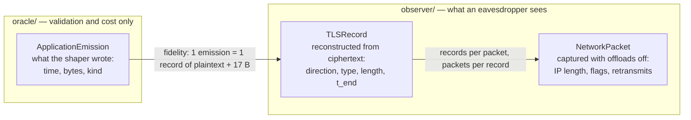

Two rules follow from this:

- **Defenses are judged only on what the observer sees**: reconstructed TLS records (primary) and packets (secondary, valid only with offload state recorded).
- **Oracle data never reaches the attacker.** The shaper's emission log is ground truth for validation and cost. It is kept in a separate directory tree that the feature and attack code cannot import, open or mount.

The observer is modelled as on-path and passive: full packet capture, connection metadata, the ability to profile the service with its own prompts, and knowledge of which defense is deployed (Kerckhoffs). Decryption, active injection and attacks on third parties are out of scope. Only CrossTalk's own infrastructure and synthetic prompts are ever measured.

## How it works

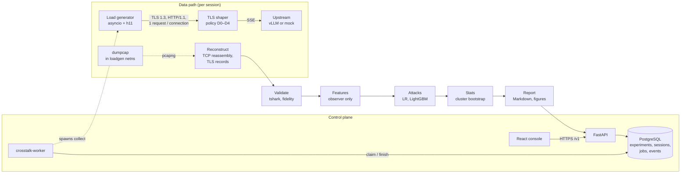

1. **Plan.** A seeded block plan assigns prompts, defense arms and concurrency per request.
2. **Collect.** The load generator opens one TLS 1.3 connection per request. A fixed-width `x-ct-arm` header selects the defense in lab mode, so request size is identical across arms. dumpcap records the client-side leg with GRO/LRO/TSO/GSO disabled.
3. **Reconstruct.** CrossTalk's own pcapng reader, TCP reassembler and TLS record parser rebuild every record, with holes, overlaps and desyncs flagged rather than guessed.
4. **Validate.** Records are compared one-for-one with tshark. Emissions are aligned to records. Each session ends `VALID`, `PARTIAL` or `INVALID`.
5. **Analyze.** Features come from observer data only. Attackers are trained under prompt-family-disjoint nested cross-validation, then statistics and reports are produced.

<p align="center">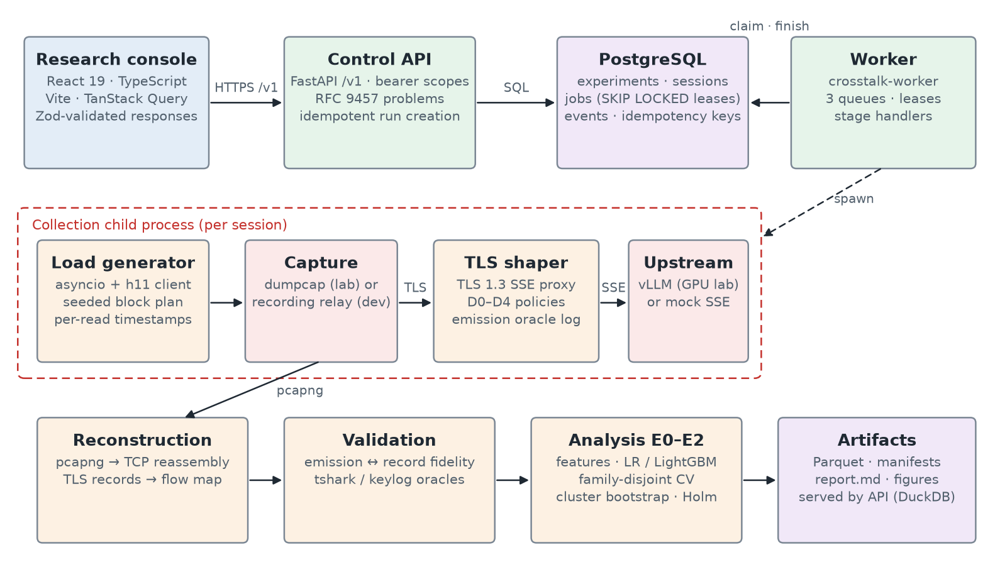</p>
<p align="center"><sub>Architecture as implemented. In the local-dev lab, a recording relay stands in for dumpcap and a mock SSE server stands in for vLLM.</sub></p>

## Defense arms D0–D4

**Five arms, all implemented in the shaper, all deployment-compatible.** Padding and cover traffic travel as SSE comment lines, which the official OpenAI SDKs ignore. Merged chunks are valid `chat.completion.chunk` objects ([ADR 007](docs/adr/007-sse-cover-traffic.md), `tests/test_sse_equivalence.py`).

| Arm | Policy | Mechanism (parameters from [`experiments/e1.yaml`](experiments/e1.yaml)) | Channel targeted | Expected cost |
|---|---|---|---|---|
| **D0** `a0` | Passthrough | One upstream SSE event = one `write()` | none (control) | ~0 |
| **D1** `a1` | Bucket padding | Pad each emission to a bucket ladder starting at 256 B, doubling | Size | Bandwidth |
| **D2** `a2` | Window batching | Merge deltas arriving within a 100 ms grid into one chunk (cap 8,192 B) | Timing, count | Inter-token latency ≤ W |
| **D3** `a3` | Constant rate | One 512 B record every 50 ms from request arrival; dummies when idle; tail padded to a multiple of 32 ticks | Size, timing, count, length | Bandwidth + latency, load-dependent |
| **D4** `a4` | Hybrid | D2 batching, then D1 padding of each merged emission | Size, timing (partial) | Between D1 and D3 |

Parameters in the experiment files are meant to be frozen from pilot runs before the reportable E1 collection; that freeze has not happened yet.

## Experiments

| Experiment | Answers | Design ([`experiments/`](experiments/)) |
|---|---|---|
| **E0** calibration | RQ0 | D0 only; NAT, MATCH-P and MATCH-PR regimes at 200 prompts per class; concurrency 1. Reproduction, not novelty |
| **E1** defenses | RQ1 | All five arms interleaved per request in the same sessions; 2 sessions × 100 per class per arm; static **and** adaptive attackers on identical held-out prompt families |
| **E2** serving load | RQ2 | Concurrency blocks C1 → C8 → C32 alternating within each session, two replicate sessions, vLLM stream interval 4 for D0 and D2 |
| `validation` | instrument check | Two sessions (C1, C16) used for tshark agreement and emission fidelity |

**Length is controlled, not ignored.** MATCH-P equalises prompt-size buckets per class; MATCH-PR also forces identical response lengths. If an attack collapses under matching, that is reported as a finding.

**The adaptive attacker is the headline.** A static attacker trains on D0 traffic; an adaptive one trains on the defended arm's traffic from training families only. Both are scored on the same held-out families, and retained leakage ρ = (m_arm − m_chance) / (m_D0 − m_chance) is reported with paired cluster-bootstrap CIs. Null-label permutations and a noise floor guard against spurious signal.

## Measurement integrity

**A result is reportable only if every gate in [`IMPLEMENTATION_PLAN.md` §29](docs/IMPLEMENTATION_PLAN.md) passes.** The pipeline fails closed.

| Check | Rule |
|---|---|
| Parser vs tshark | 100 % equality of the (content type, length) record sequence per flow and direction |
| Emission → record fidelity | ≥ 99.99 % exact one-to-one in the baseline, every exception listed with a cause |
| Capture completeness | Zero kernel/interface drops; any TCP hole or record desync invalidates the flow |
| Offload control | `ethtool` snapshot stored per session; `max(ip_len) ≤ MTU` asserted before packet features are used |
| Provenance | `manifest.json` with commit, `git_dirty`, image digests, model and tokenizer revisions, policy-set hash, seeds, kernel, OpenSSL, dumpcap/tshark versions |
| Session state | `VALID`, `PARTIAL` or `INVALID`, with machine-readable reasons |
| Reportability | `crosstalk manifest audit` rejects any session missing code, container, model, tokenizer, capture or validation provenance |

The console surfaces the same decision: any experiment built from non-reportable sessions carries a **NOT REPORTABLE** banner listing the reasons.

## Security model

**The threat model is enforced in code, not just in prose** ([ADR 008](docs/adr/008-data-isolation.md), plan §14.3).

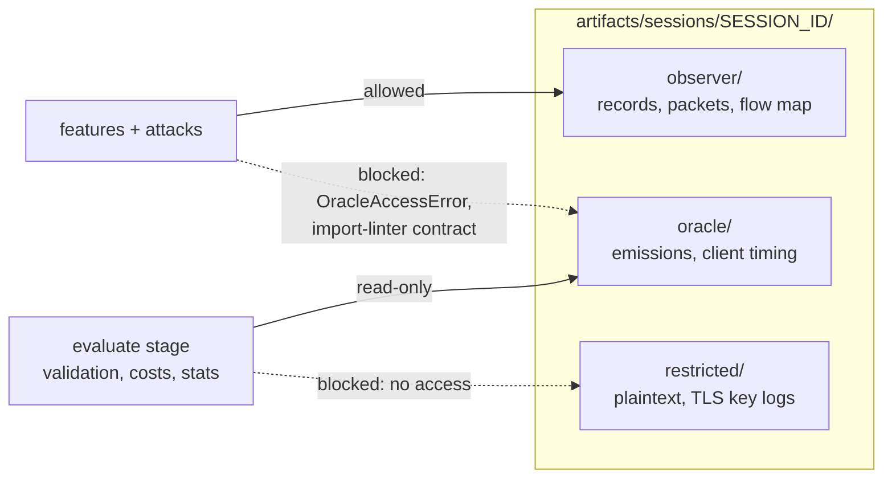

- **Data isolation.** A loader guard in `crosstalk.traces.observer` raises `OracleAccessError` for any path outside `observer/` and `labels/`. Seven import-linter contracts (`uv run lint-imports`) forbid, for example, attack code from importing the oracle or capture code from importing ML.
- **API scopes.** Operator and oracle bearer tokens are distinct. The emissions endpoint returns **HTTP 403** to an operator token; this is asserted in the browser test suite and was observed in the cloud run. Errors use RFC 9457 problem JSON.
- **Containers.** API, worker, shaper, load generator and mock run non-root with `read_only: true` and `cap_drop: [ALL]`. Only the capture container gets `NET_RAW`/`NET_ADMIN`, and the netinit and impairment helpers get `NET_ADMIN` alone. The upstream (vLLM or mock) sits on an `internal: true` network that only the shaper also joins; PostgreSQL likewise sits on an internal-only network.
- **Supply chain.** CI runs pip-audit, `pnpm audit --prod`, gitleaks and Trivy on every push. The `images` workflow builds with BuildKit SBOM and max provenance, Trivy-scans each image, and signs it keylessly with Cosign. Tokens live only in environment files and browser session storage; none are committed.

## DevOps and delivery

### Continuous integration

**Every push runs five jobs on `ubuntu-24.04`** ([`.github/workflows/ci.yml`](.github/workflows/ci.yml)):

| Job | What it does |
|---|---|
| `python-quality` | Ruff lint and format, Pyright strict, import-linter, OpenAPI drift check (`git diff --exit-code docs/openapi.json`), Alembic offline SQL |
| `python-tests` | Starts PostgreSQL, runs pytest with `-W error` and an 80 % coverage floor, uploads coverage |
| `console` | `pnpm check` (OpenAPI types, ESLint, tsc, Vitest, Vite build), then Playwright in Chromium |
| `security` | pip-audit, pnpm audit, gitleaks, Trivy filesystem scan to SARIF |
| `deployment-static` | `terraform fmt` + `validate`, `docker compose config` for every lab profile and the platform, `bash -n` on startup scripts |

Three more workflows exist: `images.yml` (build, scan, SBOM, sign, push to Artifact Registry on `v*` tags), `infra.yml` (manual Terraform plan/apply behind a protected environment) and `benchmark.yml` (weekly Docker mock-lab smoke with the E0–E2 end-to-end tests).

### Containers and Compose

**Two Compose files, five Dockerfiles** under [`services/`](services/) (`api`, `shaper`, `loadgen`, `capture`, `netinit`) plus the console image.

| File / profile | Services |
|---|---|
| `platform.yml` | `postgres` → one-shot `migrate` (Alembic) → `api`, `worker`, `console` (nginx). API and console on `127.0.0.1` only |
| `lab.yml` (always) | `shaper`, `shaper-netinit` (offloads off), `loadgen`, `capture` (dumpcap + tshark in the loadgen network namespace) |
| `lab.yml --profile mock` | adds `mock-upstream` (synthetic SSE) |
| `lab.yml --profile gpu` | adds `vllm/vllm-openai:v0.29.0` with `Qwen/Qwen2.5-1.5B-Instruct` ([ADR 013](docs/adr/013-local-model.md)) |
| `lab.yml --profile impaired` | adds a netem `impairment` sidecar for loss/reorder runs |

### Durable job queue

**PostgreSQL is the queue.** No Redis, no Kafka. The worker claims jobs with `SELECT … FOR UPDATE SKIP LOCKED`, holds a 60 s lease renewed by a 20 s heartbeat, and a reaper re-queues expired leases.

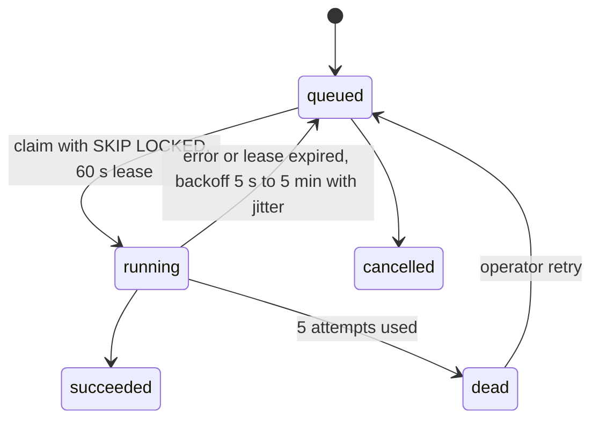

Each stage enqueues its successor under a deterministic stage key, so retries are idempotent. `POST /v1/experiments/{id}/runs` requires an `Idempotency-Key` header. Stage outputs are written to a temp directory and atomically renamed. The six stages are `plan → collect → reconstruct → validate` per session and `analyze → report` per experiment ([runbook](docs/runbooks/control-plane.md)).

### Cloud

**Terraform for GCP is written and statically validated, but has never been applied.** [`infra/terraform`](infra/terraform/) has seven modules (`network`, `gpu_server`, `client`, `storage`, `registry`, `iam`, `budget`): a `g2-standard-8` + NVIDIA L4 inference VM, a separate collection VM, no public IPs, IAP access, Cloud NAT, versioned artifact and restricted buckets, Workload Identity Federation and a billing budget.

**What did run in the cloud is a zero-cost Google Cloud Shell session** (2026-10-15). Cloud Shell is a free Linux VM with Docker; no billing account was used. [`deploy/cloud-vm/`](deploy/cloud-vm/) holds the scripts:

| Script | Purpose |
|---|---|
| `cloudshell.sh` | Unpacks the uploaded bundle, snapshots it as a git repo, installs uv, runs `validate.sh` |
| `validate.sh` | Executes the [Docker validation ledger](docs/DOCKER_BLOCKED_VALIDATION.md) in order, stops at the first failure, keeps a transcript |
| `up.sh` / `tunnel.sh` / `down.sh` | Create one CPU VM, forward ports 3000/8080 over IAP, delete it. Require billing; **not yet run** |
| `vm-bootstrap.sh` | GCE startup script: Docker Engine, tshark, ethtool, uv |

<table>
<tr>
<td width="50%">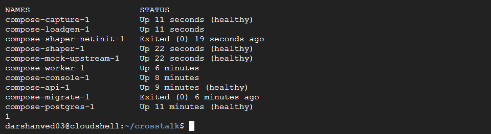</td>
<td width="50%">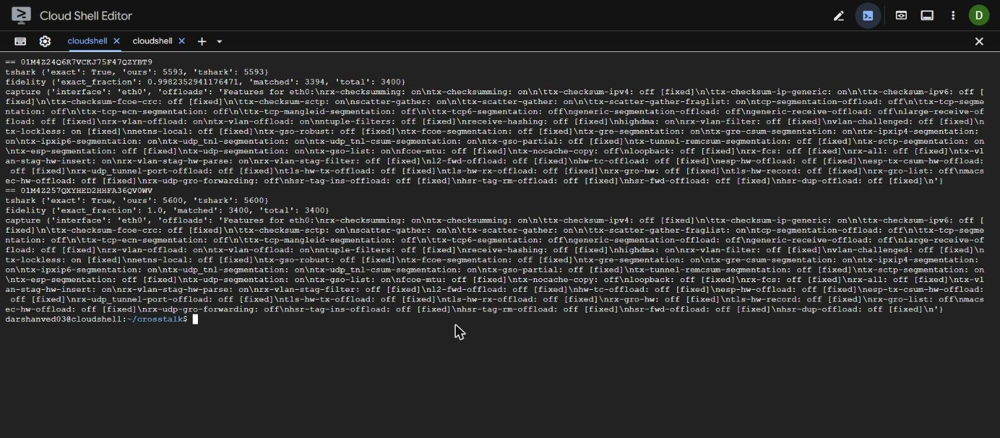</td>
</tr>
<tr>
<td><sub>Platform and lab stacks running together on Cloud Shell.</sub></td>
<td><sub>Real dumpcap capture: parser equals tshark on every record; emission fidelity 1.0 at C16.</sub></td>
</tr>
</table>

The run found and fixed **nine deployment defects** that static checks had missed: unpublished ports on an internal-only network, a worker that could not write the host-owned artifact mount, `0600` files from `mkstemp` that other containers could not read, provenance shelling out to a missing `git`, the worker image lacking the `ml` extra, a leaked `umask 077`, and Cloud Shell Web Preview intercepting the `Authorization` header. Each fix is listed in [`docs/evidence/cloudshell/README.md`](docs/evidence/cloudshell/README.md).

## Research console

**A React 19 + strict TypeScript + Vite client for the `/v1` API**: TanStack Query, Zod-validated responses, React Router. Screens: experiment grid/list with deep-linkable filters, experiment creation, run/cancel/retry controls, a live per-session stage pipeline with an activity timeline, a Markdown report view, a TLS trace explorer, an attack-results table and a leakage/cost frontier ([`docs/CONSOLE.md`](docs/CONSOLE.md)).

<table>
<tr>
<td width="50%">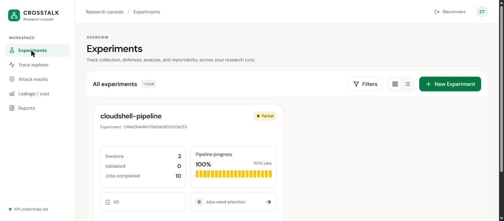</td>
<td width="50%">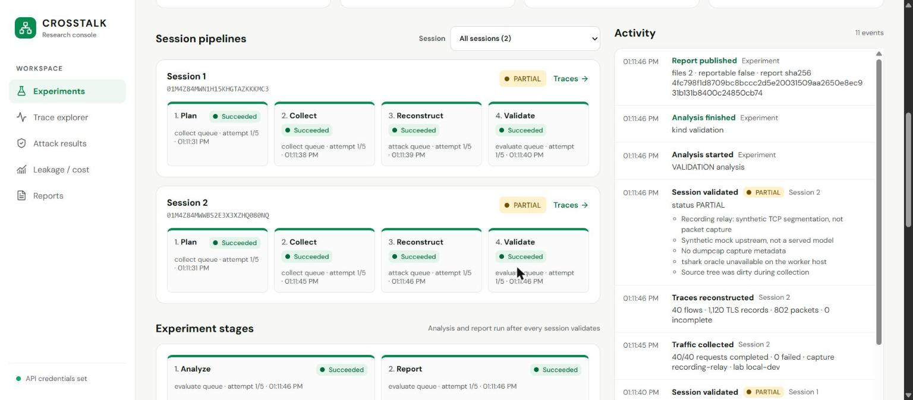</td>
</tr>
<tr>
<td><sub>Experiment created through the API and run by the worker in Cloud Shell: 2 sessions × 40 requests, 10/10 jobs.</sub></td>
<td><sub>Live stage pipeline. The activity feed lists why each session is <code>PARTIAL</code>.</sub></td>
</tr>
<tr>
<td width="50%">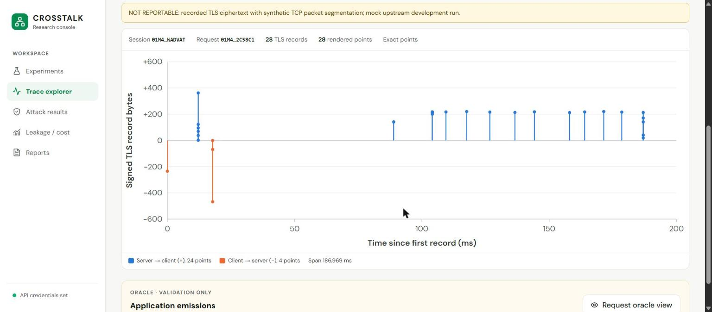</td>
<td width="50%">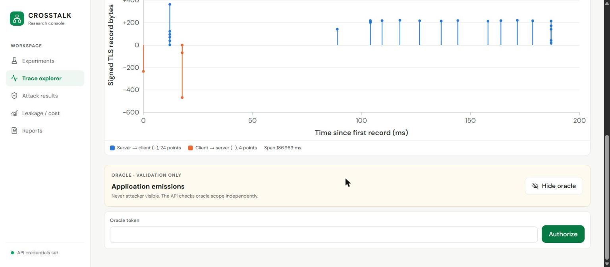</td>
</tr>
<tr>
<td><sub>Trace explorer: 28 TLS records, 24 server→client and 4 client→server.</sub></td>
<td><sub>Oracle emissions stay locked behind a separate token; the operator token cannot read them.</sub></td>
</tr>
</table>

The operator token lives in the tab's session storage and is never bundled. Polling runs every 2 s while work is live and stops at a terminal state. Report Markdown is rendered without raw HTML. More captures: [`docs/evidence/console-v2/`](docs/evidence/console-v2/) and [`docs/evidence/campaign/screenshots/`](docs/evidence/campaign/screenshots/).

## Status: what is proven and what is not

> [!IMPORTANT]
> **No scientific result is claimed.** Every E0/E1/E2 campaign so far used a synthetic mock upstream, and every report is marked **NOT REPORTABLE**. The Linux runtime performance gate currently **fails**. Nothing has been deployed with Terraform, and no GPU/vLLM run has happened.

| Area | Status | Evidence |
|---|---|---|
| Hosted CI | **Proven.** All five jobs green at commit `09d2e5b` (184 Python tests, 81.56 % coverage) and again at `2f3c703` after the Cloud Shell fixes | [CI run 38227854706](https://github.com/darved2305/Crosstalk/actions/runs/38227854706), [CI run 38704213511](https://github.com/darved2305/Crosstalk/actions/runs/38704213511), [`docs/evidence/README.md`](docs/evidence/README.md) |
| Local test suite | **Proven.** `uv run pytest -q`: 184 passed; Ruff, Pyright, 7/7 import contracts kept | [`docs/evidence/README.md`](docs/evidence/README.md) |
| Docker images and Compose stacks on Linux | **Proven** on Cloud Shell: platform and lab images built, stack healthy | [`cloudshell/README.md`](docs/evidence/cloudshell/README.md) (01–05) |
| Real packet capture + reconstruction | **Proven.** dumpcap capture, offloads off; 2 sessions × 200 requests, 0 failed | same (06–07) |
| tshark agreement | **Proven.** 5,600 / 5,600 and 5,593 / 5,593 records exact | same |
| First `VALID` session | **Proven.** C16 session: fidelity 3,400 / 3,400 = 1.0, 0 incomplete flows | same |
| `INVALID` detection | **Working.** C1 session flagged INVALID from one incomplete TCP flow (6 missing emissions); cause not yet investigated | same |
| API → queue → worker → report | **Proven** in Cloud Shell and against native PostgreSQL (`tests/test_pipeline_postgres.py`) | same (08–09), [`docs/CONSOLE.md`](docs/CONSOLE.md) |
| Console against a live API | **Proven** in Cloud Shell Web Preview and locally (Playwright, no intercepted requests) | same (10–16), [`console-v2/`](docs/evidence/console-v2/README.md) |
| Oracle isolation | **Proven.** Operator token gets HTTP 403 on emissions | browser tests, screenshot 16 |
| E0/E1/E2 pipeline | **Executes end to end** on a mock: 6 sessions, 859 requests, 0 failed, 552 evaluation rows. All `PARTIAL`, **NOT REPORTABLE** | [`docs/PROJECT_REPORT.md`](docs/PROJECT_REPORT.md), [`campaign.json`](docs/evidence/campaign/campaign.json) |
| Linux runtime gate | **Fails.** G1, G2, G4 CPU/RSS, G5 buffer/abort, G6 pass. **G3 relay Δp99 +16.28 ms (N=64) and +309.69 ms (N=256)**, **30-min soak RSS +13.9 %** and **G5 p99 +3.20 ms** fail | [`bench/RESULTS.md`](bench/RESULTS.md) |
| Terraform on GCP | **Not applied.** `init`, `fmt` and `validate` only | [`docs/VERIFICATION.md`](docs/VERIFICATION.md) |
| GPU / vLLM serving | **Not run** | — |
| netem loss/reorder, sustained load | **Not run** | [`cloudshell/README.md`](docs/evidence/cloudshell/README.md) "Not covered" |
| Signed image release | **Not run.** Workflow defined; no `v*` tag exists | [`.github/workflows/images.yml`](.github/workflows/images.yml) |

<details>
<summary><b>Runtime gate detail (harness v2, WSL2 + uvloop, 2026-10-12)</b></summary>

<br>

| Gate | Threshold | Measured (median repetition) | Result |
|---|---|---|---|
| G1 record fidelity | exact record sequence | exact in 9/9 cases | PASS |
| G2 timer, N=256 | p99 ≤ 5 ms | p99 4.04 ms | PASS |
| G3 relay, N=64 | Δp99 ≤ 2 ms | +16.28 ms | **FAIL** |
| G3 relay, N=256 | 0 errors, Δp99 ≤ 8 ms | 0 errors, +309.69 ms | **FAIL** |
| G4 CPU/RSS, N=256 | ≤ 1 core, ≤ 256 MB | 0.20 core, 86.8 MB | PASS |
| G4 soak, 30 min | RSS growth ≤ 10 % | +13.9 % | **FAIL** |
| G5 buffer cap | ≤ 1 MiB | 533,973 B | PASS |
| G5 normal-client impact | p99 change ≤ 1 ms | +3.20 ms | **FAIL** |
| G6 SSE fidelity | 0 mismatches | 10,000 cases, 0 mismatches | PASS |

A connection-pool fix removed all 156 relay errors at N=256 that harness v1 recorded. The remaining G3 cost is a real per-event shaper cost (about 250 µs of CPU per relayed event); candidate causes are listed in [`bench/RESULTS.md`](bench/RESULTS.md) but are unproven. The host was a shared Windows laptop under WSL2, not the target lab host.

</details>

<details>
<summary><b>What the mock campaign does and does not show</b></summary>

<br>

The E0/E1/E2 end-to-end tests ran on Windows with a synthetic OpenAI-compatible SSE upstream. Real TLS ciphertext passed through the shaper and was recorded by a test relay that generated synthetic TCP segmentation. The run shows that every stage executes and that the reports, figures and console views work. Example costs from that run (D1 bandwidth overhead 16.5 %, D3 600.7 %) describe the mock workload only. Retained leakage in the E2 frontier is undefined because the baseline fails the noise-floor condition, and the console leaves those points unplotted rather than inventing them.

<table>
<tr>
<td width="50%"></td>
<td width="50%"></td>
</tr>
<tr>
<td><sub>E1 results under the NOT REPORTABLE warning.</sub></td>
<td><sub>E2 frontier: ρ undefined, nothing plotted.</sub></td>
</tr>
</table>

</details>

## Quickstart

### Prerequisites

Python 3.13 with [uv](https://docs.astral.sh/uv/), Node 24 with pnpm 10, and Docker Engine with Compose v2 on Linux for the lab. The control plane can also run natively on Windows without Docker ([runbook](docs/runbooks/windows-zero-cost-demo.md)).

### 1. Install and check

```bash
uv sync --locked --all-extras      # make bootstrap
make check                         # ruff, format, pyright, import contracts, pytest (80 % floor)
```

### 2. Start the control plane

```bash
cp deploy/compose/platform.env.example deploy/compose/platform.env   # replace every secret
docker compose -f deploy/compose/platform.yml --env-file deploy/compose/platform.env up -d --build --wait
curl --fail http://127.0.0.1:8080/readyz
```

The API listens on `127.0.0.1:8080`, the console on `127.0.0.1:3000`. Operator and oracle tokens must be distinct and at least 32 characters.

### 3. Run the capture lab (Linux)

```bash
uv run crosstalk lab certs
docker compose -f deploy/compose/lab.yml --profile mock up -d --build --wait
uv run crosstalk lab provenance
docker compose -f deploy/compose/lab.yml exec loadgen \
  crosstalk session run /app/experiments/validation.yaml --root /artifacts
```

For each printed session ID, reconstruct and validate inside the capture container, which carries the tshark oracle:

```bash
docker compose -f deploy/compose/lab.yml exec capture crosstalk reconstruct run <session-id> --root /artifacts
docker compose -f deploy/compose/lab.yml exec capture crosstalk reconstruct validate <session-id> --root /artifacts
uv run crosstalk manifest audit artifacts/sessions/<session-id>/manifest.json
```

Set `CT_UID` and `CT_GID` if your host IDs differ from 1000, so the non-root containers can write the artifact mount.

### 4. Console in development mode

```bash
cd apps/console
pnpm install --frozen-lockfile
pnpm dev          # http://127.0.0.1:3000, proxies /v1 to CT_CONSOLE_API_URL
pnpm check        # OpenAPI types, ESLint, tsc, Vitest, Vite build
pnpm test:e2e     # Playwright
```

### 5. Zero-cost cloud run (Google Cloud Shell)

`cloudshell.sh` expects `~/crosstalk.tar.gz`: an archive of the repository that contains a `COMMIT` file with the source commit. One way to build it from your checkout:

```bash
git rev-parse HEAD > COMMIT
git archive --format=tar.gz --add-file=COMMIT -o crosstalk.tar.gz HEAD
```

Upload `crosstalk.tar.gz` and `deploy/cloud-vm/cloudshell.sh` to your Cloud Shell home directory, then run:

```bash
bash ~/cloudshell.sh
```

It builds both stacks, checks health, captures the validation sessions and prints an operator token. Open the console through **Web Preview → port 3000**. Everything runs against the mock upstream and is non-reportable.

## Repository layout

<details>
<summary><b>Expand the tree</b></summary>

```text
.
├── src/crosstalk/
│   ├── shaper/          TLS 1.3 SSE proxy: h11 server, SSE parser, framer, D0–D4 policies, emission accounting
│   ├── loadgen/         seeded TLS client, session runner, provenance
│   ├── capture/         pcap/pcapng reader, TCP reassembly, TLS records, capture control, netinit, tshark validation
│   ├── traces/          observer loader (guarded) and oracle loader
│   ├── features/        record-layer feature extraction (observer only)
│   ├── attacks/         family-disjoint splits, LR / LightGBM protocols
│   ├── stats/           cluster bootstrap, paired contrasts, null controls
│   ├── evaluation/      E0, E1, E2 analyses, costs, figures
│   ├── workloads/       corpus, planner, tokenizer counts
│   ├── contracts/       PyArrow table schemas, manifest, config
│   ├── orchestration/   Postgres job queue, stages, pipeline, worker, labs
│   ├── api/             FastAPI /v1 app, DuckDB result serving
│   ├── validation/      TLS key-log checks
│   ├── reporting/       waterfall plots
│   ├── testing/         mock upstream, recording relay, campaign tooling
│   ├── common/          atomic artifacts, ULIDs, clocks, certificates, logging
│   └── cli/             `crosstalk` Typer CLI
├── apps/console/        React 19 + TypeScript + Vite research console (Vitest, Playwright)
├── services/            Dockerfiles: api, shaper, loadgen, capture, netinit
├── deploy/
│   ├── compose/         lab.yml (mock / gpu / impaired profiles), platform.yml
│   ├── cloud-vm/        Cloud Shell and single-VM validation scripts
│   └── gce/             GPU and client VM startup scripts and Compose files
├── infra/terraform/     GCP root + modules: network, gpu_server, client, storage, registry, iam, budget
├── experiments/         validation, E0, E1, E2 configs (+ pilots) and policies/arms.yaml
├── workloads/corpus/    versioned synthetic prompt corpus
├── migrations/          Alembic: orchestration schema, idempotency keys
├── tests/               pytest: SSE equivalence, reassembly, defenses on the wire, API, Postgres pipeline, E2E
├── bench/               runtime gate harness and RESULTS.md
├── docs/                PRODUCT, RESEARCH, IMPLEMENTATION_PLAN, ADRs, runbooks, evidence, project report
└── .github/workflows/   ci, images, infra, benchmark
```

</details>

## Architecture decision records

| ADR | Decision |
|---|---|
| [001](docs/adr/001-observation-layers.md) | Emissions, TLS records and packets are distinct observations; validation measures their correspondence |
| [002](docs/adr/002-baseline-transport.md) | Baseline is HTTP/1.1 over TLS 1.3, one request per connection, `TCP_NODELAY`, no session tickets |
| [003](docs/adr/003-shaper-runtime.md) | Python 3.13 + asyncio + uvloop for the data path; one `write()` per emission ≤ 16 KiB |
| [004](docs/adr/004-packet-capture.md) | dumpcap in the load generator's namespace, offloads off, full snaplen; tshark is an independent oracle |
| [005](docs/adr/005-reconstruction.md) | Own pcapng/TCP/TLS parsers; holes, overlaps and desyncs invalidate flows |
| [006](docs/adr/006-policy-selection.md) | Fixed policy set loaded at startup; fixed-width lab header selects the arm; production rejects lab headers |
| [007](docs/adr/007-sse-cover-traffic.md) | Padding and cover traffic use SSE comment lines, never `data:` events |
| [008](docs/adr/008-data-isolation.md) | `observer/`, `oracle/`, `restricted/` separated by loader guards, import contracts and mounts |
| [009](docs/adr/009-evaluation-method.md) | Prompt-family-disjoint nested CV; static and adaptive attackers on the same families; paired cluster bootstrap with Holm |
| [010](docs/adr/010-storage.md) | Typed PyArrow schemas and Parquet for experimental tables; manifests carry provenance |
| [011](docs/adr/011-cloud-baseline.md) | Cloud baseline is Compute Engine with a GPU server VM and a separate client VM |
| [012](docs/adr/012-hot-path-accounting.md) | No per-emission logging; bounded queue to one async NDJSON writer, backpressure on saturation |
| [013](docs/adr/013-local-model.md) | Local GPU path: vLLM 0.29.0 with `Qwen/Qwen2.5-1.5B-Instruct`, stream interval 1 |

## Technology

| Layer | Choice |
|---|---|
| Data path | Python 3.13, asyncio + uvloop, h11, `ssl` (TLS 1.3 only), aiohttp upstream client |
| Capture and parsing | dumpcap, own pcapng / TCP / TLS parsers, tshark as validation oracle |
| Data and analysis | PyArrow + Parquet, DuckDB, NumPy, SciPy, scikit-learn, LightGBM, matplotlib |
| Serving engine | vLLM 0.29.0 (GPU profile), synthetic SSE mock for development |
| Control plane | FastAPI + uvicorn, PostgreSQL, SQLAlchemy 2 Core, psycopg 3, Alembic |
| Console | React 19, TypeScript (strict), Vite, TanStack Query, Zod, React Router, openapi-typescript |
| Quality | uv, Ruff, Pyright strict, import-linter, pytest + Hypothesis, Vitest, Playwright |
| Containers | Docker BuildKit, Compose v2, nginx for the console |
| Cloud and IaC | Terraform, GCP Compute Engine (L4), GCS, Artifact Registry, IAM + Workload Identity Federation, Budgets |
| CI/CD and security | GitHub Actions, pip-audit, pnpm audit, gitleaks, Trivy, Cosign, BuildKit SBOM |

## Roadmap

Remaining work before any result can be reported, in order ([plan §30–31](docs/IMPLEMENTATION_PLAN.md)):

- [ ] **Pass the Linux runtime gate.** Cut per-event shaper cost (G3), explain or fix soak RSS growth, re-measure G5 on a quieter host; fall back to multi-process `SO_REUSEPORT` or capped E2 concurrency if needed.
- [ ] **Investigate the C1 incomplete flow** that made the first Cloud Shell session INVALID.
- [ ] **GPU smoke test with vLLM** and pinned image digest and model revision.
- [ ] **Freeze the data path as `data-v1`** after pilots fix D1–D4 parameters. Only `data-v1` sessions are reportable.
- [ ] **Real campaigns:** E0 final, E1 (2 sessions), E2 (2 replicates), a reproducibility replicate, netem robustness runs.
- [ ] **Terraform apply** on GCP and a cloud mini-campaign with a server-side vantage.
- [ ] **Hardening:** request-listing and report-figure API endpoints, run-cancellation edge cases noted in [`docs/CONSOLE.md`](docs/CONSOLE.md).
- [ ] **Release `v1.0.0`** with signed images, SBOMs, frozen analysis (B = 10,000) and a reproducibility bundle.
- [ ] Later (P1–P3): random padding D1r and parameter sweeps, simulated-vs-deployed comparison, keep-alive and HTTP/2 arms, WAN impairment, GKE, CNN attacker, HTTP/3.

## Documents

| Document | Role |
|---|---|
| [`docs/PRODUCT.md`](docs/PRODUCT.md) | Research question, threat and observation model, experiments, defenses, metrics, limitations |
| [`docs/RESEARCH.md`](docs/RESEARCH.md) | Literature, industry mitigations, transport facts, novelty matrix, references |
| [`docs/IMPLEMENTATION_PLAN.md`](docs/IMPLEMENTATION_PLAN.md) | Stack, schemas, algorithms, quality gates, plan |
| [`docs/PROJECT_REPORT.md`](docs/PROJECT_REPORT.md) | Engineering report and mock campaign ([PDF](docs/report/CrossTalk_Project_Report.pdf)) |
| [`docs/evidence/`](docs/evidence/README.md) | Verification ledger, CI, runtime JSON, Cloud Shell run, screenshots |

## Ethics

Only CrossTalk's own infrastructure, models and synthetic prompts are measured. No third-party traffic is captured, no real personal data appears in any prompt, and commercial APIs are not attacked. The attack code exists to measure defenses.

<div align="center">
<sub>CrossTalk · DevOps and security research mini-project</sub>
</div>
