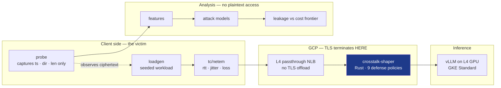

# Crosstalk

**Measuring Privacy Leaks in Encrypted AI Traffic and Testing Defenses on Google Cloud**

> In electronics, *crosstalk* is the unintended coupling of a signal from one channel into another that was supposed to be isolated. That is exactly what this project measures: the content channel is encrypted, yet it couples into the timing-and-size channel, which is not.

**Status:** design and research complete · implementation starting from zero.

---

## The problem

TLS protects *what* an AI assistant says. It does not protect the *shape* of how it says it.

Large language models generate one token at a time and stream each fragment to the user the moment it exists. So an encrypted LLM response is a sequence of small, variable-sized, content-dependent packets emitted in real time — a near-ideal side channel. A passive observer who cannot decrypt anything (a café Wi-Fi operator, a campus network, an ISP, a transit AS) still sees, for every TLS record: **its size, its direction, and its arrival time.**

From that alone, peer-reviewed work between 2024 and 2026 has recovered conversation topics at >98% AUPRC across 28 production models, identified response language, inferred private medical and financial attributes, and reconstructed a quarter of the actual sentences.

## The gap this project fills

Vendors responded to those attacks. OpenAI and Azure add an `obfuscation` field; Cloudflare and Mistral add a `p` field; Google, Amazon and Anthropic batch several tokens per streamed event.

**Nobody has published what those defenses buy, or what they cost.**

- In the one study that measured them, random padding moved attack AUPRC from **97.5% → 92.9%** — a 4.6-point dent in a near-perfect attack.
- Two of the three mitigations evaluated were never deployed. They were *simulated by summing packet sizes and inter-arrival times on already-captured traces.*
- **No latency, throughput or bandwidth cost for any LLM traffic-analysis defense exists in the published record.**
- Every self-hosted deployment, and every application that re-streams an upstream API to its own users, inherits none of these protections.

Meanwhile the website-fingerprinting field spent fifteen years learning the lessons this one is about to need: lightweight defenses die to retrained attackers, simulated overheads are wrong by 2–10×, and leakage should be measured in bits rather than in one classifier's accuracy.

## What Crosstalk is

**A traffic-analysis wind tunnel for LLM serving systems.**

Define an experiment — backend, model, workload, concurrency, region, protocol, network conditions, defense policy. Crosstalk provisions real inference infrastructure, generates reproducible traffic, captures it exactly as a network observer would, trains attack models under contamination-proof evaluation splits, and answers the question the literature left open:

> **How much does a passive observer learn, how much does each defense take away, and what does that defense cost in time-to-first-token, tail latency, bandwidth, throughput and dollars?**

### Three things that make this more than a reproduction

1. **Defenses are implemented in-path and measured on the wire** — a Rust streaming proxy with byte-exact control of what is emitted and when, not arithmetic applied to saved traces.
2. **Every defense faces an attacker that knows about it** — each policy reports a *pair*: a static attacker trained on undefended traffic, and one retrained on defended traffic. (WTF-PAD held attacks to 20% in 2016 and to >90% two years later, once attackers retrained against it. Nobody has run that test on LLM defenses.)
3. **Serving infrastructure is an experimental variable** — continuous batching, prefix caching, speculative decoding, replica autoscaling, cold starts and load-balancer tier all shape what the observer sees. *Is your autoscaling policy a privacy parameter?*

## Architecture

**Why an L4 passthrough load balancer matters:** with a managed L7 load balancer, TLS terminates at the cloud provider's front end, so capture inside the VPC no longer sees the client's connection — and measuring that leg would be scientifically invalid. Passthrough keeps TLS termination under our control, which is what makes the observer position legitimate.

**The attack pipeline cannot read plaintext.** Prompts and responses live in a bucket the attack worker's service account has no permission to read; trace schemas have no field capable of holding content; and CI fails the build if natural-language content ever appears in the feature store. The threat model is enforced by IAM, not by good intentions.

## Documentation

| Document | What it contains |
|---|---|
| [`docs/RESEARCH.md`](docs/RESEARCH.md) | 45+ primary sources verified paper-by-paper — LLM side channels, cache/timing channels, 25 years of classical traffic analysis, defense literature, industry landscape, open-source review with reuse verdicts, and the gap matrix |
| [`docs/PRODUCT.md`](docs/PRODUCT.md) | Problem definition, threat model with three capture vantages and their validity conditions, the nine experiments, attack and defense models, evaluation methodology, metrics, architecture, GCP component justification, cost model, risks, demo script |
| [`docs/IMPLEMENTATION_PLAN.md`](docs/IMPLEMENTATION_PLAN.md) | Technology decision record, repository layout, SQL schemas, event contracts, API specification, Kubernetes/Terraform/CI-CD design, testing strategy, and 15 phases with numbered tasks and acceptance criteria |

Every factual claim in these documents carries one of four tags — **VERIFIED** (primary source), **INFERENCE** (our conclusion from evidence), **PROPOSAL** (something we intend to build), **UNVERIFIED** (requires our own experiment). Nothing is promoted to a higher tier without new evidence.

## Experiments

| ID | Question |
|---|---|
| **E0** | Does the known size + timing topic attack reproduce on our own stack under prompt-family-disjoint splits? |
| **E1** ⭐ | For nine defense policies: how much leakage survives a *retrained* attacker, and what does each cost in TTFT, tail latency, bandwidth and dollars? |
| **E2** | Does leakage rise, fall, or merely change shape as concurrency goes 1 → 128? Is continuous batching an accidental defense? |
| **E3** | Can an observer tell a coding assistant from a RAG app from a translation service, without plaintext? |
| **E4** | Is a KV prefix-cache hit visible to a *passive observer* behind a load balancer, under load? |
| **E5** | Can an observer fingerprint the serving engine, its batching setting, or whether speculative decoding is on? |
| **E6** | Do autoscaling events and pod cold starts leave wire-visible signatures? |
| **E7** | Does the attack survive realistic WAN latency, jitter and loss? |
| **E8** | Is a managed L7 load balancer an accidental defense? |
| **E9** ⭐ | Given an SLO budget, which defense configuration minimises leakage? |

## Planned stack

| Layer | Choice | Why |
|---|---|---|
| Defense proxy | **Rust** (tokio, hyper, rustls) | No GC pauses in the emission path — a pause would inject noise into the exact timing channel under measurement. Go's `crypto/tls` also performs dynamic record sizing, which silently confounds observed record sizes |
| Capture probe | Rust (AF_PACKET, TLS record segmentation) | Writes `(timestamp, direction, length)` and nothing else |
| Control plane | Python · FastAPI · PostgreSQL | Durable, resumable run state machine |
| Workers | Python · Pub/Sub | Collection, feature extraction, training and evaluation as idempotent stages with DLQs |
| ML | XGBoost → 1-D CNN, plus a kNN mutual-information leakage estimator | Simplest model first; leakage also reported in bits so defense claims do not rest on one classifier's strength |
| Serving | vLLM on NVIDIA L4 · GKE Standard | Real continuous batching, prefix caching and speculative decoding |
| Frontend | Next.js · TypeScript | Trace explorer and the leakage-vs-cost frontier |
| Infrastructure | Terraform · Helm · GitHub Actions with Workload Identity Federation | Reproducible, keyless, destroyable |

**GKE Standard, not Autopilot** — Autopilot drops `CAP_NET_RAW` and `CAP_NET_ADMIN` and blocks host namespaces, which would kill the packet-capture path.

## Non-goals

No new attack technique (the attacks are solved — they are our measuring instrument). No verbatim response reconstruction. No privacy score out of 100. No AI-generated "insights". No blockchain, no agent swarm, no service mesh (a sidecar's buffering would corrupt the signal being measured). No Redis or Kafka without a named constraint requiring them. No trusted-execution-environment work — a TEE protects memory from the operator, it does not change how many bytes leave the machine or when.

## Ethics

Only our own infrastructure and our own synthetic workloads are ever measured. No third-party user traffic is captured, on any network. No real personal data enters any workload — prompts are synthetic or drawn from public benchmark corpora. The project publishes a *defense* alongside the measurement; the attack code exists to evaluate that defense.

## Selected references

- Weiss, Ayzenshteyn, Amit, Mirsky. *What Was Your Prompt? A Remote Keylogging Attack on AI Assistants.* USENIX Security '24
- McDonald, Bar Or. *Whisper Leak: a side-channel attack on Large Language Models.* arXiv:2511.03675
- Zhang et al. *NetEcho: From Real-World Streaming Side-Channels to Full LLM Conversation Recovery.* arXiv:2510.25472
- Carlini, Nasr. *Remote Timing Attacks on Efficient Language Model Inference.* arXiv:2410.17175
- Gong, Zhang, Zhang, Wang. *WFDefProxy: Modularly Implementing and Empirically Evaluating Website Fingerprinting Defenses.* arXiv:2111.12629
- Arp et al. *Dos and Don'ts of Machine Learning in Computer Security.* USENIX Security 2022

The full annotated list of 77 sources is in [`docs/RESEARCH.md`](docs/RESEARCH.md).
