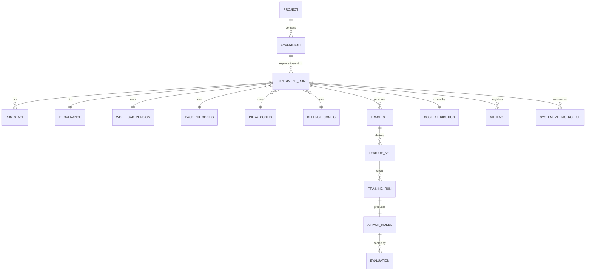
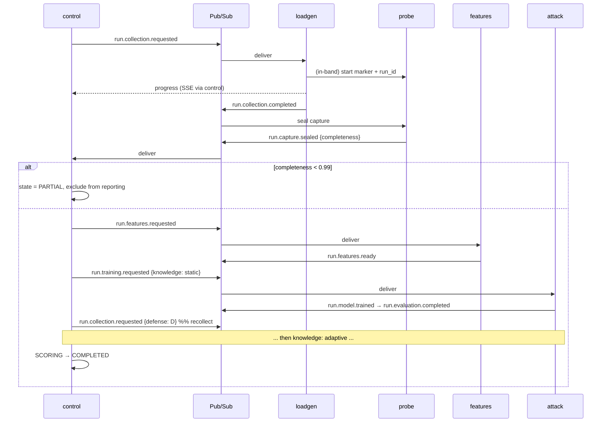
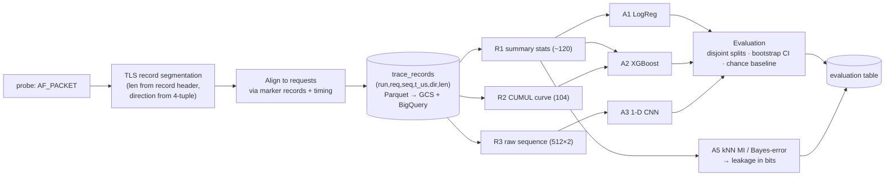
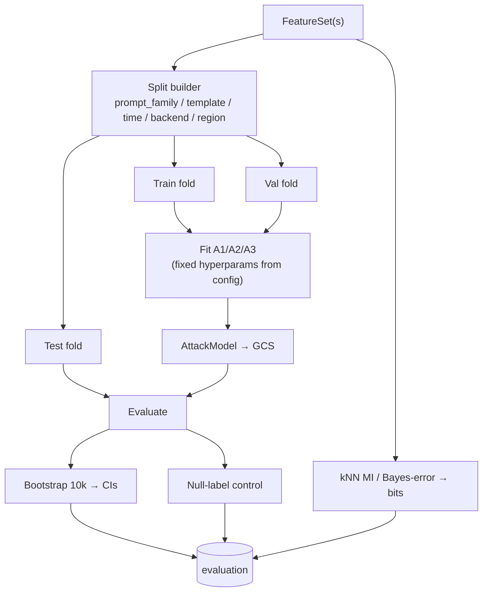
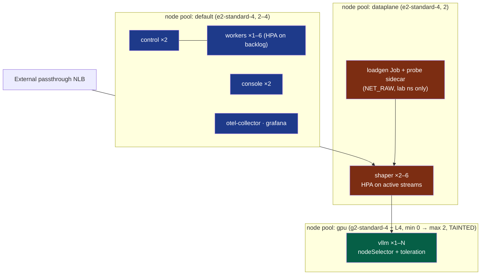
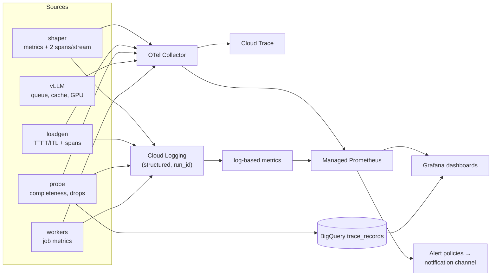
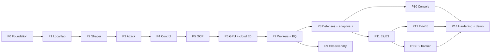

# IMPLEMENTATION_PLAN.md — Crosstalk

**The engineering authority.** Product rationale is in `PRODUCT.md`; evidence is in `RESEARCH.md`.

This document is written so that a competent coding agent can execute it phase by phase without making architectural decisions of its own. Where a decision is open, it is marked **[DECIDE]** with the criteria for deciding.

Version 1.0 · 13 September 2026 · Target: zero existing code.

---

## 1. Development principles

1. **Measure, never simulate, when measurement is possible.** If a number can be obtained from a running system, it is not acceptable to compute it from a transformation of captured data. Where a simulated number is used, it is labelled `simulated=true` in the data model and in the UI.
2. **The threat model is enforced by the system, not by discipline.** The attack pipeline must be *unable* to read plaintext. Tests prove it.
3. **Simplest rung first.** Logistic regression before XGBoost before CNNs. A monolith before workers before microservices. A new technology enters only when a named constraint forces it.
4. **Every result carries provenance.** Git commit, image digests, model revision, config hash, seed, timestamps. A result without provenance is a bug.
5. **Every stage is idempotent and resumable.** Stages key their outputs by `(run_id, stage, config_hash)`. Re-running a stage must be safe.
6. **Fail loudly, degrade explicitly.** A run with <99% capture completeness becomes `PARTIAL` and is excluded from reported results — it does not silently produce a biased number.
7. **Cost is a build-time constraint.** Every cloud resource is created by Terraform, tagged with a `crosstalk` label, and destroyable. GPU pools scale to zero.
8. **The hot path is not instrumented per chunk.** Observability must not perturb the timing channel under measurement.
9. **Trunk-based development.** Short-lived branches, PR review, CI gates, `main` always deployable.
10. **Write the test that would have caught it.** Every bug fix adds a regression test.

---

## 2. Selected stack

| Layer | Choice | Version target |
|---|---|---|
| Defense proxy | **Rust** + tokio + hyper 1.x + rustls + axum (admin) | Rust 1.83+ |
| Capture probe | **Rust** + `pcap` + `etherparse` | Rust 1.83+ |
| Control plane / API | **Python 3.12** + FastAPI + SQLAlchemy 2.0 + Alembic + Pydantic v2 | — |
| Workers | Python 3.12 (same base image family as control) | — |
| Load generator | Python 3.12 + `httpx` (h1/h2), `aioquic` for h3 (P2) | — |
| ML | scikit-learn, XGBoost, LightGBM, PyTorch (CPU is sufficient), NumPy, Polars, PyArrow | — |
| Optimisation (P3) | Optuna (NSGA-II + `constraints_func`) | — |
| Frontend | **Next.js 15 (App Router)** + TypeScript + Tailwind + TanStack Query; **uPlot** for time series, **Canvas** for the packet waterfall, plain SVG for matrices | — |
| Transactional DB | PostgreSQL 16 (Cloud SQL) | — |
| Analytics | BigQuery (Parquet in GCS as source of truth) | — |
| Object storage | Cloud Storage (MinIO locally) | — |
| Messaging | Pub/Sub (emulator locally) | — |
| Inference backend | vLLM (cloud, GPU) · Ollama/llama.cpp (local dev) | — |
| Orchestration | GKE Standard, Helm | K8s 1.31+ |
| IaC | Terraform (BUSL-1.1 — documented; OpenTofu is the drop-in alternative) | 1.9+ |
| CI/CD | GitHub Actions + Workload Identity Federation | — |
| Observability | OpenTelemetry, Google Managed Service for Prometheus, Grafana, Cloud Logging, Cloud Trace | — |

---

## 3. Technology decision record

| Area | Candidates | **Selected** | Why | Rejected because |
|---|---|---|---|---|
| **Defense gateway language** | Rust, Go, C++, Node | **Rust** | No GC pauses in the emission path — a GC pause would inject noise into the exact timing channel being measured. Precise `tokio` timers, explicit buffer control, one flush → one TLS record. rustls gives predictable record behaviour | **Go**: `crypto/tls` performs **dynamic record sizing** (small records until ~1 MB written, governed by `tcpMSSEstimate`/`recordSizeBoostThreshold`) — a silent confound that changes observed record sizes as a function of bytes already sent; plus GC jitter. **C++**: no safety benefit for the effort. **Node**: event-loop jitter, poor control |
| **Capture implementation** | Rust+`pcap`, Go+`gopacket`, C+libpcap, eBPF, Zeek | **Rust + `pcap`/`etherparse`** (AF_PACKET) | Keeps both data-path components in one toolchain; no GC in the capture loop; straightforward ring-buffer sizing | **eBPF**: more elegant, kernel-version risk — revisit at P2. **Zeek**: connection-level logs, heavyweight for `(ts,dir,len)`. **Hubble**: verified not to count bytes/packets |
| **Control plane language** | Python, Go, TypeScript | **Python/FastAPI** | Shares the language of the ML pipeline, so contracts and dataclasses are shared; fastest path to OpenAPI; the control plane is not latency-critical | **Go**: would split the codebase for no benefit here. **TS**: weakest ML story |
| **ML language** | Python | **Python** | Uncontested | — |
| **Transactional DB** | Postgres, MySQL, Firestore | **PostgreSQL** | Relational integrity for run/artifact lineage; JSONB for config blobs; mature migrations | **Firestore**: no joins, weak for lineage. **MySQL**: no advantage |
| **Analytics DB** | BigQuery, Postgres, ClickHouse, DuckDB | **BigQuery** | 10⁸–10⁹ trace rows across a campaign; cross-run scans; serverless with a usable free tier; native GCS/Parquet integration | **Postgres**: would need partitioning gymnastics at this row count. **ClickHouse**: excellent but another stateful service to run. **DuckDB**: great locally — kept for local mode |
| **Object storage** | GCS, S3, MinIO | **GCS** (MinIO locally) | Native IAM separation for the threat-model control; lifecycle rules; CMEK | — |
| **Messaging** | Pub/Sub, Cloud Tasks, Kafka, Celery+Redis, Temporal | **Pub/Sub** | Managed, IAM-integrated, DLQ + retry policies first-class, no broker to operate. Exactly-once is pull-only/same-region and still requires idempotent consumers, so we design for at-least-once anyway | **Kafka**: no ordering/replay need at our volume; an operational burden. **Celery+Redis**: would drag in Redis for no other reason. **Temporal**: excellent fit for long workflows but a large control plane for a student project — noted as the natural upgrade |
| **Cache/ephemeral store** | Redis, Memcached, **none** | **None** | No caching, locking or session need. Postgres row locks + Pub/Sub ack deadlines cover coordination | Adding Redis would be architecture theatre |
| **Container orchestration** | GKE Standard, GKE Autopilot, Cloud Run, GCE + systemd, Nomad | **GKE Standard** | Autopilot **verifiably** drops `CAP_NET_RAW`/`CAP_NET_ADMIN`, blocks `hostNetwork`/host namespaces, and restricts privileged containers to verified partners — which kills the capture path. We also need GPU node pools and autoscaling as an experimental variable | **Cloud Run**: no packet capture, no autoscaling internals. **GCE**: hand-rolled orchestration |
| **Cloud** | GCP primary, AWS secondary | **GCP primary; AWS as one optional external client vantage** | Project mandate + genuine capabilities (L4 passthrough preserving TLS termination, Packet Mirroring, GPU scale-to-zero) | AWS as a co-primary would double the infrastructure work for no scientific gain |
| **IaC** | Terraform, OpenTofu, Pulumi, gcloud scripts | **Terraform** | Largest provider/module ecosystem; GCS backend supports state locking; the skill is the industry default. Licence (BUSL-1.1 for ≥1.6) documented; educational use unaffected | **Pulumi**: fine, smaller ecosystem. **Scripts**: no state, no plan, no destroy guarantees |
| **CD** | GitHub Actions push, Argo CD, Flux, Cloud Build | **GitHub Actions + Helm** (Argo CD at P2) | One system, least moving parts, WIF-authenticated, sufficient to demonstrate proper CD | **Argo CD**: real GitOps value but another control plane to run and secure; added only if time allows |
| **Observability** | Managed Prometheus, self-hosted Prometheus, Datadog | **Managed Prometheus + Grafana + Cloud Logging/Trace + OTel** | Removes a stateful workload; Grafana reads it via the data-source syncer; OTel keeps us portable | **Self-hosted Prometheus**: we would be operating the thing we are trying to measure around. **Datadog**: cost |
| **Load generator** | k6, Locust, Vegeta, custom | **Custom async Python** | We need seeded reproducibility, per-chunk client-side receive timestamps at microsecond resolution, ground-truth logging keyed by `request_id`, and protocol arms. ~400 lines | **k6**: AGPL-3.0 and SSE only via an extension; insufficient chunk-timestamp fidelity. **Locust**: no per-chunk timing. **Vegeta**: not streaming-aware |
| **API style** | REST+OpenAPI, gRPC, GraphQL | **REST + OpenAPI 3.1**, SSE for live progress | One human-facing API; OpenAPI generates the TS client; SSE is the natural fit for run progress | **gRPC**: no service-to-service RPC need (workers consume Pub/Sub). **GraphQL**: no client-shaped query problem |
| **AuthN/Z** | Google OIDC, Auth0, custom | **Google OIDC** + two roles | Single-org tool; the operator already has a Google identity for GCP | Custom auth is a liability |
| **Frontend framework** | Next.js, SvelteKit, plain React+Vite | **Next.js 15 + TS** | SSR for fast dense pages, file-based routing, largest ecosystem, deployable as a container to GKE | Others fine; no decisive advantage |
| **Charting** | Recharts, visx, uPlot, Plotly, D3 | **uPlot (time series) + Canvas (waterfall) + SVG (matrices)** | The waterfall renders 10³–10⁵ marks; uPlot handles large series at 60 fps; a hand-written Canvas layer gives exact control | **Recharts**: too slow and too opinionated at this density. **Plotly**: heavy bundle |

---

## 4. Repository structure

Single monorepo, `pnpm` for JS, `uv` for Python, `cargo` workspace for Rust.

```
crosstalk/
├── README.md
├── PRODUCT.md
├── IMPLEMENTATION_PLAN.md
├── RESEARCH.md
├── Makefile                        # make dev | test | lint | up | down | destroy
├── .github/workflows/              # ci.yml, cd.yml, nightly.yml, security.yml
│
├── apps/
│   ├── console/                    # Next.js 15 + TS  (owner: frontend)
│   │   ├── app/                    # routes: /, /experiments, /runs/[id], /trace/[id], /frontier, /compare, /infra
│   │   ├── components/             # Waterfall.tsx, FrontierScatter.tsx, ConfusionMatrix.tsx, StageTimeline.tsx
│   │   ├── lib/api/                # generated OpenAPI client (do not hand-edit)
│   │   └── Dockerfile
│   └── control/                    # FastAPI control plane
│       ├── src/crosstalk_control/
│       │   ├── api/v1/             # experiments.py, runs.py, results.py, frontier.py, defenses.py, events.py
│       │   ├── domain/             # models.py, state_machine.py, provenance.py, cost.py
│       │   ├── db/                 # session.py, models.py (SQLAlchemy), migrations/ (Alembic)
│       │   ├── bus/                # publisher.py, schemas.py (event contracts)
│       │   └── main.py
│       ├── tests/
│       └── Dockerfile
│
├── services/
│   ├── shaper/                     # ⭐ Rust defense proxy  (owner: data path)
│   │   ├── src/
│   │   │   ├── main.rs
│   │   │   ├── proxy.rs            # upstream client, SSE parse/re-encode, backpressure
│   │   │   ├── tls.rs              # rustls config, one-flush-one-record discipline
│   │   │   ├── policy/
│   │   │   │   ├── mod.rs          # DefensePolicy trait, Action enum, registry
│   │   │   │   ├── passthrough.rs  pad_random.rs  pad_bucket.rs  pad_optimal.rs
│   │   │   │   ├── batch_k.rs      batch_window.rs  jitter.rs
│   │   │   │   ├── constant_rate.rs  cover_traffic.rs  hybrid.rs
│   │   │   │   └── maybenot.rs     # P3
│   │   │   ├── accounting.rs       # per-stream pad bytes, added delay, dummies
│   │   │   └── admin.rs            # /healthz /readyz /metrics /policy (hot reload)
│   │   ├── tests/                  # fidelity.rs, timing.rs, soak.rs
│   │   └── Dockerfile
│   │
│   ├── probe/                      # Rust capture → trace records
│   │   ├── src/{main.rs,capture.rs,tls_records.rs,writer.rs,correlate.rs}
│   │   └── Dockerfile
│   │
│   ├── loadgen/                    # seeded workload client
│   │   ├── src/crosstalk_loadgen/{client.py,scheduler.py,protocols.py,groundtruth.py}
│   │   └── Dockerfile
│   │
│   └── workers/                    # one image, entrypoint selects the worker
│       ├── src/crosstalk_workers/
│       │   ├── features/{extract.py,representations.py,schema.py}
│       │   ├── attack/{train.py,evaluate.py,splits.py,models.py,leakage.py}
│       │   ├── cost/{attribute.py,ratecard.py}
│       │   ├── search/{nsga.py,space.py}          # P3
│       │   └── runner.py           # Pub/Sub consumer loop, idempotency, DLQ
│       └── Dockerfile
│
├── packages/
│   ├── contracts/                  # single source of truth for cross-language schemas
│   │   ├── openapi/crosstalk.yaml
│   │   ├── events/*.schema.json
│   │   ├── trace/trace_record.avsc # + Parquet schema
│   │   └── config/{experiment.schema.json,defense.schema.json}
│   ├── pyshared/                   # config loading, logging, otel, GCS helpers, ids
│   └── tsshared/                   # generated types for the console
│
├── ml/
│   ├── notebooks/                  # exploration only; nothing in the critical path
│   ├── experiments/                # declarative run configs (YAML), version-controlled
│   └── reports/                    # generated figures/tables for the write-up
│
├── infra/
│   ├── terraform/
│   │   ├── modules/{network,gke,gpu_pool,data,capture,observability,iam,budget}/
│   │   └── environments/{dev,demo}/
│   └── helm/crosstalk/             # umbrella chart + subcharts per service
│
├── deploy/
│   ├── compose/docker-compose.yml  # local full stack
│   └── k8s/                        # raw manifests used only for the lab namespace
│
├── observability/
│   ├── grafana/dashboards/*.json
│   └── prometheus/rules/*.yaml
│
├── scripts/                        # bootstrap_gcp.sh, seed_workload.py, verify_notext.py
└── docs/
    ├── adr/                        # 0001-rust-shaper.md, 0002-l4-passthrough.md, ...
    ├── runbooks/                   # gpu-quota.md, capture-loss.md, cost-spike.md
    └── experiments/                # E0..E9 protocol documents
```

**Ownership:** `services/shaper` + `services/probe` = data path (highest correctness bar, most tests). `apps/control` + `services/workers` = platform. `apps/console` = frontend. `packages/contracts` is owned jointly and **changes there require regenerating clients in the same PR**.

---

## 5. Environments

| Env | Where | Purpose | Lifetime | Data |
|---|---|---|---|---|
| `local` | Laptop, docker-compose | Development, plumbing tests, small real experiments with Ollama | Permanent | Throwaway |
| `dev` | GCP project `crosstalk-dev` | Integration on real infrastructure; GPU experiments | **Created per campaign, destroyed after** | Results exported to GCS before destroy |
| `demo` | GCP project `crosstalk-demo` | The stable environment for the presentation | Brought up ~48 h before the demo | Pre-collected baseline datasets loaded |

There is no permanent production environment. Terraform workspaces are per-environment with separate state prefixes.

---

## 6. Local setup

**Prerequisites:** Docker 24+, Rust 1.83+, Python 3.12 + `uv`, Node 20+ + `pnpm`, `make`, and (Linux or WSL2 for capture — **note:** raw packet capture requires Linux; on Windows develop inside WSL2).

```bash
git clone <repo> && cd crosstalk
make bootstrap        # installs toolchains, pre-commit hooks, generates clients from contracts
make up               # docker-compose: postgres, pubsub-emulator, minio, ollama, control, console
make seed             # loads workload v1 corpus + rate card + demo users
make lab              # runs shaper + probe + loadgen against ollama in the lab network
make test             # unit + integration
make e2e              # full local experiment: collect → extract → train → evaluate
```

`docker-compose.yml` services:

| Service | Image | Purpose |
|---|---|---|
| `postgres` | `postgres:16-alpine` | Control-plane DB |
| `pubsub` | `gcr.io/google.com/cloudsdktool/google-cloud-cli:emulators` | Pub/Sub emulator |
| `minio` | `minio/minio` | GCS stand-in, **two buckets with different credentials** to mirror the IAM split |
| `ollama` | `ollama/ollama` | Local backend, real SSE streaming |
| `shaper` | built | Defense proxy, TLS with a locally generated CA |
| `probe` | built, `NET_ADMIN`+`NET_RAW`, joined to the loadgen network namespace | Capture |
| `loadgen` | built | Workload client |
| `control` | built | API |
| `console` | built | UI |
| `duckdb`-based analysis | n/a (library) | Local stand-in for BigQuery |

**Local fidelity note:** local mode uses a self-signed CA and Ollama rather than vLLM, so *absolute* leakage numbers from `local` are never reported. Local is for correctness; `dev`/`demo` are for results. The run record stores `environment` and the UI refuses to plot `local` runs on the frontier.

---

## 7. Domain model



**Key invariants**
- An `EXPERIMENT` with a matrix expands into N `EXPERIMENT_RUN`s at submission time; each run is independently executable, retryable and reportable.
- A `TRAINING_RUN` records `knowledge ∈ {static, adaptive, transfer}` and the `FEATURE_SET`(s) it consumed. An adaptive training run **must** reference a feature set whose `defense_config_id` equals the run being defended.
- An `EVALUATION` is `(attack_model, split_spec, task, dataset)` — the same model may be evaluated on several splits, and each is stored separately.
- `config_hash` = SHA-256 over the canonicalised (workload, backend, infra, defense, path, network, task) blob. Two runs with equal `config_hash` and equal `seed` are expected to be reproducible within the measured noise floor.

---

## 8. Database schema (PostgreSQL)

Abbreviated DDL; Alembic migrations live in `apps/control/src/crosstalk_control/db/migrations/`.

```sql
CREATE TYPE run_state AS ENUM (
  'DRAFT','QUEUED','PROVISIONING','WARMUP','COLLECTING','CAPTURE_SEALED',
  'EXTRACTING','TRAIN_STATIC','EVAL_STATIC','RECOLLECT_DEFENDED',
  'TRAIN_ADAPTIVE','EVAL_ADAPTIVE','SCORING','COMPLETED','PARTIAL','FAILED','CANCELLED');

CREATE TYPE attacker_knowledge AS ENUM ('static','adaptive','transfer');
CREATE TYPE vantage AS ENUM ('A_CLIENT','B_MIRROR','C_BEHIND_L7');

CREATE TABLE project (
  id            uuid PRIMARY KEY DEFAULT gen_random_uuid(),
  name          text NOT NULL UNIQUE,
  created_at    timestamptz NOT NULL DEFAULT now()
);

CREATE TABLE workload_version (
  id            uuid PRIMARY KEY DEFAULT gen_random_uuid(),
  version       text NOT NULL UNIQUE,          -- 'v1.2.0'
  content_hash  text NOT NULL,
  n_classes     int  NOT NULL,
  n_families    int  NOT NULL,
  n_prompts     int  NOT NULL,
  manifest_uri  text NOT NULL,                 -- gs://.../workloads/v1.2.0/manifest.json
  created_at    timestamptz NOT NULL DEFAULT now()
);

CREATE TABLE backend_config (
  id            uuid PRIMARY KEY DEFAULT gen_random_uuid(),
  engine        text NOT NULL,                 -- 'vllm' | 'ollama' | 'openai_compatible'
  model         text NOT NULL,
  model_revision text,
  dtype         text,
  stream_interval int NOT NULL DEFAULT 1,      -- vLLM tokens per streamed chunk
  prefix_caching boolean NOT NULL DEFAULT true,
  speculative   jsonb,                          -- {method, draft_model, num_spec_tokens} | null
  max_model_len int,
  extra         jsonb NOT NULL DEFAULT '{}'::jsonb,
  UNIQUE (engine, model, model_revision, stream_interval, prefix_caching, speculative, dtype)
);

CREATE TABLE infra_config (
  id            uuid PRIMARY KEY DEFAULT gen_random_uuid(),
  cloud         text NOT NULL DEFAULT 'gcp',
  region        text NOT NULL,
  gpu_type      text,
  replicas      int  NOT NULL DEFAULT 1,
  hpa           jsonb,                          -- {min,max,metric,target} | null
  concurrency   int  NOT NULL DEFAULT 1,        -- concurrent client streams
  lb_tier       text NOT NULL,                  -- 'l4_passthrough' | 'l7_alb' | 'direct'
  protocol      text NOT NULL DEFAULT 'h2',     -- 'h1' | 'h2' | 'h3'
  netem         jsonb,                          -- {rtt_ms,jitter_ms,loss_pct,rate_mbit} | null
  client_site   text NOT NULL DEFAULT 'gcp_same_region' -- | 'gcp_other_region' | 'aws_us_east_1'
);

CREATE TABLE defense_config (
  id            uuid PRIMARY KEY DEFAULT gen_random_uuid(),
  policy        text NOT NULL,                  -- 'passthrough','pad_random',...
  params        jsonb NOT NULL DEFAULT '{}'::jsonb,
  placement     text NOT NULL DEFAULT 'gateway',-- 'gateway'|'model_server'|'transport'|'none'
  policy_version text NOT NULL,                 -- shaper policy registry version
  UNIQUE (policy, params, placement, policy_version)
);

CREATE TABLE experiment (
  id            uuid PRIMARY KEY DEFAULT gen_random_uuid(),
  project_id    uuid NOT NULL REFERENCES project(id) ON DELETE CASCADE,
  name          text NOT NULL,
  description   text,
  task          text NOT NULL,                  -- 'T1_topic','T2_detect','T3_apptype','T4_tokens','T5_infra'
  matrix        jsonb NOT NULL,                 -- axes → value lists
  budget_cap_usd numeric(10,2) NOT NULL DEFAULT 25.00,
  created_by    text NOT NULL,
  created_at    timestamptz NOT NULL DEFAULT now()
);

CREATE TABLE experiment_run (
  id              uuid PRIMARY KEY DEFAULT gen_random_uuid(),
  experiment_id   uuid NOT NULL REFERENCES experiment(id) ON DELETE CASCADE,
  cell_key        text NOT NULL,                -- human-readable matrix coordinate
  state           run_state NOT NULL DEFAULT 'DRAFT',
  state_reason    text,
  workload_version_id uuid NOT NULL REFERENCES workload_version(id),
  backend_config_id   uuid NOT NULL REFERENCES backend_config(id),
  infra_config_id     uuid NOT NULL REFERENCES infra_config(id),
  defense_config_id   uuid NOT NULL REFERENCES defense_config(id),
  vantage         vantage NOT NULL DEFAULT 'A_CLIENT',
  seed            bigint NOT NULL,
  n_requests      int NOT NULL,
  warmup_requests int NOT NULL DEFAULT 50,
  config_hash     text NOT NULL,
  environment     text NOT NULL,                -- 'local'|'dev'|'demo'
  paired_control_run_id uuid REFERENCES experiment_run(id),  -- the passthrough twin
  started_at      timestamptz,
  finished_at     timestamptz,
  created_at      timestamptz NOT NULL DEFAULT now(),
  UNIQUE (experiment_id, cell_key)
);
CREATE INDEX ON experiment_run (state);
CREATE INDEX ON experiment_run (config_hash, seed);

CREATE TABLE run_stage (
  id            bigserial PRIMARY KEY,
  run_id        uuid NOT NULL REFERENCES experiment_run(id) ON DELETE CASCADE,
  stage         text NOT NULL,
  attempt       int  NOT NULL DEFAULT 1,
  state         text NOT NULL,                  -- 'PENDING','RUNNING','SUCCEEDED','FAILED','SKIPPED'
  started_at    timestamptz, finished_at timestamptz,
  error         jsonb,
  idempotency_key text NOT NULL,
  UNIQUE (run_id, stage, attempt)
);

CREATE TABLE provenance (
  run_id        uuid PRIMARY KEY REFERENCES experiment_run(id) ON DELETE CASCADE,
  git_commit    text NOT NULL,
  image_digests jsonb NOT NULL,                 -- {shaper: 'sha256:..', probe: '..', ...}
  model_revision text,
  terraform_state_serial bigint,
  helm_release_revision int,
  policy_version text NOT NULL,
  workload_hash text NOT NULL,
  captured_at   timestamptz NOT NULL DEFAULT now()
);

CREATE TABLE trace_set (
  id            uuid PRIMARY KEY DEFAULT gen_random_uuid(),
  run_id        uuid NOT NULL REFERENCES experiment_run(id) ON DELETE CASCADE,
  vantage       vantage NOT NULL,
  uri           text NOT NULL,                  -- gs://analysis/traces/<run_id>/<vantage>/*.parquet
  n_requests    int NOT NULL,
  n_records     bigint NOT NULL,
  completeness  numeric(5,4) NOT NULL,          -- matched requests / attempted  (SLI, gate ≥0.99)
  pcap_sampled  boolean NOT NULL DEFAULT false,
  created_at    timestamptz NOT NULL DEFAULT now()
);

CREATE TABLE feature_set (
  id            uuid PRIMARY KEY DEFAULT gen_random_uuid(),
  trace_set_id  uuid NOT NULL REFERENCES trace_set(id) ON DELETE CASCADE,
  representation text NOT NULL,                 -- 'R1','R2','R3'
  uri           text NOT NULL,
  n_rows        int NOT NULL,
  feature_schema_version text NOT NULL,
  extractor_digest text NOT NULL,
  created_at    timestamptz NOT NULL DEFAULT now(),
  UNIQUE (trace_set_id, representation, feature_schema_version)
);

CREATE TABLE training_run (
  id            uuid PRIMARY KEY DEFAULT gen_random_uuid(),
  run_id        uuid NOT NULL REFERENCES experiment_run(id) ON DELETE CASCADE,
  knowledge     attacker_knowledge NOT NULL,
  model_family  text NOT NULL,                  -- 'logreg','xgboost','cnn1d','lstm'
  hyperparams   jsonb NOT NULL,
  train_feature_set_ids uuid[] NOT NULL,
  split_spec    jsonb NOT NULL,                 -- {kind:'prompt_family_disjoint', test_frac:0.2, seed:..}
  seed          bigint NOT NULL,
  state         text NOT NULL,
  created_at    timestamptz NOT NULL DEFAULT now()
);

CREATE TABLE attack_model (
  id            uuid PRIMARY KEY DEFAULT gen_random_uuid(),
  training_run_id uuid NOT NULL UNIQUE REFERENCES training_run(id) ON DELETE CASCADE,
  uri           text NOT NULL,
  size_bytes    bigint NOT NULL,
  train_seconds numeric(10,2) NOT NULL
);

CREATE TABLE evaluation (
  id            uuid PRIMARY KEY DEFAULT gen_random_uuid(),
  attack_model_id uuid NOT NULL REFERENCES attack_model(id) ON DELETE CASCADE,
  eval_run_id   uuid NOT NULL REFERENCES experiment_run(id),  -- traffic evaluated ON
  task          text NOT NULL,
  split_kind    text NOT NULL,
  is_null_control boolean NOT NULL DEFAULT false,
  chance_level  numeric(6,5) NOT NULL,
  balanced_accuracy numeric(6,5), bal_acc_ci_low numeric(6,5), bal_acc_ci_high numeric(6,5),
  macro_f1      numeric(6,5),
  pr_auc_macro  numeric(6,5), pr_auc_ci_low numeric(6,5), pr_auc_ci_high numeric(6,5),
  roc_auc       numeric(6,5),
  precision_at_recall jsonb,                    -- {"0.05":0.91,"0.10":0.88,"0.25":0.61}
  retained_leakage_ratio numeric(6,5),          -- ρ  (defended vs paired control)
  leakage_bits  numeric(8,5), leakage_bits_method text,
  confusion     jsonb,
  n_test        int NOT NULL,
  created_at    timestamptz NOT NULL DEFAULT now()
);
CREATE INDEX ON evaluation (eval_run_id, task, split_kind);

CREATE TABLE cost_attribution (
  run_id        uuid PRIMARY KEY REFERENCES experiment_run(id) ON DELETE CASCADE,
  gpu_seconds   numeric(12,2) NOT NULL DEFAULT 0,
  cpu_seconds   numeric(12,2) NOT NULL DEFAULT 0,
  egress_bytes  bigint NOT NULL DEFAULT 0,
  storage_bytes bigint NOT NULL DEFAULT 0,
  usd_total     numeric(10,4) NOT NULL DEFAULT 0,
  usd_per_1k_requests numeric(10,4),
  ratecard_version text NOT NULL,
  is_estimate   boolean NOT NULL DEFAULT true
);

CREATE TABLE system_metric_rollup (
  run_id        uuid NOT NULL REFERENCES experiment_run(id) ON DELETE CASCADE,
  metric        text NOT NULL,                  -- 'ttft_ms','itl_ms','tokens_per_s','bytes_on_wire',...
  p50 numeric, p95 numeric, p99 numeric, mean numeric, stddev numeric, n int,
  PRIMARY KEY (run_id, metric)
);

CREATE TABLE artifact (
  id            uuid PRIMARY KEY DEFAULT gen_random_uuid(),
  run_id        uuid NOT NULL REFERENCES experiment_run(id) ON DELETE CASCADE,
  kind          text NOT NULL,                  -- 'trace','features','model','figure','report','pcap'
  uri           text NOT NULL,
  bytes         bigint,
  sha256        text,
  created_at    timestamptz NOT NULL DEFAULT now()
);

CREATE TABLE processed_event (                  -- consumer idempotency
  event_id      text PRIMARY KEY,
  consumer      text NOT NULL,
  processed_at  timestamptz NOT NULL DEFAULT now()
);
```

### 8.1 BigQuery schema

```sql
-- Partitioned by run_date, clustered by run_id, request_id.
-- REQUIRE PARTITION FILTER = true  (prevents accidental full scans)
CREATE TABLE crosstalk.trace_records (
  run_id     STRING NOT NULL,
  request_id STRING NOT NULL,
  vantage    STRING NOT NULL,
  seq        INT64  NOT NULL,     -- record index within the request
  t_us       INT64  NOT NULL,     -- microseconds since request send
  dir        INT64  NOT NULL,     -- +1 server→client, -1 client→server
  len        INT64  NOT NULL,     -- TLS record length (bytes)
  run_date   DATE   NOT NULL
) PARTITION BY run_date CLUSTER BY run_id, request_id
  OPTIONS (require_partition_filter = true, partition_expiration_days = 90);

CREATE TABLE crosstalk.run_metrics    (...);   -- flattened system_metric_rollup
CREATE TABLE crosstalk.evaluations    (...);   -- flattened evaluation
CREATE TABLE crosstalk.cost           (...);
CREATE VIEW  crosstalk.frontier_points AS ...; -- joins evaluation ↔ metrics ↔ cost per defense config
```

**The trace record schema has no text field.** This is the structural half of control C6.

---

## 9. Event schemas

Envelope (`packages/contracts/events/envelope.schema.json`), CloudEvents-inspired:

```json
{
  "event_id": "01J9X8...",           
  "type": "crosstalk.run.collection.completed",
  "schema_version": "1.0",
  "occurred_at": "2026-09-13T10:22:31.442Z",
  "producer": "loadgen@sha256:abc...",
  "run_id": "uuid",
  "experiment_id": "uuid",
  "correlation_id": "traceparent-compatible",
  "attempt": 1,
  "payload": { }
}
```

| Event type | Producer | Consumers | Payload highlights |
|---|---|---|---|
| `experiment.created` | control | — (audit) | matrix, cell count, estimated cost |
| `run.queued` | control | scheduler | run_id, config_hash |
| `run.provisioning.requested` | control | infra worker | gpu pool target, replicas |
| `run.collection.requested` | control | loadgen | workload uri, seed, concurrency, endpoint, n_requests |
| `run.collection.completed` | loadgen | control, probe-sealer | requests_sent, ground_truth_uri |
| `run.capture.sealed` | probe | control, features | trace_set_uri, n_records, completeness |
| `run.features.requested` | control | features | trace_set_id, representations |
| `run.features.ready` | features | control, attack | feature_set_ids, n_rows |
| `run.training.requested` | control | attack | knowledge, model_family, split_spec, feature_set_ids |
| `run.model.trained` | attack | control | attack_model_id, train_seconds |
| `run.evaluation.requested` | control | attack | attack_model_id, eval targets |
| `run.evaluation.completed` | attack | control, scoring | metrics blob |
| `run.cost.attributed` | cost | control | usd_total, per-1k |
| `run.completed` / `run.failed` / `run.partial` | control | console (SSE) | terminal state + reason |

**Delivery semantics**
- **At-least-once is the design assumption**, even where Pub/Sub exactly-once is enabled (it is pull-only, same-region, and subscribers must still be idempotent).
- **Idempotency:** every consumer inserts `event_id` into `processed_event` inside the same transaction as its side effect; a duplicate key means "already done, ack and return."
- **Ordering:** not required. Every handler validates the run's current state and either advances it or no-ops. Out-of-order delivery cannot corrupt the state machine because transitions are guarded by a `WHERE state = <expected>` update.
- **Retries:** exponential backoff (min 10 s, max 600 s), `max_delivery_attempts = 5`, then to `<topic>-dlq`.
- **DLQ handling:** a DLQ consumer records the failure on `run_stage`, transitions the run to `FAILED` with the reason, and emits `run.failed`. DLQ depth is an alerting SLI.
- **Correlation:** `correlation_id` carries the W3C traceparent so the event chain joins to OpenTelemetry spans.

### 9.1 Event flow (Diagram H)



---

## 10. API specification

Base: `/v1`. OpenAPI 3.1 in `packages/contracts/openapi/crosstalk.yaml` — **the contract is the source of truth**; the FastAPI app is validated against it in CI and the TypeScript client is generated from it.

Errors use RFC 9457 `application/problem+json`:

```json
{ "type":"https://crosstalk.dev/errors/budget-exceeded",
  "title":"Estimated cost exceeds experiment budget cap",
  "status":409, "detail":"Estimated $41.20 exceeds remaining cap $25.00",
  "instance":"/v1/experiments/uuid/submit",
  "errors":[{"field":"matrix.defense","issue":"reduce cell count"}] }
```

| Method | Path | Purpose | Notes |
|---|---|---|---|
| `POST` | `/experiments` | Create (DRAFT) | Body validated against `experiment.schema.json` |
| `POST` | `/experiments/{id}/estimate` | Cost/time estimate for the matrix | Returns cells, est_seconds, est_usd |
| `POST` | `/experiments/{id}/submit` | Expand matrix → runs, enqueue | **409 if estimate > budget cap**; idempotent via `Idempotency-Key` header |
| `GET` | `/experiments` | List + filter | Cursor pagination |
| `GET` | `/experiments/{id}` | Detail incl. run summary | |
| `POST` | `/experiments/{id}/cancel` | Cancel all non-terminal runs | |
| `GET` | `/runs` | List runs | Filter by state, defense, task, environment |
| `GET` | `/runs/{id}` | Run detail + stages + provenance | |
| `POST` | `/runs/{id}/cancel` | Cancel | |
| `POST` | `/runs/{id}/retry` | Retry from last failed stage | Idempotent |
| `POST` | `/runs/{id}/replay` | Create a new run with identical config+seed | Returns the new run id |
| `GET` | `/runs/{id}/events` | **SSE** live stage/progress stream | `text/event-stream`; heartbeat every 15 s |
| `GET` | `/runs/{id}/metrics` | Rollups (TTFT, ITL, throughput, bytes) | |
| `GET` | `/runs/{id}/traces` | Trace set metadata + signed URLs | Never returns raw records inline |
| `GET` | `/runs/{id}/traces/{request_id}` | One request's record sequence (for the waterfall) | Downsampled if >20k records |
| `GET` | `/runs/{id}/evaluations` | All evaluations for this run | |
| `GET` | `/runs/{id}/cost` | Cost attribution | |
| `GET` | `/frontier` | Frontier points | Query: `task`, `knowledge`, `cost_axis`, `environment`; returns points + Pareto flags |
| `GET` | `/compare?a={runId}&b={runId}` | Config diff + metric deltas with CIs | |
| `GET`/`POST` | `/defense-configs` | List/create defense configurations | |
| `GET`/`POST` | `/attack-configs` | List/create attacker configurations | |
| `GET` | `/workloads` | Workload versions | |
| `GET` | `/infra/status` | Pods, GPU node state, queue depth, DLQ depth | Backed by the K8s API + Prometheus |
| `GET` | `/healthz` `/readyz` | Probes | Unauthenticated |
| `GET` | `/metrics` | Prometheus | Cluster-internal only |

**Versioning:** URL-versioned (`/v1`). Additive changes only within a version; breaking changes get `/v2` with both served during migration. The OpenAPI document is linted in CI (spectral) and breaking-change-checked against `main`.

---

## 11. Service boundaries and communication

| From → To | Mechanism | Sync/Async | Why |
|---|---|---|---|
| console → control | REST + SSE | sync | User-facing; SSE for live run progress |
| control → workers | **Pub/Sub** | async | Stages take minutes to hours; must survive restarts and scale independently |
| workers → control | **Pub/Sub events** (not HTTP callbacks) | async | Avoids a retry/availability coupling; the control plane reduces events into state |
| loadgen → shaper | **HTTPS (the experiment itself)** | sync streaming | This *is* the measured path |
| shaper → backend | HTTP/1.1 or h2 in-cluster | sync streaming | Plain HTTP inside the cluster keeps the measured TLS leg unambiguous |
| probe → storage | Direct GCS write | async | Bulk Parquet; no intermediary |
| control → K8s API | Client library | sync | Reads pod/node status for `/infra/status`; scales the GPU pool |
| workers → BigQuery/GCS | Client libraries | sync within the job | — |

**No gRPC anywhere.** There is no internal RPC between services: everything is either the user-facing REST API, the measured HTTP path, or the event bus. Introducing gRPC would add a transport with no consumer.

**Long-running operations never block HTTP.** `POST /experiments/{id}/submit` returns `202` with run IDs; all progress is observed via SSE or polling.

---

## 12. Network design

### 12.1 Namespaces and ports

| Namespace | Workloads | Notes |
|---|---|---|
| `crosstalk-platform` | control (8080), console (3000), workers (no ingress) | Standard security context, no capabilities |
| `crosstalk-dataplane` | shaper (8443 TLS, 9090 admin/metrics), vllm (8000) | shaper is the only externally reachable service |
| `crosstalk-lab` | loadgen Job + probe sidecar | **The only namespace permitting `NET_RAW`/`NET_ADMIN`** |
| `crosstalk-obs` | grafana, otel-collector | — |

### 12.2 NetworkPolicy matrix (default deny ingress and egress per namespace)

| Source | Destination | Ports | Rationale |
|---|---|---|---|
| Internet / NLB | `dataplane/shaper` | 8443 | The measured path |
| `lab/loadgen` | `dataplane/shaper` | 8443 | Experiment traffic |
| `dataplane/shaper` | `dataplane/vllm` | 8000 | Upstream inference |
| `platform/control` | Cloud SQL (Private Service Connect / private IP) | 5432 | Control state |
| `platform/*`, `lab/*` | Google APIs via Private Google Access | 443 | GCS, Pub/Sub, BigQuery |
| `obs/otel-collector` | Google APIs | 443 | Telemetry export |
| **everything else** | **denied** | | |

Explicitly denied and tested: `lab/*` → Cloud SQL; `platform/workers` → `restricted` bucket (IAM-level); `dataplane/vllm` → Internet (after model download, egress is closed).

### 12.3 TLS termination map

| Path arm | Client TLS terminates at | In-VPC capture valid? | Used for |
|---|---|---|---|
| `direct` (local) | shaper container | n/a (local) | Development |
| `l4_passthrough` | **shaper pod** | **Yes** (Vantage B valid) | **Primary experiments** |
| `l7_alb` | Google Front End | **No** for the client leg | E8 experimental arm only, measured from Vantage A |

The control plane **rejects** any run combining `vantage = B_MIRROR` with `lb_tier = l7_alb`, with an error explaining why (this is a real validation rule, not documentation).

### 12.4 Protocol arms

| Arm | Client | Server | Notes |
|---|---|---|---|
| `h1` | httpx HTTP/1.1 | shaper (hyper h1) | Chunked transfer encoding; one chunk per emission |
| `h2` (default) | httpx HTTP/2 | shaper (hyper h2) | One DATA frame per emission; **record framing must be verified**, since h2 may coalesce |
| `h3` (P2) | aioquic / `curl --http3` | via L7 ALB (GFE) only | We do not implement a QUIC server; the ALB provides HTTP/3 to clients |

**Verification task (Phase 2):** confirm empirically with `tshark` that one policy emission produces exactly one TLS record on each arm. If h2 coalesces emissions into a single record under load, that is a **finding** to report, and the shaper must expose a `flush_per_event` mode to control it.

---

## 13. Attack pipeline

### 13.1 Data flow (Diagram E)



### 13.2 Feature definitions

**R1 — summary statistics (~120 scalars).** Computed per direction (↑ client→server, ↓ server→client) and combined:
- Counts/totals: `n_records`, `total_bytes`, per direction; up/down ratios.
- Size distribution: min, max, mean, std, median, p10/p25/p75/p90/p95/p99; histogram over 20 fixed buckets (0–64, 64–128, …, >1400) as fractions.
- Timing: flow duration; observable TTFT (first ↓ record after the last ↑ request record); inter-arrival mean/std/median/p90/p99; records-per-second overall and in the first/second half.
- Bursts (a burst = consecutive same-direction records with gaps < τ, τ = 20 ms by default and recorded): count, size mean/max, duration mean/max, inter-burst gap stats.
- Positional: sizes of the first 20 ↓ records; time offsets of the first 20 ↓ records; sizes of the last 5.
- Derived: estimated token count (↓ record count minus framing overhead events), estimated mean chars/token.

**R2 — CUMUL.** Signed cumulative bytes `C_i = Σ_{j≤i} dir_j · len_j`, linearly interpolated to 100 equally spaced points, prepended with total ↑/↓ packets and bytes = **104 features**.

**R3 — raw sequence.** First `N=512` records as two aligned channels: `signed_size_i = dir_i · len_i` (scaled) and `Δt_i` (log1p microseconds). Zero-padded/truncated to the run's 95th-percentile length, which is recorded in the feature-set metadata.

All three are computed by `services/workers/src/crosstalk_workers/features/representations.py` with a `feature_schema_version`; changing a definition bumps the version and invalidates cached feature sets.

### 13.3 Splits

`splits.py` implements:

```python
def make_split(df, kind, seed, test_frac=0.2):
    # kind ∈ {"prompt_family_disjoint","template_disjoint","time_disjoint",
    #         "backend_disjoint","region_disjoint","defense_disjoint","random_UNSAFE"}
```

- `random_UNSAFE` exists **only** so the contamination experiment can demonstrate the inflated number; it is refused for any run flagged `reportable=true` and the UI labels it in red.
- `prompt_family_disjoint` is the default. Families are assigned to folds by hashing `prompt_family_id` with the split seed.
- `time_disjoint` requires two collection sessions; the control plane schedules the second automatically for runs marked `time_split=true`.

### 13.4 Evaluation

`evaluate.py` produces, per (model, eval set, task, split):
balanced accuracy · macro-F1 · per-class + macro PR-AUC · ROC-AUC · precision@recall {0.05, 0.10, 0.25} · confusion matrix · chance level · **bootstrap 95% CIs (10,000 resamples over test items)** · retained leakage ratio ρ against the paired control run · leakage bits (A5).

**Mandatory controls executed for every reportable evaluation:**
1. **Null control** — labels permuted; stored with `is_null_control=true`. If its balanced accuracy CI excludes chance, the parent evaluation is marked invalid.
2. **Chance baseline** — computed from the test class distribution and stored on the row.
3. **Determinism probe** — a fixed prompt repeated `M=30` times in every collection; its trace-distance distribution is stored as the run's noise floor.

---

## 14. Defense pipeline (the shaper)

### 14.1 Request lifecycle

1. Accept TLS (rustls, ALPN h2/h1), read request, extract `X-Crosstalk-Run-Id` and `X-Crosstalk-Request-Id` (loadgen-supplied; absent in a non-experiment deployment).
2. Instantiate the policy from the active `PolicyConfig` (hot-reloadable; the version in force is stamped on the response and recorded).
3. Open the upstream stream to vLLM/Ollama; parse SSE events incrementally.
4. Feed each parsed chunk into the policy; the policy returns `Action`s.
5. Each `Emit` → build the outbound SSE event (optionally with a padding field) → **single `write()` + explicit flush** → one TLS record.
6. On stream end, run the policy tail (cover traffic, constant-rate drain), then close.
7. Write per-stream accounting to the metrics endpoint and, keyed by `request_id`, to the run's accounting sink.

### 14.2 Policy parameters

| Policy | Parameters | Default |
|---|---|---|
| `passthrough` | — | — |
| `pad_random` | `max_pad_bytes` | 64 |
| `pad_bucket` | `buckets: [64,128,256,512,1024]`, `mode: next_bucket` | as listed |
| `pad_optimal` (P2) | `overhead_budget_frac`, fitted from a size distribution | 0.15 |
| `batch_k` | `k`, `exempt_first: true` | k=5 |
| `batch_window` | `window_ms`, `max_buffer_events`, `exempt_first: true` | 40 ms |
| `jitter` | `max_delay_ms`, `distribution: uniform` | 15 ms |
| `constant_rate` | `interval_ms`, `unit_bytes`, `tail_ms` | 80 ms / 256 B / 500 ms (Carlini & Nasr's 80 ms as the reference point) |
| `cover_traffic` | `idle_threshold_ms`, `rate_hz`, `size_dist`, `tail_ms` | 200 ms / 5 Hz |
| `hybrid` | ordered list of the above | `pad_bucket(128) → batch_window(40) → jitter(10)` |

### 14.3 Correctness invariants (tested)

| Invariant | Test |
|---|---|
| **Content fidelity** | `tests/fidelity.rs`: for 1,000 randomised upstream streams (including multi-byte UTF-8 split across chunks, `[DONE]` markers, empty deltas, error events), the concatenation of `delta.content` from the shaped output equals upstream byte-for-byte |
| **No content-dependent timing** | Policy decisions are a function of `(chunk_size, chunk_index, clock)` only — enforced by the trait signature (the policy never receives decoded text) and asserted by a review checklist item in `docs/adr/` |
| **Termination** | Every stream terminates within `generation_time + tail_ms + ε`; soak test asserts no leaked tasks or file descriptors |
| **Backpressure** | Bounded buffer; if the client is slower than generation, the policy must not grow memory without bound — assert RSS ceiling under a slow-consumer test |
| **One emission = one record** | `tests/timing.rs` + a `tshark`-based integration check |
| **Accounting completeness** | Padding bytes + real bytes = observed bytes on the wire (±TLS/TCP overhead), verified against the probe's own count |

### 14.4 Shaper performance requirements

| Requirement | Target |
|---|---|
| Added latency, `passthrough`, p95 | **< 2 ms** per chunk |
| Added latency attributable to policy, measured | Reported per policy (this is a result, not a limit) |
| Concurrent streams | **500** sustained on 2 vCPU without error or fidelity loss |
| Memory per stream | < 256 KiB steady state |
| CPU per stream-second | Measured and reported in the cost model |

---

## 15. Workload generation

### 15.1 Corpus builder

`scripts/seed_workload.py` builds `workload@vX.Y.Z` from `ml/experiments/workload/`:

```
workload/
├── classes.yaml            # 8 T1 classes → subcategories
├── templates/<class>/*.j2  # Jinja templates with slots
├── slots/*.yaml            # entity fills (synthetic; no real PII)
├── apptypes.yaml           # T3 definitions incl. required context shapes
└── build.py                # → manifest.json + prompts.parquet + content hash
```

Rules enforced by the builder (and by a unit test):
- Every prompt has `prompt_family_id`; paraphrases share it.
- No template appears in more than one `template_group`, so template-disjoint splits are always possible.
- Class balance within ±2%.
- A banned-content check rejects anything resembling real PII patterns (emails, phone numbers, national IDs) in slot values.
- The manifest records counts, hashes, and the generator commit.

### 15.2 Load generator

`services/loadgen`:
- Reads a run spec (endpoint, workload URI, seed, concurrency, n_requests, protocol, warmup).
- Deterministic ordering: `rng = Random(seed)`; the prompt order and inter-request think times are drawn from it and logged.
- Concurrency via a bounded `asyncio.Semaphore`; the arrival process is either closed-loop (fixed concurrency, the default for leakage experiments) or open-loop Poisson (for throughput benchmarking) — recorded in the run spec.
- **Per-chunk client-side receive timestamps** (`time.perf_counter_ns()`) recorded for every SSE event — these give TTFT and ITL independent of the server's own reporting.
- Emits a **capture marker**: a distinctive request to `/__crosstalk/marker?request_id=...` immediately before each experiment request, so the probe can segment the packet stream into per-request spans without reading any payload.
- Writes ground truth to the **restricted** bucket: prompt id, class, family, template, response token count (from the API's usage field), TTFT, ITL series, status.

---

## 16. Capture pipeline

### 16.1 Probe design

- Binds `AF_PACKET` on the loadgen's interface (Vantage A: the sidecar shares the pod's network namespace; Vantage B: the collector VM receives Geneve-encapsulated mirrored packets and de-encapsulates first).
- BPF filter narrows to the shaper's IP/port pair — reduces load and is a documented threat-model restriction.
- Parses Ethernet/IP/TCP (or UDP/QUIC at P2), reassembles the **TLS record layer** boundaries from the 5-byte headers, and emits one row per record: `(t_us, dir, len)`.
- **Never buffers or writes payload bytes.** The parser reads only headers; there is no code path that copies application data (verified by review and by a test that feeds known plaintext and asserts it is absent from all outputs).
- Segments records into requests using the marker requests plus a configurable idle gap; unmatched records go to an `unassigned` bucket that counts against completeness.
- Writes Parquet in ~10 MB chunks to `gs://<analysis>/traces/<run_id>/<vantage>/part-*.parquet`; then loads them to BigQuery.
- Reports `completeness = matched_requests / attempted_requests`, and drops from the ring buffer are counted and reported (`pcap_drops`).

### 16.2 Capture SLO

| Metric | Gate |
|---|---|
| `completeness` | **≥ 0.99** or the run is `PARTIAL` |
| `pcap_drops` | 0 expected at ≤128 concurrency; any non-zero value is recorded on the trace set and surfaced in the UI |
| Clock | Vantage A shares the loadgen's clock, so no cross-host skew; Vantage B records NTP offset |

### 16.3 Optional PCAP retention

`pcap_sample_rate` (default 0.02) writes full PCAPs for a random subset to the **restricted** bucket with a 7-day lifecycle, for parser validation against `tshark`. Never used by the attack pipeline.

---

## 17. ML pipeline

### 17.1 Training pipeline (Diagram F)



### 17.2 Model configurations (fixed; no unlogged tuning)

| Model | Library | Configuration |
|---|---|---|
| A1 logreg | scikit-learn | L2, `class_weight='balanced'`, standardised features, `max_iter=2000` |
| A2 XGBoost | xgboost | `n_estimators=2000`, `learning_rate=0.03`, `max_depth=6`, `subsample=0.8`, `colsample_bytree=0.8`, early stopping on val (patience 50) |
| A3 CNN1D | PyTorch | DF-style: 4 conv blocks (32/64/128/256 filters, kernel 8, ELU, batch-norm, max-pool 8, dropout 0.1), FC 512→512→C, Adam 2e-3, batch 128, early stop patience 15 |
| A5 leakage | custom | kNN mutual-information estimator (Kraskov-style) over R1 and over A3's penultimate layer; also a kNN Bayes-error estimate; both reported with the estimator and k recorded |

**Hyperparameter policy:** hyperparameters are declared in the attack config and stored on `training_run`. Any tuning is a separate, logged experiment on a validation split — never on test, never undocumented.

### 17.3 Adaptive-attacker loop

```
for each defended run R with defense D:
  control_run = R.paired_control_run   # passthrough, same session
  static:   train on control_run features    → evaluate on R features
  adaptive: train on R features (D enabled)  → evaluate on R features (disjoint split)
  ρ_static  = (m_static  - chance) / (m_control - chance)
  ρ_adaptive= (m_adaptive - chance) / (m_control - chance)
  report the pair; the frontier's default axis is ρ_adaptive
```

The control plane emits the recollection and retraining automatically: a defended run always schedules `RECOLLECT_DEFENDED → TRAIN_ADAPTIVE → EVAL_ADAPTIVE` unless `adaptive=false` is explicitly set (and the UI marks such results as incomplete).

### 17.4 Anti-cheating checklist (enforced in `evaluate.py`)

1. Test fold never contributes to scaler fitting, feature selection, early stopping or threshold selection.
2. Split keys are derived from metadata that the attacker could not observe (family/template ids), and those columns are **dropped** from the feature matrix — asserted by a test.
3. `random_UNSAFE` splits cannot produce a `reportable` evaluation.
4. Null control is executed and stored for every reportable evaluation.
5. Class balance and base rate are recorded on the evaluation row.
6. Feature matrices are asserted to contain no column correlating with collection order above a threshold (a proxy for time-as-label leakage).

---

## 18. Frontend implementation

### 18.1 Stack and structure

Next.js 15 App Router, TypeScript strict, Tailwind, TanStack Query for server state, `zod` for runtime validation of API responses, and a generated OpenAPI client (`pnpm gen:api`) that is **never hand-edited**.

```
app/
├── page.tsx                         # Overview
├── experiments/new/page.tsx         # Matrix builder
├── experiments/[id]/page.tsx
├── runs/[id]/page.tsx               # Stage timeline + live metrics (SSE)
├── runs/[id]/trace/[reqId]/page.tsx # Trace Explorer
├── frontier/page.tsx                # ⭐ leakage vs cost
├── compare/page.tsx
└── infra/page.tsx
components/
├── Waterfall.tsx          # Canvas; 10^3–10^5 marks; pan/zoom; overlay mode
├── CumulativeCurve.tsx    # uPlot; CUMUL view
├── FrontierScatter.tsx    # Canvas/SVG hybrid; Pareto hull; static↔adaptive toggle
├── ConfusionMatrix.tsx    # SVG
├── MetricWithCI.tsx       # number + CI whisker + chance marker
├── StageTimeline.tsx      # run stages with durations and retry badges
└── ConfigDiff.tsx
```

### 18.2 Components with real requirements

| Component | Requirement |
|---|---|
| **Waterfall** | Renders a request's record sequence on Canvas: x = t_us since request, y = direction lane, bar height ∝ `len`. Must handle 100k marks at 60 fps via a single-pass draw with binary-searched viewport culling. Supports overlaying a paired control run in a contrasting hue. Tooltip shows `(seq, t_us, dir, len)` — **never any content**. |
| **FrontierScatter** | Points = defense configurations; x-axis selectable (Δp95 TTFT / Δbandwidth% / Δthroughput% / $ per 1k); y = ρ (or bits). Computes the Pareto hull client-side and draws it. A prominent **static ⇄ adaptive** toggle re-fetches and animates point positions — this single interaction communicates the project's thesis. |
| **MetricWithCI** | Every headline metric renders as `value [lo–hi]` with a chance-level marker. A metric without a CI renders with a warning glyph. |
| **Estimate panel** | On the matrix builder: live cell count, estimated wall-clock, estimated USD, remaining budget. Submit is disabled when the estimate exceeds the cap, with the reason inline. |
| **Validity guard** | Client-side mirror of the server rule: selecting `vantage=B_MIRROR` with `lb_tier=l7_alb` shows an explanatory error and blocks submission. |

### 18.3 Live updates

`GET /v1/runs/{id}/events` (SSE) drives the Run Detail page. The client reconnects with `Last-Event-ID`; the server replays from the run's stage log. Polling fallback at 5 s if SSE fails.

### 18.4 Design rules (enforced in review)

Tabular-figure monospace for all numerals; one accent colour; semantic colour only for defended/undefended, pass/fail, Pareto/dominated; dark and light themes both defined with explicit tokens; no gradients, no glassmorphism, no decorative cards, no score-out-of-100, no chatbot. Every chart has axis labels with units. Estimated values carry a distinct visual marker and a tooltip stating that they are estimates.

---

## 19. Docker

### 19.1 Standards for every image

- Multi-stage build; final stage is `gcr.io/distroless/cc-debian12` (Rust) or `python:3.12-slim` (Python) or `gcr.io/distroless/nodejs20` (console).
- `USER 10001:10001`, non-root; `readOnlyRootFilesystem: true` in K8s with explicit `emptyDir` mounts for scratch.
- Pinned base image **digests**, pinned lockfiles (`uv.lock`, `Cargo.lock`, `pnpm-lock.yaml`).
- `HEALTHCHECK` where meaningful; `/healthz` and `/readyz` endpoints on all long-lived services.
- Labels: `org.opencontainers.image.revision`, `.source`, `.created`.
- No build tools, no shells in the final stage (distroless), no secrets in layers.

### 19.2 Shaper Dockerfile (illustrative)

```dockerfile
FROM rust:1.83-slim@sha256:<pinned> AS build
WORKDIR /src
COPY Cargo.toml Cargo.lock ./
COPY services/shaper ./services/shaper
RUN cargo build --release -p crosstalk-shaper --locked

FROM gcr.io/distroless/cc-debian12@sha256:<pinned>
COPY --from=build /src/target/release/crosstalk-shaper /usr/local/bin/crosstalk-shaper
USER 10001:10001
EXPOSE 8443 9090
ENTRYPOINT ["/usr/local/bin/crosstalk-shaper"]
```

### 19.3 Probe image exception

The probe requires `NET_RAW` (and `NET_ADMIN` only if it manages the capture interface). It is the **only** image granted a capability, it runs exclusively in `crosstalk-lab`, and its Dockerfile carries a comment linking to `docs/adr/0004-capture-capabilities.md` explaining the grant.

### 19.4 Local compose

`deploy/compose/docker-compose.yml` brings up the full stack (§6). Two MinIO credential pairs are created at boot to mirror the restricted/analysis IAM split, so the C6 control is exercised locally too.

---

## 20. Kubernetes design

### 20.1 Diagram C — cluster layout



### 20.2 Per-workload specification

| Workload | Kind | Replicas | Requests / Limits | Probes | Scaling | Disruption | Security context |
|---|---|---|---|---|---|---|---|
| `control` | Deployment | 2 | 250m/512Mi → 1/1Gi | `readyz` checks DB + Pub/Sub; `healthz` liveness | HPA CPU 70% (2–4) | PDB minAvailable 1 | non-root, RO rootfs, all caps dropped |
| `console` | Deployment | 2 | 100m/256Mi → 500m/512Mi | HTTP `/` | — | PDB minAvailable 1 | same |
| `workers` | Deployment | 1 (dev) / 2–6 | 500m/2Gi → 2/4Gi | liveness on heartbeat file | **HPA on Pub/Sub backlog** via the custom-metrics adapter (P2); fixed otherwise | PDB maxUnavailable 1 | same |
| `shaper` | Deployment | 2 | **1/512Mi → 2/1Gi** (CPU-sensitive: the latency measurement depends on not being throttled) | `readyz` verifies upstream reachable; `healthz` liveness; **startupProbe** 10 s | HPA on `crosstalk_shaper_streams_active` (custom metric), 2–6 | **PDB minAvailable 1**; `terminationGracePeriodSeconds: 120` + `preStop: sleep 10` so in-flight streams drain | non-root, RO rootfs, no caps |
| `vllm` | **Deployment** (not StatefulSet) | 1 (variable in E2/E6) | `nvidia.com/gpu: 1`, 4/16Gi | **startupProbe** `failureThreshold: 60, periodSeconds: 10` (model load takes minutes); readiness `/health` | Manual or HPA on `vllm:num_requests_waiting` for E6 | PDB minAvailable 0 (single replica is expected) | non-root where the image permits; GPU device plugin required |
| `loadgen` | **Job** (one per run) | 1 | 500m/1Gi → 2/2Gi | — | `parallelism` = 1; concurrency is internal | `backoffLimit: 0` (a failed collection must not silently re-run and double-count) | non-root |
| `probe` | **Native sidecar** of the loadgen Job (init container with `restartPolicy: Always`) | — | 500m/512Mi → 1/1Gi | — | — | must outlive the main container's start and be signalled to seal on completion | **`NET_RAW` only**; lab namespace only |

**Why vLLM is a Deployment, not a StatefulSet:** it needs no stable network identity, no per-replica persistent volume, and no ordered rollout. Model weights come from a shared read-only PVC (or an init container that syncs from GCS). Using a StatefulSet would be cargo-culting. *Exception:* if E6 requires deterministic per-replica identity for cold-start attribution, we add a StatefulSet variant then — and document why.

### 20.3 Scheduling

- **Node pools and taints:** GPU pool carries `nvidia.com/gpu=present:NoSchedule`; only `vllm` tolerates it. Dataplane pool carries `crosstalk.dev/dataplane=true:NoSchedule` so platform workloads cannot land on the nodes whose CPU contention would distort latency measurements. **This is a measurement-integrity control, not tidiness.**
- **Anti-affinity:** `shaper` uses `podAntiAffinity` (preferred) plus `topologySpreadConstraints` across zones with `maxSkew: 1`.
- **Priority classes:** `crosstalk-dataplane` (high) > `crosstalk-platform` (medium) > `crosstalk-workers` (low), so a burst of feature extraction can never evict a running experiment.
- **Resource quota** per namespace, so a runaway worker cannot consume the cluster.

### 20.4 Configuration and secrets

- ConfigMaps: defense policy catalogue, rate card, feature schema version, workload manifest pointer.
- Secrets: DB credentials and HuggingFace token from **Secret Manager** via the Secret Store CSI driver or an init-time fetch using Workload Identity — **no static Kubernetes Secrets with real values committed anywhere**.
- Policy hot reload: the shaper watches its ConfigMap; a change bumps `policy_version`, which is stamped into every run's provenance. A run in flight keeps the version it started with.

### 20.5 Graceful termination for streams

The shaper's shutdown sequence: stop accepting new connections → finish in-flight streams up to `drain_timeout` (90 s) → emit a `shaper.drained` metric → exit. Kubernetes `preStop` sleeps 10 s first so endpoints propagate before the container stops accepting. **A rollout during a run is blocked by the control plane** (it refuses to deploy to `dataplane` while any run is in `COLLECTING`), because a mid-run restart invalidates the experiment.

---

## 21. Terraform

### 21.1 Layout and state

```
infra/terraform/
├── modules/
│   ├── network/        # VPC, subnets (primary + pod/service secondary ranges), Cloud NAT, firewall, PSA for Cloud SQL
│   ├── gke/            # private regional cluster, default + dataplane node pools, Workload Identity, Dataplane V2
│   ├── gpu_pool/       # L4 node pool, min_node_count = 0, taints, autoscaling
│   ├── data/           # 2× GCS buckets (restricted/analysis) + lifecycle + CMEK, Cloud SQL, BigQuery dataset + tables
│   ├── capture/        # mirroring policy / NSI deployment group, collector MIG, internal passthrough NLB
│   ├── observability/  # Managed Prometheus, log sinks, dashboards, alert policies, notification channel
│   ├── iam/            # per-workload GSAs, KSA bindings, role grants (and the denied-by-omission matrix)
│   └── budget/         # billing budget + threshold alerts + Pub/Sub notification
└── environments/{dev,demo}/{main.tf,variables.tf,backend.tf,terraform.tfvars}
```

Backend: GCS with **state locking** (natively supported) and object versioning enabled; one bucket, one prefix per environment; CMEK-encrypted.

### 21.2 Conventions

- Every resource carries labels `{app="crosstalk", env=var.env, managed_by="terraform", owner=var.owner}` — the label is what the cost-attribution worker and the cleanup job filter on.
- `prevent_destroy = true` on the two GCS result buckets and the BigQuery dataset; documented override procedure in `docs/runbooks/destroy.md`.
- No provider credentials in files: CI authenticates by Workload Identity Federation; humans use ADC.
- `terraform plan` runs on every PR touching `infra/`; the plan is posted as a PR comment; `apply` is gated behind a manual approval in the CD workflow.
- Variables that change cost (`gpu_node_count`, `gpu_max_nodes`, `sql_tier`) are surfaced in `terraform.tfvars` with comments stating their hourly cost.

### 21.3 Module contracts (selected outputs)

| Module | Key outputs |
|---|---|
| `network` | `vpc_id`, `subnet_self_link`, `pods_range`, `services_range`, `nat_ip` |
| `gke` | `cluster_endpoint`, `cluster_ca`, `workload_identity_pool` |
| `gpu_pool` | `node_pool_name`, `taint_key` |
| `data` | `bucket_restricted`, `bucket_analysis`, `sql_connection_name`, `bq_dataset` |
| `iam` | map of `workload → service_account_email` |
| `budget` | `budget_id`, `alert_topic` |

---

## 22. CI/CD

### 22.1 Diagram J

```mermaid
flowchart LR
    PR["Pull request"] --> LINT["fmt · lint · typecheck"]
    LINT --> UNIT["unit tests<br/>rust · python · ts"]
    UNIT --> INT["integration<br/>testcontainers: pg, pubsub, minio"]
    INT --> CON["contract<br/>OpenAPI lint + breaking-change + event schemas"]
    CON --> SEC["Semgrep · Gitleaks · Trivy fs"]
    SEC --> BUILD["build images (no push)"]
    BUILD --> TFV["terraform fmt/validate/plan → PR comment"]
    TFV --> GATE{"all green?"}
    GATE -->|no| BLOCK["merge blocked"]
    GATE -->|yes| MERGE["merge to main"]

    MERGE --> IMG["build + push digest-tagged images<br/>Trivy image scan · Syft SBOM · Cosign sign"]
    IMG --> DEVD["helm upgrade → dev"]
    DEVD --> SMOKE["smoke: healthz, one 20-request experiment E2E"]
    SMOKE --> APPROVE{"manual approval"}
    APPROVE --> DEMOD["helm upgrade → demo"]
    DEMOD --> VERIFY["post-deploy verification + rollback on failure"]
```



### 22.2 Workflows

| File | Trigger | Jobs |
|---|---|---|
| `ci.yml` | PR, push to `main` | `lint` (ruff, mypy, clippy, `cargo fmt --check`, eslint, tsc) · `test-rust` · `test-python` · `test-ts` · `integration` (testcontainers) · `contracts` (spectral lint + `oasdiff` breaking-change gate + JSON-schema validation of event fixtures) · `security` (Semgrep, Gitleaks, Trivy fs) · `build` (matrix over images, no push) · `terraform` (fmt, validate, plan) |
| `cd.yml` | push to `main` (after CI) | `images` (buildx, push by digest to Artifact Registry, Trivy image scan with HIGH/CRITICAL gate, Syft SBOM upload, Cosign keyless sign) · `deploy-dev` (helm upgrade --atomic --wait) · `smoke` · `e2e-mini` · `approval` · `deploy-demo` |
| `nightly.yml` | cron | dependency audit, `terraform plan` drift detection against `dev`, cost report, ML regression suite on a frozen dataset |
| `security.yml` | schedule + PR | CodeQL, Trivy repo scan, SBOM diff |

### 22.3 Gates that actually block

- Any HIGH/CRITICAL CVE in a built image with no documented allowlist entry → fail.
- Any Gitleaks finding → fail.
- OpenAPI breaking change without a `/v2` path or an `api-breaking` label → fail.
- ML regression: the frozen-dataset balanced accuracy moving by more than ±3 pp from the recorded baseline → fail (catches silent feature-pipeline changes).
- **Plaintext canary** (control C6): fail if the feature-store sample shows natural-language content.
- Coverage floors: shaper ≥ 80% line coverage on `policy/`, control ≥ 70% overall.

### 22.4 Image tagging and rollout

Images are tagged `sha-<gitsha>` and referenced **by digest** in Helm values, written by the CD pipeline. Provenance records the digest. Rollback = `helm rollback` to the previous revision, which is by digest, so rollbacks are exact.

---

## 23. Logging

Structured JSON to stdout; Cloud Logging collects.

**Mandatory fields:** `ts`, `severity`, `service`, `version`, `run_id`, `request_id`, `experiment_id`, `stage`, `event_id`, `trace_id`, `span_id`, `message`, plus typed extras.

**Rules**
- No plaintext prompt or response content in any log, at any level, in any service. A lint rule forbids logging variables named `prompt`, `response`, `content`, `text`, `delta` in the shaper and probe crates.
- The shaper logs at stream granularity only (start/end), never per chunk.
- Error logs carry a stable `error_code` for log-based metrics and alerting.
- Log-based metrics: `crosstalk_errors_total{service,error_code}`, `crosstalk_run_failures_total{reason}`.
- Retention 30 days; the `restricted` bucket's data-access audit logs retained 90 days.

---

## 24. Metrics

Prometheus naming, `crosstalk_` prefix. **`run_id`/`request_id` are never labels** (cardinality); they live in logs and BigQuery.

| Service | Metric | Type | Labels |
|---|---|---|---|
| shaper | `crosstalk_shaper_streams_active` | gauge | `policy` |
| shaper | `crosstalk_shaper_added_latency_seconds` | histogram | `policy`, `phase{first_chunk,steady}` |
| shaper | `crosstalk_shaper_emissions_total` | counter | `policy`, `kind{real,dummy}` |
| shaper | `crosstalk_shaper_padding_bytes_total` | counter | `policy` |
| shaper | `crosstalk_shaper_upstream_errors_total` | counter | `policy`, `code` |
| shaper | `crosstalk_shaper_stream_duration_seconds` | histogram | `policy` |
| probe | `crosstalk_probe_records_total` / `_drops_total` | counter | `vantage` |
| probe | `crosstalk_probe_completeness` | gauge | `vantage` |
| loadgen | `crosstalk_loadgen_ttft_seconds` | histogram | `protocol`, `policy` |
| loadgen | `crosstalk_loadgen_itl_seconds` | histogram | `protocol`, `policy` |
| loadgen | `crosstalk_loadgen_requests_total` | counter | `status` |
| control | `crosstalk_api_request_duration_seconds` | histogram | `route`, `method`, `status` |
| control | `crosstalk_runs_in_state` | gauge | `state` |
| control | `crosstalk_stage_duration_seconds` | histogram | `stage`, `result` |
| workers | `crosstalk_worker_jobs_total` | counter | `stage`, `result` |
| workers | `crosstalk_dlq_messages` | gauge | `topic` |
| vLLM (scraped) | `vllm:time_to_first_token_seconds`, `vllm:num_requests_running`, `vllm:num_requests_waiting`, `vllm:gpu_cache_usage_perc` | — | — |

Recording rules precompute p50/p95/p99 for the dashboards; alerting rules are in `observability/prometheus/rules/`.

---

## 25. Tracing

- OpenTelemetry SDK in `control`, `workers`, `loadgen`; OTLP → collector → Cloud Trace.
- Span tree per run: `run.execute` → `stage.collect` → (per request) `request.stream` → `shaper.stream` (child, linked by traceparent propagation).
- **The shaper emits exactly two spans per stream** (open/close) with attributes `policy`, `emissions`, `padding_bytes`, `added_delay_ms`. **No per-chunk spans** — instrumenting the emission loop would perturb the channel being measured. This constraint is recorded in `docs/adr/0006-no-hot-path-tracing.md` and is itself a reportable observation about measuring timing side channels.
- Sampling: 100% for experiment traffic below 32 concurrency (volume is low and fidelity matters); head-based 10% above that, with the sampling rate recorded on the run.
- Trace ↔ packet join: the client's `request.stream` span carries `request_id`, which the probe stamps on the trace-record rows. This is the join that makes cross-layer analysis possible.

---

## 26. Security implementation

| Control | Implementation | Verified by |
|---|---|---|
| Keyless CI → GCP | WIF pool + provider restricted to `repo:<org>/<repo>:ref:refs/heads/main`; `google-github-actions/auth` with no `service_account` (direct WIF) where possible | A CI job asserting no `*_KEY` secrets exist in the repo settings |
| Workload identity | One GSA per workload, bound to its KSA; roles per §25.1 of `PRODUCT.md` | `terraform plan` review + an integration test that the attack SA gets 403 on the restricted bucket |
| **C6 plaintext isolation** | (a) IAM denial; (b) trace/feature schemas with no text columns; (c) CI canary scanning sampled feature files for entropy/word-ratio; (d) UI "oracle view" labelling | `tests/security/test_no_plaintext.py`, `scripts/verify_notext.py`, and a fixture pair (clean/dirty) proving the canary detects contamination |
| Secrets | Secret Manager + CSI driver; no plaintext secrets in Git, Helm values, or ConfigMaps; Gitleaks in CI and as a pre-commit hook | Gitleaks gate |
| Container hardening | non-root, RO rootfs, dropped caps, distroless, pinned digests | `kubectl` policy check in CI (`kubeconform` + a conftest/OPA policy asserting securityContext fields) |
| Supply chain | Syft SBOM per image, Cosign keyless signature, Trivy gates, Renovate | CD artifacts; optional Binary Authorization at P3 |
| Network | Private cluster, default-deny NetworkPolicies, Cloud NAT, firewall rules in Terraform | A test suite that asserts denied paths actually fail (e.g. exec into a worker pod and attempt Cloud SQL) |
| API authz | OIDC; `operator` role required for mutating endpoints | Contract tests for 401/403 |
| Audit | Cloud Audit Logs on admin activity + data access on `restricted` | Log sink to a dedicated bucket |

---

## 27. Testing strategy

| Level | Scope | Where | Examples |
|---|---|---|---|
| **Unit** | Pure functions | each service | Policy scheduling decisions given synthetic chunk arrivals; TLS record segmentation from byte fixtures; feature math against golden vectors; split-builder disjointness properties |
| **Property** | Invariants | shaper, features | *Content fidelity* over randomised streams (the most important test in the repo); split builders never share a `prompt_family_id` across folds; bucket padding never shrinks a payload |
| **Integration** | Real dependencies via testcontainers | control, workers | Run state machine against real Postgres incl. concurrent transitions; Pub/Sub emulator delivery, duplicate delivery, DLQ routing; MinIO read/write with the two credential sets |
| **Contract** | Cross-language schemas | CI | OpenAPI ⇄ FastAPI routes; event fixtures validate against JSON Schema; Parquet schema matches the Avro contract; generated TS client compiles |
| **End-to-end** | Whole pipeline | `make e2e` and CI (mini) | Create experiment → collect 200 requests against Ollama → capture → extract → train A2 → evaluate → assert: completeness ≥0.99, null control at chance, balanced accuracy > chance, artifacts registered, provenance complete |
| **Load** | §28 | dedicated | 500 concurrent streams through the shaper |
| **Chaos** | Failure injection | `dev` | Kill the shaper mid-run (expect: run fails cleanly, not silently truncated); kill a worker mid-training (expect: retry from stage); delete the vLLM pod (expect: run `FAILED` with a clear reason); inject Pub/Sub duplicates; fill the probe's ring buffer |
| **Security** | Scanning + assertions | CI | Trivy/Semgrep/Gitleaks; the 403 assertion; the plaintext canary |
| **ML regression** | Frozen dataset | nightly | A checked-in 2,000-trace fixture must yield balanced accuracy within ±3 pp of the recorded baseline |
| **Reproducibility** | Same config + seed | nightly on `dev` | Re-run a stored config; assert metric deltas fall inside the recorded noise floor; fail if outside |

**Coverage targets:** shaper `policy/` ≥ 80% lines; feature extraction ≥ 85%; control-plane state machine 100% of transitions exercised; console smoke-tested with Playwright on the three critical screens.

---

## 28. Load testing

| Scenario | Setup | Success criteria |
|---|---|---|
| **L1 — Shaper throughput** | Mock upstream emitting a fixed 300-chunk stream; 1 → 500 concurrent streams | No errors, no fidelity violations, p95 added latency (passthrough) < 2 ms, RSS < 256 KiB/stream |
| **L2 — Policy cost curve** | Same, one run per policy at 1/8/32/128/500 concurrency | Produces the per-policy CPU/latency/bandwidth cost table used in the frontier |
| **L3 — End-to-end serving** | Real vLLM on L4, concurrency 1/8/32/64 | Records TTFT/ITL/tokens-per-sec/queue depth; establishes where the GPU saturates so E2 concurrency levels are chosen from data, not guessed |
| **L4 — Defense under load** | `constant_rate` and `cover_traffic` at 128 concurrent streams | Quantifies the economic collapse point: at what concurrency does a per-stream cover-traffic policy become untenable? **This is a result, not just a test** |
| **L5 — Capture under load** | Probe at the concurrency found in L3 | `completeness ≥ 0.99` and `pcap_drops = 0`; if not, increase the ring buffer and re-measure — and record the limit |

Driver: the project's own `loadgen` (it already has the timing fidelity we need), with a mock-upstream mode for L1/L2 so GPU time is not spent on proxy benchmarking.

---

## 29. Reliability: SLIs and SLOs

Realistic for a research platform. **No 99.999% promises.**

| SLI | Definition | SLO | Consequence of breach |
|---|---|---|---|
| Experiment completion rate | runs reaching `COMPLETED` ÷ runs started (excluding user cancellations) | **≥ 95%** over 30 days | Investigate top failure reason before starting new experiment classes |
| **Capture completeness** | matched requests ÷ attempted, per run | **≥ 99%** per run | Run is marked `PARTIAL` and excluded from reported results |
| Shaper stream success | streams completing without error ÷ total | **≥ 99.9%** during runs | Blocks promotion of a policy to reportable status |
| Shaper added latency (passthrough) | p95 over a run | **< 2 ms** | Indicates CPU throttling; re-measure after fixing resources; affected runs are re-run |
| API availability | non-5xx ÷ total on `/v1/*` | **≥ 99%** monthly | Error-budget review |
| API latency | p95 of read endpoints | **< 400 ms** | Query/index work |
| Stage durability | stages resuming correctly after worker restart | **100%** | Any failure is a P1 bug — it threatens result integrity |
| Reproducibility | replayed run metrics within the recorded noise floor | **≥ 90%** of replays | Investigate non-determinism sources before publishing results |

---

## 30. Failure engineering

| Failure | Detection | Response | Data integrity |
|---|---|---|---|
| Backend (vLLM) unavailable | Readiness fails; shaper upstream errors | Shaper returns 503 with `Retry-After`; loadgen retries with exponential backoff up to `max_retries=3`, then the run fails | Partial collection is **discarded**, not analysed — a truncated dataset is a biased dataset |
| Shaper pod dies mid-run | Stream errors + missing heartbeats | Run → `FAILED(shaper_restart)`. Deployments to `dataplane` are blocked while a run is `COLLECTING` | Affected run is never marked `COMPLETED` |
| Probe drops packets | `crosstalk_probe_drops_total > 0`; completeness < 0.99 | Run → `PARTIAL`; alert; runbook `capture-loss.md` (increase ring buffer, reduce concurrency, add a second probe) | Excluded from reporting |
| Pub/Sub duplicate delivery | Duplicate `event_id` | `processed_event` unique-key insert fails → ack and no-op | Exactly-once *effect* without relying on exactly-once delivery |
| Worker dies mid-training | Ack deadline expires → redelivery | Stage restarts from its checkpoint; partial artifacts are overwritten by content hash | Idempotent by `(run_id, stage, config_hash)` |
| Feature extraction crashes on a malformed trace | Exception + DLQ after 5 attempts | Poison message lands in DLQ; run → `FAILED(features_poison)` with the offending part file recorded | Bad part file quarantined, not silently skipped |
| GCS upload fails | Retry with backoff in the client | Resumable uploads; on persistent failure the stage fails and retries | No partial Parquet is registered (write to a temp object, then atomic rename/finalise) |
| Cloud SQL briefly unavailable | Connection errors | Connection pool retry + circuit breaker (open 30 s); API returns 503; workers pause consumption | State transitions are transactional; no partial transitions |
| GPU node preempted (Spot) | Node NotReady | Run → `FAILED(node_preempted)`; the orchestrator may re-queue once if `allow_retry_on_preemption` | Never merge pre- and post-preemption data into one dataset |
| Experiment exceeds time budget | Watchdog on `run_stage` duration | Cancel + `FAILED(timeout)` | Partial data discarded |
| Cost approaching cap | Budget alert + control-plane accumulator | New submissions rejected with 409; optional auto-pause of queued runs | — |

**Patterns used:** exponential backoff with jitter everywhere; circuit breaker on the DB and on upstream inference; timeouts at every boundary (client, shaper→upstream, worker job); DLQ with a documented drain procedure; idempotency keys on all mutating API endpoints and all consumers; compensation by discarding partial datasets rather than attempting to repair them.

---

## 31. Cost controls (implementation)

1. **Estimator** — `POST /experiments/{id}/estimate` computes `cells × (warmup + n_requests) × est_seconds_per_request` plus GPU/CPU/egress from the rate card. Rate card is a versioned ConfigMap (`ratecard_version` stored on every cost row).
2. **Hard cap** — `submit` returns 409 when `estimate > budget_cap_usd - spent_so_far`.
3. **GPU scale-to-zero** — the orchestrator sets the GPU node pool's target size at `PROVISIONING` and back to 0 at `CAPTURE_SEALED`; a CronJob enforces zero if no run has been active for 30 minutes.
4. **Billing budget** — Terraform `budget` module with 50/80/100% alerts to a Pub/Sub topic; a subscriber sets a global `submissions_paused` flag at 100%.
5. **Lifecycle rules** — PCAP 7 days; traces → Nearline at 90 days; BigQuery partition expiry 90 days; `require_partition_filter` prevents accidental full-table scans.
6. **Nightly cleanup CronJob** — deletes completed Jobs, prunes untagged images in Artifact Registry, reports spend to the `#crosstalk` notification channel.
7. **`make destroy`** — `terraform destroy` for `dev`; a CI job runs a destroy-plan weekly to prove no resource has drifted outside Terraform.

---

## 32. Deployment procedure

**First-time bootstrap**

```bash
# 1. Project + APIs + Terraform state bucket + WIF pool (one-time, scripted)
./scripts/bootstrap_gcp.sh --project crosstalk-dev --region us-central1

# 2. Infrastructure
cd infra/terraform/environments/dev
terraform init && terraform apply    # ~15–20 min (GKE + SQL dominate)

# 3. Platform
helm upgrade --install crosstalk ../../helm/crosstalk \
  -f values-dev.yaml --atomic --wait --timeout 10m

# 4. Data plane (GPU pool scales up on first run)
kubectl apply -k deploy/k8s/dataplane

# 5. Verify
./scripts/verify_deployment.sh      # healthz, readyz, DB migration, Pub/Sub round-trip,
                                    # bucket permission assertions (incl. the expected 403)
```

**Routine deploys** go through `cd.yml`. **Rollback** is `helm rollback crosstalk <rev>` (digest-pinned) plus, if a migration was involved, the documented Alembic downgrade — migrations are required to be backward-compatible for one release (expand/contract), so a rollback never requires a data migration.

**Pre-demo checklist** lives in `docs/runbooks/demo.md` and includes: GPU node warm, baseline datasets loaded, stored-result fallbacks verified, budget headroom confirmed, and a dry run of the five-minute script.

---

## 33. Phases

**Task IDs are `T<phase>.<n>` and are referenced by acceptance criteria in §35.** Effort estimates assume one focused developer; a pair can parallelise the data path and the platform from Phase 4 onward.

---

### Phase 0 — Foundation and contracts

**Goal.** A repository that builds, tests, lints and generates cross-language clients, with CI green on an empty application.
**Why now.** Contracts-first prevents the most expensive class of rework: schema drift between Rust, Python and TypeScript.
**Effort.** ~3 days.

| # | Task |
|---|---|
| T0.1 | Initialise monorepo per §4; `Makefile` with `bootstrap/up/down/test/lint/e2e/destroy`; `uv`, `pnpm`, `cargo` workspaces |
| T0.2 | Author `packages/contracts/openapi/crosstalk.yaml` covering the endpoints in §10 (schemas may reference empty objects initially, but every path and error shape is defined) |
| T0.3 | Author event JSON Schemas (§9) and one valid + one invalid fixture per event type |
| T0.4 | Author the trace-record schema (Avro + Parquet) and the feature-set schema; **assert in a test that neither contains a string field capable of holding content** |
| T0.5 | Codegen: `pnpm gen:api` (openapi-typescript), `uv run gen-models` (datamodel-code-generator) — outputs committed and CI-checked for drift |
| T0.6 | `ci.yml` with lint/test/contract jobs; branch protection on `main` |
| T0.7 | `docs/adr/0001-rust-shaper.md`, `0002-l4-passthrough.md`, `0003-gke-standard-not-autopilot.md` — each recording the verified evidence from `RESEARCH.md` |
| T0.8 | Pre-commit hooks: ruff, black/ruff-format, clippy, gitleaks |

**DoD.** CI green; `make bootstrap && make test` passes on a clean clone; codegen drift check passes; three ADRs merged.
**Risks.** Over-specifying the API before the domain is exercised — mitigate by allowing additive changes within `/v1` for the first four phases.

---

### Phase 1 — Local traffic lab ⭐ *first proof*

**Goal.** Generate real streaming LLM traffic locally, capture it as trace records, and **see the token-length channel with your own eyes**.
**Why now.** This is the cheapest possible test of the project's central premise. If the channel is not visible here, everything downstream is pointless.
**Effort.** ~1 week.

| # | Task |
|---|---|
| T1.1 | `deploy/compose/docker-compose.yml`: postgres, minio (two credential sets), pubsub emulator, ollama |
| T1.2 | `services/loadgen`: seeded prompt sampling, closed-loop concurrency, SSE client with per-chunk `perf_counter_ns()` timestamps, ground-truth writer to the restricted bucket |
| T1.3 | Marker protocol: `GET /__crosstalk/marker?request_id=...` issued immediately before each experiment request; document the exact byte signature the probe keys on |
| T1.4 | `services/probe`: AF_PACKET capture, BPF filter, TLS record segmentation from 5-byte headers, direction from the 4-tuple, Parquet writer |
| T1.5 | Request segmentation: markers + idle-gap heuristic → `request_id` assignment; compute and emit `completeness` |
| T1.6 | `scripts/plot_waterfall.py`: render one request's trace as a matplotlib waterfall — **the artifact that proves the channel exists** |
| T1.7 | Validation harness: compare probe-derived record lengths against `tshark -T fields -e tls.record.length` on the same PCAP; assert agreement ≥99.9% |
| T1.8 | Minimal TLS: a local CA and a stub TLS terminator (or Ollama behind a simple stunnel/nginx TLS front) so Phase 1 captures genuine TLS records before the shaper exists |

**Tests.** Unit: record segmentation over byte fixtures incl. records split across TCP segments and coalesced records. Integration: 100-request capture → completeness ≥0.99. Validation: T1.7 comparison.
**Verification.** Open the waterfall for two prompts with very different answer lengths and confirm they are visually distinguishable; confirm record sizes correlate with token character lengths from the ground truth (report Pearson r).
**DoD.** `make lab` produces a Parquet trace set and a waterfall PNG; tshark agreement ≥99.9%; **r between record size and token length reported in `docs/experiments/E0-pilot.md`**.
**Depends.** Phase 0.
**Risks.** TCP segmentation/coalescing complicating record parsing → mitigate with the tshark cross-check before building anything on top.
**Expected result.** A picture of the side channel, produced by our own code, on day ~10.

---

### Phase 2 — Shaper v1

**Goal.** A correct, fast, in-path defense proxy with three policies and airtight content fidelity.
**Why now.** The shaper is the long pole and the flagship artifact; starting it early de-risks the project.
**Effort.** ~1.5 weeks.

| # | Task |
|---|---|
| T2.1 | `services/shaper` skeleton: tokio + hyper 1.x + rustls; TLS listener, upstream client, `/healthz` `/readyz` `/metrics` on a separate admin port |
| T2.2 | Incremental SSE parser: handles chunk boundaries mid-event, multi-byte UTF-8 split across reads, comment/heartbeat lines, `[DONE]`, error events |
| T2.3 | `DefensePolicy` trait + `Action` enum + registry + config loader (§14.2) |
| T2.4 | Policies: `passthrough`, `pad_random`, `batch_k` |
| T2.5 | Emission path: one `Action::Emit` → one `write()` + flush → verify one TLS record (`tests/timing.rs` + tshark check) |
| T2.6 | `accounting.rs`: per-stream padding bytes, added delay per emission, dummy count; exported as metrics and written to the run accounting sink |
| T2.7 | Backpressure: bounded channel between upstream reader and policy scheduler; slow-consumer test asserting an RSS ceiling |
| T2.8 | `tests/fidelity.rs`: 1,000 randomised streams, byte-exact content equality (property test) |
| T2.9 | Hot-reloadable policy config with `policy_version` stamped on responses |
| T2.10 | Benchmark harness with a mock upstream (no GPU needed): latency and CPU per policy at 1/8/32/128/500 streams |

**Tests.** Property (fidelity), unit (policy scheduling with a mock clock), integration (real Ollama upstream), soak (500 streams × 10 min, zero errors, no FD/task leaks).
**Verification.** L1 and L2 load scenarios (§28) produce the first per-policy cost table.
**DoD.** Fidelity property test green; p95 passthrough added latency <2 ms at 128 streams; 500-stream soak clean; per-policy cost table committed to `docs/experiments/shaper-bench.md`.
**Depends.** Phase 1 (for the capture-side verification).
**Risks.** HTTP/2 coalescing multiple emissions into one record → detect in T2.5; expose `flush_per_event` and **report the behaviour as a finding**.

---

### Phase 3 — Attack pipeline and evaluation harness ⭐ *first result*

**Goal.** Turn trace records into a defensible leakage number, with contamination controls in place from the first commit.
**Why now.** Evaluation discipline retrofitted later is evaluation discipline that does not exist.
**Effort.** ~1.5 weeks.

| # | Task |
|---|---|
| T3.1 | `features/representations.py`: R1 (~120 stats per §13.2), R2 (CUMUL 104), R3 (512×2 sequence); golden-vector unit tests |
| T3.2 | `attack/splits.py`: all split kinds; property tests asserting disjointness; `random_UNSAFE` gated behind `reportable=false` |
| T3.3 | `attack/models.py`: A1 logreg, A2 XGBoost with the fixed configuration in §17.2 |
| T3.4 | `attack/evaluate.py`: all metrics in §19.1 of `PRODUCT.md`, bootstrap CIs (10k), chance baseline, confusion matrix, null control |
| T3.5 | `attack/leakage.py`: A5 kNN mutual-information and Bayes-error estimators over R1 |
| T3.6 | Contamination demo: run the same data with `random_UNSAFE` vs `prompt_family_disjoint` and record both numbers in `docs/experiments/contamination.md` — **this becomes a slide** |
| T3.7 | Determinism probe: 30 repetitions of a fixed prompt per collection; trace-distance distribution → the run's noise floor |
| T3.8 | E0 pilot locally: 2-class and 8-class on Ollama, ≥300 requests/class, 5 seeds |

**Tests.** Golden-vector feature tests; split property tests; a synthetic dataset with a *known* injected signal (e.g. class A always 2× longer) where the pipeline must recover it; null control must land at chance.
**Verification.** E0 pilot balanced accuracy CI excludes chance on a prompt-family-disjoint split, and the null control does not.
**DoD.** `make e2e` runs collect → extract → train → evaluate end-to-end locally; contamination demo documented with both numbers; noise floor reported.
**Depends.** Phases 1, 2.
**Risks.** Local Ollama's traffic shape differs from vLLM's → results are labelled `environment=local` and excluded from the frontier by construction.

---

### Phase 4 — Control plane and orchestration

**Goal.** Runs are declarative, durable, resumable and reproducible — no more shell scripts.
**Why now.** Before cloud deployment, because orchestration bugs are far cheaper to fix locally.
**Effort.** ~1.5 weeks.

| # | Task |
|---|---|
| T4.1 | SQLAlchemy models + Alembic migrations for the full schema in §8 |
| T4.2 | `domain/state_machine.py`: guarded transitions (`UPDATE ... WHERE state = expected`), stage records, attempts, idempotency keys; 100% transition coverage in tests |
| T4.3 | API v1: experiments (create/estimate/submit/cancel), runs (get/list/retry/replay/cancel), results, SSE events |
| T4.4 | Matrix expansion: axes → cells → runs, with automatic creation of the **paired passthrough control** for every defended cell |
| T4.5 | `bus/`: publisher + local in-process consumer (Pub/Sub emulator in compose), `processed_event` idempotency |
| T4.6 | `provenance.py`: capture git commit, image digests, model revision, config hash, policy version at run start |
| T4.7 | Cost estimator + `budget_cap_usd` enforcement returning RFC 9457 `409` |
| T4.8 | Validity rules incl. the `vantage=B_MIRROR × lb_tier=l7_alb` rejection |

**Tests.** Integration against real Postgres: concurrent transition attempts (only one wins); duplicate event delivery is a no-op; worker restart mid-stage resumes correctly; replay produces an identical `config_hash`.
**Verification.** Submit an 8-cell matrix locally; all cells complete; `GET /frontier` returns points (even if only two policies exist).
**DoD.** A local experiment is fully driven by `POST /experiments` + `submit`, with no manual steps.
**Depends.** Phase 3.
**Risks.** State-machine complexity creep → keep transitions in one module with an exhaustive table test.

---

### Phase 5 — GCP foundation

**Goal.** Reproducible infrastructure: network, private GKE, storage with the IAM split, SQL, registry, budget.
**Why now.** Everything cloud-shaped depends on it, and GPU quota requests take time — start them here.
**Effort.** ~1 week.

| # | Task |
|---|---|
| T5.1 | `scripts/bootstrap_gcp.sh`: enable APIs, create the Terraform state bucket (versioned, CMEK), create the WIF pool/provider for GitHub |
| T5.2 | **Request L4 GPU quota in two candidate regions on day one of this phase** |
| T5.3 | `modules/network`: VPC, subnet with secondary ranges, Cloud NAT, firewall, Private Service Access for Cloud SQL |
| T5.4 | `modules/gke`: private regional cluster, Dataplane V2, Workload Identity, default + dataplane node pools, release channel pinned |
| T5.5 | `modules/data`: two GCS buckets with distinct IAM and lifecycle rules, Cloud SQL, BigQuery dataset + tables with `require_partition_filter` |
| T5.6 | `modules/iam`: one GSA per workload with the role matrix from `PRODUCT.md` §25.1; KSA bindings |
| T5.7 | `modules/budget`: billing budget, thresholds, Pub/Sub notification, subscriber setting `submissions_paused` |
| T5.8 | Helm umbrella chart; deploy control + console + workers to `dev`; `cd.yml` deploying on merge |
| T5.9 | `scripts/verify_deployment.sh` including **the assertion that the attack SA receives 403 on the restricted bucket** |

**Tests.** `terraform validate` + plan in CI; post-deploy verification script; a destroy-plan job proving no drift.
**Verification.** `terraform apply` from zero in a clean project completes; verification script passes including the 403 assertion.
**DoD.** Infrastructure reproducible from scratch; CD deploys to `dev` on merge; budget alerts wired and tested with a forced threshold.
**Depends.** Phase 4.
**Risks.** GPU quota denial (R3) → two regions requested; the CPU/Ollama path keeps everything testable meanwhile.

---

### Phase 6 — GPU serving and the cloud data path ⭐ *first real result*

**Goal.** vLLM on an L4 behind the shaper behind an L4 passthrough NLB, with client-side capture — and E0 reproduced on real infrastructure.
**Why now.** This is the configuration every subsequent experiment uses.
**Effort.** ~1.5 weeks.

| # | Task |
|---|---|
| T6.1 | `modules/gpu_pool`: L4 node pool, `min_node_count = 0`, taints, autoscaling; orchestrator hooks to scale up/down per run |
| T6.2 | vLLM Deployment: GPU request, tolerations, model cache PVC, **startupProbe tuned for multi-minute model load**, `--stream-interval` exposed as a config value, metrics scraped |
| T6.3 | Shaper Deployment + Service + **external passthrough NLB** (`externalTrafficPolicy: Local`); real certificate; HPA on `streams_active`; PDB; 120 s grace period |
| T6.4 | loadgen as a Kubernetes Job with the probe as a native sidecar (`NET_RAW`, lab namespace); Job templating per run from the control plane |
| T6.5 | Deployment guard: refuse Helm upgrades to `dataplane` while any run is `COLLECTING` |
| T6.6 | Run E0 on `dev`: 8-class, ≥400 requests/class, 5 seeds, concurrency 1, passthrough |
| T6.7 | Record and publish the baseline: balanced accuracy with CIs, per-class confusion, leakage bits, noise floor |

**Tests.** E2E on `dev` via CI (`e2e-mini`, 20 requests); capture completeness gate; GPU scale-to-zero verified after the run.
**Verification.** E0 on real infrastructure with a prompt-family-disjoint split beats chance with a non-overlapping CI; null control at chance; **GPU node pool returns to zero within 30 minutes**.
**DoD.** `docs/experiments/E0.md` with the reproducible config, the numbers, and the provenance record.
**Depends.** Phase 5.
**Risks.** NLB + TLS + HPA interactions; model download time → pre-warm the PVC; L4 capacity → fall back to the second region.

---

### Phase 7 — Distributed workers, analytics, cost

**Goal.** Stages run as autoscaled workers on Pub/Sub; trace records land in BigQuery; runs are costed.
**Why now.** Phase 8's matrices are too large for in-process execution.
**Effort.** ~1 week.

| # | Task |
|---|---|
| T7.1 | `workers/runner.py`: Pub/Sub streaming pull, idempotency via `processed_event`, ack-deadline extension for long jobs, structured errors |
| T7.2 | Topics, subscriptions, retry policies and **DLQ per stage**; DLQ consumer that fails the run with a reason |
| T7.3 | Feature and attack stages as workers; horizontal scaling |
| T7.4 | Parquet → BigQuery load jobs; `frontier_points` view |
| T7.5 | `cost/attribute.py`: resource-seconds from Prometheus + egress bytes from the loadgen/probe + rate card → `cost_attribution` |
| T7.6 | HPA for workers on Pub/Sub backlog via the custom-metrics adapter (P2 — fixed replicas are acceptable first) |

**Tests.** Duplicate-delivery no-op; poison message → DLQ → run `FAILED`; worker killed mid-job resumes; BigQuery row counts match Parquet row counts.
**Verification.** A 10-cell matrix completes with workers autoscaling; `GET /runs/{id}/cost` returns a non-zero, plausible figure.
**DoD.** No stage runs in the API process; DLQ drain runbook written and exercised.
**Depends.** Phase 6.

---

### Phase 8 — Defense catalogue and the adaptive loop ⭐⭐ *flagship*

**Goal.** All nine policies implemented and measured, each evaluated against both a static and a retrained adaptive attacker, with full cost vectors. **This phase produces the project's headline result.**
**Effort.** ~2 weeks.

| # | Task |
|---|---|
| T8.1 | Implement `pad_bucket`, `batch_window`, `jitter`, `constant_rate`, `cover_traffic`, `hybrid` (composition) |
| T8.2 | Policy composition semantics: ordered application, with a test proving `hybrid(pad,batch)` ≡ manual chaining |
| T8.3 | Orchestrator support for `RECOLLECT_DEFENDED → TRAIN_ADAPTIVE → EVAL_ADAPTIVE`, automatic for every defended run |
| T8.4 | ρ (retained leakage ratio) computation against the paired control; stored on `evaluation` |
| T8.5 | Per-policy cost vector: Δp95 TTFT, Δ ITL p95, Δbandwidth %, Δthroughput %, shaper CPU-ms/stream, $/1k requests |
| T8.6 | **Simulation-vs-deployment comparison**: implement Whisper-Leak-style trace-level simulation of `batch_k` and `pad_random` and compare against the deployed measurement of the same parameters — report the delta |
| T8.7 | Run E1: 9 policies × 5 seeds at concurrency 1 and 32, with paired controls |
| T8.8 | Model-server-side arm: vLLM `--stream-interval ∈ {1,3,5}` compared against gateway `batch_k` at matched k |

**Tests.** Fidelity for every policy; constant-rate termination bound; cover-traffic tail bounded; composition associativity where claimed.
**Verification.** For every policy, both ρ_static and ρ_adaptive exist with CIs, and a complete cost vector exists. The simulation-vs-deployment delta is quantified.
**DoD.** `docs/experiments/E1.md` containing the full table and the first Pareto frontier; **the adaptive-vs-static gap is stated numerically** whatever its sign.
**Depends.** Phase 7.
**Risks.** Adaptive retraining doubles collection cost → keep `n_requests` modest per cell and lean on the paired-control design; constant-rate may be very expensive at concurrency 32 — **that is the result**, not a failure.

---

### Phase 9 — Observability, SLOs, failure engineering

**Goal.** The platform is operable and the cross-layer correlation works.
**Effort.** ~1 week.



| # | Task |
|---|---|
| T9.1 | OTel SDK in control/workers/loadgen; collector deployment; Cloud Trace export; traceparent propagation loadgen → shaper |
| T9.2 | All metrics in §24; recording rules; cardinality guard test (fail CI if a forbidden label appears) |
| T9.3 | Six Grafana dashboards (§27.2 of `PRODUCT.md`), provisioned from `observability/grafana/` |
| T9.4 | Alert policies: DLQ depth > 0, capture completeness < 0.99, run failure rate, budget thresholds, GPU node up > 45 min with no active run |
| T9.5 | SLO definitions and error-budget tracking per §29 |
| T9.6 | Chaos suite: kill shaper mid-run, kill worker mid-training, delete vLLM pod, inject duplicate events, saturate the probe buffer — each with an asserted expected outcome |
| T9.7 | Runbooks: `gpu-quota.md`, `capture-loss.md`, `cost-spike.md`, `dlq-drain.md`, `destroy.md`, `demo.md` |

**DoD.** Every chaos scenario produces its documented outcome; no chaos scenario produces a silently-`COMPLETED` run with corrupt data; dashboards answer the six questions.
**Depends.** Phase 7.

---

### Phase 10 — Console

**Goal.** The operator UI, with the Trace Explorer and the Frontier as the two screens that carry the project.
**Effort.** ~1.5 weeks.

| # | Task |
|---|---|
| T10.1 | App shell, auth (Google OIDC), generated API client, TanStack Query, design tokens (light/dark) |
| T10.2 | Overview + Experiments list + New Experiment matrix builder with the live estimate panel and validity guards |
| T10.3 | Run Detail with SSE stage timeline, live counters, completeness indicator, provenance panel |
| T10.4 | **Trace Explorer**: Canvas waterfall, overlay mode, cumulative curve, inter-arrival histogram, oracle-view toggle clearly labelled |
| T10.5 | Attack Results: confusion matrix, PR curves, metrics with CIs and chance markers, split spec displayed, null-control badge |
| T10.6 | **Frontier**: interactive scatter, selectable cost axis, Pareto hull, static⇄adaptive toggle |
| T10.7 | Compare: config diff + metric deltas + overlaid traces |
| T10.8 | Infrastructure screen from `/infra/status` |
| T10.9 | Playwright smoke tests on Overview, Run Detail, Frontier |

**DoD.** A new user can create, watch and interpret an experiment without the CLI; the waterfall renders 100k marks smoothly; the frontier toggle visibly moves points.
**Depends.** Phase 8 (for data worth showing).

---

### Phase 11 — Concurrency and application-type experiments

**Goal.** E2 and E3 — the first two genuinely new findings.
**Effort.** ~1 week.

| # | Task |
|---|---|
| T11.1 | L3 load test to locate the GPU saturation point; choose E2 concurrency levels from data |
| T11.2 | E2: concurrency ∈ {1, 8, 32, 128} × {passthrough, pad_bucket, batch_window} × 5 seeds; record vLLM batch size and queue depth alongside |
| T11.3 | E2 analysis: leakage vs concurrency; is continuous batching an accidental defense? Correlate leakage with observed batch size |
| T11.4 | T3 workload classes (6 application types) with realistic context shapes |
| T11.5 | E3: application-type classification, prompt-family- and template-disjoint |
| T11.6 | Write-ups `docs/experiments/E2.md`, `E3.md` |

**DoD.** Both experiments complete with CIs and null controls; findings stated with their evidence tags, including null results.
**Depends.** Phase 8.

---

### Phase 12 — Cloud vantage, impairment, infrastructure signatures *(P2)*

**Goal.** E4–E8: the experiments that make infrastructure the independent variable.
**Effort.** ~2 weeks; each item is independently droppable.

| # | Task |
|---|---|
| T12.1 | `modules/capture`: mirroring policy (or NSI out-of-band), collector MIG behind an internal passthrough NLB, Geneve de-encapsulation in the probe |
| T12.2 | **Vantage A ⇄ B agreement study**: same run captured both ways; report record-level agreement — validates Vantage B |
| T12.3 | E7: netem profiles (RTT 10/50/100 ms, jitter 5/20 ms, loss 0.1/1/2%) applied at the loadgen; leakage vs impairment |
| T12.4 | E8: `l4_passthrough` vs `l7_alb` arms; h1/h2/h3; "is a managed LB an accidental defense?" |
| T12.5 | E4: prefix-cache experiment — controlled cache-hit and cache-miss populations (shared long prefix vs unique), measured at concurrency 1 and 32, passive TTFT-based classification |
| T12.6 | E5: backend fingerprinting — vLLM vs Ollama, `--stream-interval` levels, speculative decoding on/off; backend-disjoint splits |
| T12.7 | E6: autoscaling signatures — scripted HPA scale-ups and pod cold starts during collection; can a classifier detect the event window from the wire? |
| T12.8 | AWS vantage (optional): Terraform for one spot instance running loadgen + probe; cross-cloud run of E0 |

**DoD.** Each attempted experiment has a write-up with a result **or** a documented reason it was inconclusive. Vantage B is either validated by T12.2 or explicitly dropped.
**Depends.** Phase 11.
**Risks.** Packet mirroring cost and complexity → time-boxed to one campaign; if T12.2 shows disagreement, report why and continue with Vantage A.

---

### Phase 13 — Policy search and the frontier *(P1 grid / P3 NSGA-II)*

**Goal.** E9 — find the cheapest policy meeting an SLO constraint, reproducibly.
**Effort.** ~1 week.

| # | Task |
|---|---|
| T13.1 | Define the search space: `pad_bucket.buckets`, `batch_window.window_ms`, `jitter.max_delay_ms`, `cover.rate_hz` with documented ranges |
| T13.2 | **Grid baseline** over a coarse lattice (~24 configurations), fully measured |
| T13.3 | `search/nsga.py`: Optuna NSGA-II, objectives = (ρ_adaptive, Δp95 TTFT, Δbandwidth %), `constraints_func` encoding the operator SLOs |
| T13.4 | Each trial executes a real run + adaptive retrain; trial budget capped and cost-estimated up front |
| T13.5 | Compare NSGA-II vs grid at equal trial budget by hypervolume; **if the grid wins, say so and keep the grid** |
| T13.6 | Frontier view wired to the results; `docs/experiments/E9.md` |

**DoD.** A frontier with ≥20 measured configurations; a stated answer to "what is the cheapest policy achieving ρ_adaptive ≤ 0.5 at p95 TTFT overhead ≤ 15%?"; an honest search-vs-grid comparison.
**Depends.** Phase 8, 11.

---

### Phase 14 — Hardening, final campaign, demo

**Goal.** Ship it.
**Effort.** ~1 week.

| # | Task |
|---|---|
| T14.1 | Security pass: Trivy/Semgrep/Gitleaks clean; policy checks for securityContext; Cosign signing verified; SBOMs attached |
| T14.2 | Reproducibility campaign: replay 5 stored configurations; report metric deltas against the noise floor |
| T14.3 | Final benchmark campaign on `demo` with frozen image digests; export all figures to `ml/reports/` |
| T14.4 | Report generation: tables and figures for the write-up, each stamped with its `run_id` and provenance |
| T14.5 | README with architecture diagram, quickstart, and the claim-discipline table |
| T14.6 | Demo rehearsal ×3 including the stored-result fallback path |
| T14.7 | Cost review; `terraform destroy` dry-run on `dev`; confirm `demo` teardown plan |

**DoD.** §40 checklist fully green; demo rehearsed; all results reproducible from committed configs.

---

## 34. Task index and conventions

- **IDs.** `T<phase>.<n>` as above; commits reference the task ID (`T8.3: add adaptive recollection stage`).
- **Issue mapping.** Each task becomes one GitHub issue with the phase as a milestone and a `P0`–`P3` label.
- **Definition of ready.** A task may start when: its dependencies are merged, its acceptance criterion is written, and (if it touches contracts) the schema change is drafted.
- **Definition of done (global).** Code + tests + docs updated + CI green +, where the task produces a measurement, a committed write-up under `docs/experiments/`.
- **Branching.** `phase-<n>/<task-id>-<slug>`, squash-merged into `main`.

---

## 35. Acceptance criteria (per component)

| Component | PASS requires |
|---|---|
| **Shaper** | Proxies SSE/streaming without altering decoded content (property test, 1,000 randomised streams incl. UTF-8 boundary splits) · policy configurable at runtime with the version recorded · per-stream overhead accounting emitted · **500 concurrent streams for 10 minutes with zero errors, zero fidelity violations, no FD/task leaks** · p95 added latency in `passthrough` < 2 ms at 128 streams · one emission produces exactly one TLS record (tshark-verified) on the h1 and h2 arms, or the deviation is documented |
| **Capture** | Encrypted records captured with lengths matching `tshark` on ≥99.9% of records · **no payload byte is ever written to any output** (test feeds known plaintext and asserts absence across all artifacts) · requests correlated to traces by `request_id` **using only marker and timing metadata, never payload** · completeness ≥99% at target concurrency, with drops counted and surfaced |
| **Workload engine** | Same `(workload_version, seed)` yields the identical prompt sequence · families/templates partitionable · ground truth written only to the restricted bucket · banned-content check passes |
| **Attack** | Beats chance with a non-overlapping bootstrap CI on a **prompt-family-disjoint** split · null-label control lands at chance · chance baseline stored on every evaluation row · learning curve produced for flagship configurations · A5 leakage estimate reported in bits |
| **Defense evaluation** | For every policy, **both** ρ_static and ρ_adaptive reported with CIs · adaptive attacker trained on recollected defended traffic from the same configuration · full cost vector attached · paired passthrough control collected in the same session |
| **Orchestration** | A run is fully described by a committed config · stages idempotent and resumable after worker kill · duplicate events are no-ops · failed runs never reach `COMPLETED` · replay reproduces `config_hash` |
| **Data plane security (C6)** | Attack service account receives 403 on the restricted bucket (asserted in CI) · trace/feature schemas contain no content-capable string fields · plaintext canary detects a deliberately contaminated fixture and passes a clean one |
| **CI/CD** | A clean commit deploys to `dev` automatically · a failing test, a HIGH CVE, a leaked secret, or an OpenAPI breaking change blocks the deploy · rollback by digest restores the previous revision · ML regression gate catches a ±3 pp shift on the frozen dataset |
| **Infrastructure** | `terraform apply` from an empty project succeeds · `terraform destroy` leaves zero billable resources (result buckets excluded by design, with a documented override) · budget alerts fire at thresholds · GPU pool returns to zero within 30 min of the last run |
| **Observability** | One `run_id` retrieves: app spans, packet trace, shaper accounting, vLLM metrics and cost · no forbidden high-cardinality labels · every alert has a runbook |
| **Console** | Create → watch → interpret an experiment without the CLI · waterfall renders 100k marks interactively · frontier toggle switches static⇄adaptive · every displayed metric shows a CI or is marked as an estimate |

---

## 36. Priorities

| Priority | Contents |
|---|---|
| **P0 — mandatory** | Phases 0–6 in full, plus the E1 subset covering `passthrough`, `pad_random`, `batch_k` with static + adaptive attackers. This alone is a complete, defensible project |
| **P1 — strong differentiators** | Phase 7 (workers, BigQuery, cost), Phase 8 in full (9 policies + simulation-vs-deployment), Phase 10 (console incl. Frontier), Phase 11 (E2, E3), Phase 13 grid-based E9 |
| **P2 — advanced** | Phase 9 chaos/SLO depth, Phase 12 (E4–E8, Vantage B, netem, AWS), worker HPA on backlog, `pad_optimal`, leakage-bits at scale |
| **P3 — research stretch** | NSGA-II policy search, Maybenot policy backend, TLS-record-layer padding via OpenSSL, HTTP/3 arm, cross-provider generalisation, verbatim reconstruction replication, Argo CD, Binary Authorization |

**Gate rule.** No P2 task starts before every P0 acceptance criterion in §35 is green and the demo has been rehearsed once end-to-end.

---

## 37. Dependencies



**External dependencies and lead times:** L4 GPU quota (request in Phase 5, can take days) · a GCP billing account with the free-trial credit · a HuggingFace token for gated models (or choose an ungated model) · a domain/certificate for the shaper's TLS (or use a self-signed CA with a pinned client, documented as such) · GitHub repository with Actions and branch protection.

---

## 38. Implementation risks

| # | Risk | Trigger to watch | Mitigation / fallback |
|---|---|---|---|
| I1 | TLS record ⇄ emission relationship is not 1:1 on h2 | T2.5 tshark check | Expose `flush_per_event`; if unavoidable, switch the primary arm to h1 and **report the h2 behaviour as a finding** |
| I2 | Capture drops at high concurrency bias E2 | `pcap_drops > 0` in L5 | Larger ring buffer, BPF narrowing, second probe instance; cap E2's top concurrency at the verified-clean level and state the limit |
| I3 | Adaptive retraining doubles cost and time | Phase 8 cell count | Reduce `n_requests` per cell; reuse the paired control across seeds where valid; prioritise 4 policies for adaptive if budget bites |
| I4 | vLLM version churn changes metrics or flags (`--stream-interval`, APC defaults) | Image bump | Pin the vLLM image by digest in provenance; a version bump is an explicit, tested change |
| I5 | GPU preemption on Spot corrupts a run | Node NotReady mid-run | Use on-demand for reported runs (short duration keeps it cheap); Spot only for development |
| I6 | Clock resolution insufficient for ITL at high rates | ITL distribution shows quantisation | `perf_counter_ns` at the client; verify resolution in Phase 1; if insufficient, report timing results at coarser granularity |
| I7 | Results are null (no measurable leakage difference) | Phase 8 CIs overlap everywhere | A null result is publishable given a measured noise floor; pivot emphasis to the cost frontier and the accidental-defense findings |
| I8 | Scope creep into a second project (agents, reconstruction) | Any P3 task started early | §36 gate rule |
| I9 | Windows development friction for raw capture | Phase 1 | Develop inside WSL2 or a Linux VM from the start; the Makefile detects and warns |
| I10 | Cost surprise from packet mirroring or egress | Budget alert at 50% | Mirroring time-boxed to one campaign; egress dominated by padding policies — estimate before running `constant_rate` at high concurrency |

---

## 39. Milestone verification

| M | Milestone | Verification | Phase |
|---|---|---|---|
| **M1** | *The channel is visible* | A waterfall plot from our own capture; record-size ⇄ token-length correlation reported; tshark agreement ≥99.9% | 1 |
| **M2** | *The defense is real* | Fidelity property test green; 500-stream soak clean; per-policy cost table | 2 |
| **M3** | *The result is honest* | Local E0 beats chance on a prompt-family-disjoint split; null control at chance; contamination demo documents both numbers | 3 |
| **M4** | *The platform is a platform* | An 8-cell matrix runs from a single API call, resumes after a worker kill, and replays reproducibly | 4 |
| **M5** | *The cloud is reproducible* | `terraform apply` from empty; verification script passes including the 403 assertion; budget alert fires | 5 |
| **M6** | *The real result exists* | E0 on GKE + vLLM + L4 NLB with CIs and provenance; GPU pool returns to zero | 6 |
| **M7** | *It scales* | 10-cell matrix on autoscaled workers; BigQuery counts reconcile; cost attributed | 7 |
| **M8** | **The flagship** | E1 complete: 9 policies × (static, adaptive) × cost vectors; first Pareto frontier; simulation-vs-deployment delta quantified | 8 |
| **M9** | *It is operable* | Every chaos scenario yields its documented outcome; no corrupt run reaches `COMPLETED` | 9 |
| **M10** | *It is legible* | A non-author creates, runs and interprets an experiment using only the console | 10 |
| **M11** | *New findings* | E2 and E3 written up with CIs, including any null results | 11 |
| **M12** | *Demo-ready* | Five-minute demo rehearsed three times, fallbacks verified, §40 green | 14 |

---

## 40. Final production-readiness checklist

**Correctness and science**
- [ ] Content fidelity property test green for every policy
- [ ] Capture validated against `tshark` (≥99.9% record agreement)
- [ ] No payload byte reachable from any attack-pipeline artifact (test-proven)
- [ ] Every reported result uses a prompt-family-disjoint (or stricter) split
- [ ] Null-label control executed and at chance for every reported evaluation
- [ ] Chance baseline and bootstrap CIs on every reported metric
- [ ] ≥5 seeds for every headline number
- [ ] Determinism probe / noise floor recorded per run
- [ ] Every defense reports both ρ_static and ρ_adaptive
- [ ] Simulation-vs-deployment delta measured and reported
- [ ] Claim-discipline tags (VERIFIED / INFERENCE / PROPOSAL / UNVERIFIED) applied throughout the write-up

**Platform**
- [ ] All stages idempotent and resumable; verified by kill tests
- [ ] DLQ configured per stage with a drain runbook exercised
- [ ] Failed runs never reach `COMPLETED`; `PARTIAL` excluded from reporting
- [ ] Replay reproduces `config_hash`; reproducibility campaign passed
- [ ] `/healthz` and `/readyz` on every long-lived service; probes tuned (vLLM startup)
- [ ] PDBs, priority classes, topology spread, graceful termination for streams
- [ ] Deployment to `dataplane` blocked during active collection

**Security**
- [ ] No service-account keys anywhere; WIF for CI and Workload Identity in-cluster
- [ ] Attack SA 403 on the restricted bucket, asserted in CI
- [ ] Plaintext canary passes clean fixtures and catches dirty ones
- [ ] All images non-root, read-only rootfs, dropped capabilities (probe's `NET_RAW` documented in an ADR)
- [ ] Trivy/Semgrep/Gitleaks gates enforced; SBOMs published; images signed
- [ ] Private cluster, default-deny NetworkPolicies, denied paths tested
- [ ] Audit logging on the restricted bucket

**Operations and cost**
- [ ] Six dashboards provisioned; every alert has a runbook
- [ ] SLOs defined with realistic targets and error-budget tracking
- [ ] Chaos scenarios documented with expected outcomes, all passing
- [ ] Billing budget with alerts; `budget_cap_usd` enforced at submission
- [ ] GPU node pool scales to zero; nightly cleanup verified
- [ ] `terraform destroy` leaves zero billable resources (result buckets excepted by design)
- [ ] Total spend reconciled against the estimate in `PRODUCT.md` §28

**Delivery**
- [ ] README with architecture, quickstart, and the honest-claims table
- [ ] `docs/experiments/E*.md` for every attempted experiment, including inconclusive ones
- [ ] All figures stamped with `run_id` and provenance
- [ ] Demo rehearsed ×3 with fallbacks
- [ ] `PRODUCT.md`, `IMPLEMENTATION_PLAN.md`, `RESEARCH.md` updated to match what was actually built

---

*End of IMPLEMENTATION_PLAN.md.*
