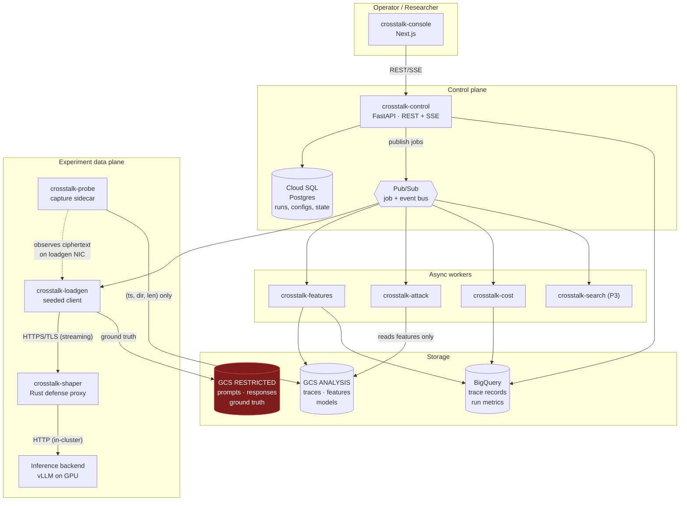
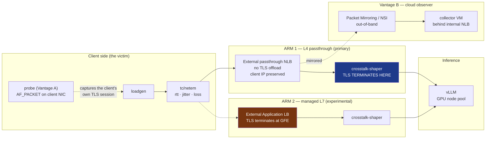
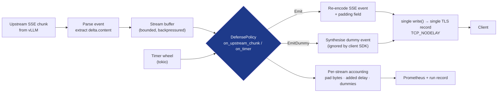
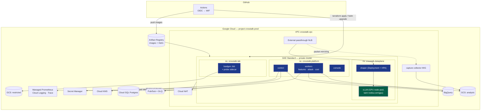

# PRODUCT.md — Crosstalk

**CROSSTALK — Measuring Privacy Leaks in Encrypted AI Traffic and Testing Defenses on Google Cloud**

*The product and research authority. Engineering execution lives in `IMPLEMENTATION_PLAN.md`. Evidence and citations live in `RESEARCH.md`.*

Version 1.0 · 13 September 2026

> **Name.** In electronics and telephony, *crosstalk* is the unintended coupling of a signal from one channel into another that was supposed to be isolated. That is exactly what this project measures: the content channel is encrypted and isolated, yet it couples into the timing-and-size channel, which is not. The name is a technical term, not branding.

---

## 1. Executive summary

TLS protects the *content* of a conversation with an AI assistant. It does not protect the *shape* of that conversation. Because LLMs generate text one token at a time and stream each fragment to the user as soon as it exists, an encrypted LLM response is a sequence of small, variable-sized, content-dependent packets emitted in real time — a near-ideal side channel. Peer-reviewed work between 2024 and 2026 has established that a passive observer who cannot decrypt anything can nonetheless infer a conversation's topic with >98% AUPRC, identify the response language, reconstruct a quarter of the actual sentences, and recover roughly 70% of the information in a medical or legal consultation.

Vendors responded. OpenAI and Azure add an `obfuscation` field; Cloudflare adds a `p` field; Mistral adds `p`; Google, Amazon and Anthropic batch several tokens per streamed event. **Nobody has published what those defenses actually buy, or what they cost.** In the one study that measured them, random padding moved attack AUPRC from 97.5% to 92.9% — a 4.6-point dent in a near-perfect attack — and two of the three mitigations were not deployed at all, but *simulated by summing packet sizes and inter-arrival times on already-captured traces*. No latency number exists. No throughput number exists. No dollar figure exists. And every self-hosted deployment and every application that re-streams an upstream API to its own users inherits none of these protections.

**Crosstalk is a traffic-analysis wind tunnel for LLM serving systems.** It is a deployable platform on Google Cloud that lets an operator define an experiment — backend, model, workload, concurrency, region, protocol, network conditions, defense policy — execute it against real inference infrastructure, capture the encrypted traffic exactly as a network observer would see it, train and evaluate attack models against it under contamination-proof evaluation splits, and then answer the question the literature has left open:

> **How much does a passive observer learn, how much does each defense take away, and what does that defense cost in time-to-first-token, tail latency, bandwidth, throughput and dollars?**

Three things make this more than a reproduction:

1. **Defenses are implemented and measured, not simulated.** `crosstalk-shaper` is a real in-path streaming proxy with byte-exact control of what goes on the wire and when. Every policy is measured simultaneously for leakage reduction *and* for latency/bandwidth/CPU/cost. The website-fingerprinting literature has shown that simulated defense overheads are wrong by factors of 2–10× (WFDefProxy measured Tamaraw's time overhead at 21% where simulation predicted 51–242%), and that application-layer defenses do not control what the attacker actually observes.
2. **Every defense is evaluated against an attacker that knows about it.** For each policy we report a pair: the *static* attacker trained on undefended traffic, and the *adaptive* attacker retrained on defended traffic from the same configuration. This is mandatory practice in the anonymity literature — WTF-PAD held attacks to 20% in 2016 and to >90% two years later once the attacker was retrained against it — and it has never been applied to LLM streaming defenses.
3. **The serving infrastructure is an independent variable, not a fixed backdrop.** Continuous batching, prefix caching, speculative decoding, replica autoscaling, cold starts and load-balancer tier all shape the packet timing an observer sees. Crosstalk asks whether *DevOps configuration changes privacy* — a question that makes Kubernetes, autoscaling and load balancing scientifically load-bearing rather than decorative.

The output is a reproducible, quantitative **leakage-versus-cost Pareto frontier** for streaming LLM defenses, produced by real measurements on real infrastructure, plus a deployable shaper that any self-hosted LLM operator could put in front of their model server.

---

## 2. Problem definition

### 2.1 The concrete problem

A user asks a self-hosted or hosted AI assistant a question about a medical symptom, a legal exposure, an immigration status, a mental-health concern, or a security vulnerability in their employer's code. The session is TLS 1.3. The observer — a coffee-shop Wi-Fi operator, a campus network, a corporate middlebox, an ISP under a retention mandate, a transit AS, or a co-tenant with packet-mirroring rights in the same cloud VPC — captures the ciphertext. They learn nothing from decryption because they cannot decrypt.

They do, however, observe a time series: for each TLS record, its arrival time, its direction, and its length. From that series alone, published work recovers topic, language, approximate content, and specific private attributes.

### 2.2 Why this problem is getting worse, not better

- **Streaming is a product requirement.** Perceived latency is the dominant UX metric for chat interfaces; nobody is going to stop streaming. The feature that creates the channel is the feature users want.
- **Inference optimisation amplifies the channel.** Speculative decoding, prefix caching and continuous batching all make timing *more* data-dependent, not less. Every performance improvement is a potential privacy regression.
- **The protected surface is a small minority.** Mitigations exist at a handful of large providers' first-party APIs. NetEcho documents that downstream applications do not inherit them — a Next.js app calling OpenAI re-streams to its own users with no padding at all — and that self-hosted vLLM/SGLang/Ollama deployments have nothing.
- **Nobody knows what protection costs.** Which means nobody can make an informed decision about deploying it. An operator asking "should I turn on padding?" has no data to answer with.

### 2.3 The research problem, stated precisely

> Given a streaming LLM service *S*, a workload distribution *W*, an infrastructure configuration *I* (backend, batching, caching, concurrency, replica count, LB tier, network path), and a defense policy *D*, quantify:
> **(a)** the information an optimal-ish passive observer can extract about *W* from the encrypted traffic of *S* under *I* and *D*;
> **(b)** the cost of *D* along latency, bandwidth, throughput and monetary axes under *I*;
> **(c)** how (a) changes when the observer is *told* which *D* is deployed and retrains accordingly;
> and identify the Pareto-optimal *D* subject to operator-supplied service-level constraints.

No published work answers (b) or (c) for LLM traffic, and (a) has only been answered for a single fixed *I* with concurrency 1.

---

## 3. Why encryption still leaks metadata

### 3.1 The mechanism, from the bottom up

TLS 1.3 encrypts a record's *plaintext* but transmits its *length* in the clear as part of the record header, and that length is a deterministic function of the plaintext length:

```
ciphertext_len = plaintext_len + 1 (content type byte) + AEAD tag (16 bytes) + optional zero padding
TLS record on the wire = 5-byte header + ciphertext_len
```

TLS 1.3 permits arbitrary zero padding inside the record (RFC 8446 §5.4), but **almost nothing uses it by default**, and OpenSSL's padding API (`SSL_CTX_set_block_padding`) is incompatible with Kernel TLS. So in practice, for a streaming response:

```
one generated token
  → one SSE event: data: {"choices":[{"delta":{"content":"hepatitis"}}]}\n\n
  → one write() to the TLS socket
  → one TLS record (small, so it fits in one record)
  → one TCP segment (with TCP_NODELAY, which every streaming server sets)
  → one packet the observer timestamps and measures
```

The observer therefore reads off, per token: **how many characters it had** (record size minus a constant framing overhead) and **when it was produced** (arrival time). That is the whole attack surface. It is the same physics as SSH sending one packet per keystroke in 2001, and variable-bitrate codecs leaking phonemes in 2008.

### 3.2 Why the two channels are different and both matter

| Channel | Physical cause | What it carries | Defeated by |
|---|---|---|---|
| **Size** (Trace B in NetEcho's terms) | Token character length varies (BPE tokens are 1–15+ chars); JSON framing is constant | Word-length sequence → language, vocabulary domain, verbatim reconstruction | Padding (application-layer or TLS-record) |
| **Timing** (Trace A) | Autoregressive decode rate; speculative-decoding acceptance; batching; queueing; cache hits | Token *count*, generation difficulty, cache state, server load, model identity | Batching, jitter, constant-rate emission |

The critical empirical fact: Whisper Leak measured **size-only average AUPRC 93.3% versus time-only 69.7%** across 28 models. Size dominates — which is why padding was the industry's first move. But NetEcho then showed that with padding applied, the traces "still leak ~80%+ via Trace A." **Padding alone attacks the strong channel and leaves the weak-but-sufficient one intact.** Any serious defense must address both, and that is exactly the trade-off Crosstalk quantifies: timing defenses cost latency, size defenses cost bandwidth, and you need some of each.

### 3.3 The aggregation illusion

The obvious fix — send several tokens per event — is what Google, Amazon and Anthropic effectively do, and it demonstrably helps: the least-leaky models in Whisper Leak are precisely the ones emitting 6–55 tokens per event. But it does not solve the problem. PromptEcho (USENIX Security '26) attacks **merged** chunk lengths directly, recovering topics for 42.5% of sessions and reconstructing a quarter of responses at high similarity. Aggregation converts a fine-grained channel into a coarse one; it does not close it. And aggregation is not free — it is exactly a delay, which is why it must appear on a cost frontier rather than in a bullet list.

---

## 4. Threat model

### 4.1 The Crosstalk Observer (CO)

**Position.** On-path between the client and the service edge that terminates the client's TLS session. Concretely: the client's LAN, the client's ISP/access network, any transit AS, or a cloud network position with visibility of the same leg.

**Observes (in scope):**
- For every TLS record on the client-visible leg: arrival timestamp (µs), direction (client→server / server→client), and record length.
- Derived: total bytes per direction, record counts, flow duration, time-to-first-response-record (observable TTFT), inter-record gaps, burst structure, request/response size ratio.
- Connection-level: destination IP and port, ASN, SNI (unless Encrypted Client Hello is in use), ALPN (`h2`/`h3`), TLS/QUIC handshake fingerprints (JA3/JA4-class).
- The observer may also act as an **ordinary client of the same service** in order to build a labelled training corpus by probing it — the standard assumption in every paper in this space, and the reason the attack is practical at all.

**Cannot observe (out of scope):**
- Any plaintext: prompts, responses, tokens, system prompts, API keys, HTTP headers, URLs beyond SNI.
- Server internals: model weights, logs, GPU state, KV-cache contents.
- Endpoint state: the client's screen, memory or disk.

**Cannot do:**
- Decrypt, or downgrade, or MITM the TLS session (no rogue CA).
- Inject into, modify, drop or reorder the victim's packets (the CO is *passive*; an active in-path attacker is explicitly out of scope).
- Compromise the inference server or the client.

### 4.2 Observer variants Crosstalk models

| ID | Variant | Realised in Crosstalk as | Priority |
|---|---|---|---|
| **V1** | Local passive (same LAN / public Wi-Fi) | Capture sidecar on the client pod, same netns as the load generator | P0 |
| **V2** | ISP / transit observer with a realistic wide-area path | Client on AWS EC2 in a different region + `tc/netem` RTT/jitter/loss profiles | P2 |
| **V3** | Cloud-network observer (co-tenant or infrastructure operator) with mirroring rights | GCP Packet Mirroring / Network Security Integration out-of-band → collector VM, capturing the client↔shaper leg (valid **only** behind an L4 passthrough LB — see §4.4) | P2 |
| **V4** | Probing adversary: also a paying client, profiles the service to build training data | The training-data collection path itself; also the prefix-cache probe experiment | P1 |
| **V5** | Active in-path attacker (delays/drops to amplify signal) | **Out of scope.** Named to be explicitly excluded | — |

### 4.3 What leaks: evidence status

This table is the project's intellectual honesty control. Rows marked VERIFIED are *reproduced*, never *claimed as new*. Rows marked UNVERIFIED are our experiments and **must not be asserted until measured**.

| Leaked property | Status | Evidence / Crosstalk experiment |
|---|---|---|
| Response length / output token count | **VERIFIED** | Time Will Tell: r > 0.987 locally |
| Topic, binary detection of one sensitive topic | **VERIFIED** | Whisper Leak: >98% AUPRC on many of 28 models |
| Topic, multi-class | **VERIFIED (narrow)** | Carlini & Nasr 89.5–99.8% medical vs coding; NetEcho topic Top-1 73.3–98.2% |
| Response language | **VERIFIED** | Time Will Tell 75–83%; Carlini & Nasr 49% top-1 of 10 on ChatGPT |
| Verbatim content (partial reconstruction) | **VERIFIED** | Weiss et al. 29% of responses; PromptEcho 25.5% at cos>0.9; NetEcho ~70% information |
| Private attributes (medical/financial fields) | **VERIFIED** | Wiretapping LLMs: 71–92% (vLLM), 50–90% (ChatGPT) |
| Presence/behaviour of speculative decoding | **VERIFIED** | Wei et al.: 1-of-50 prompt fingerprinting, REST 100% |
| **Application type** (coding assistant vs RAG vs summarisation vs structured JSON vs translation) | **UNVERIFIED** | Crosstalk **E3** |
| **Backend / serving-engine identity** from traffic shape | **UNVERIFIED** (inference only: Whisper Leak's per-model tokens-per-event differences imply distinguishability) | Crosstalk **E5** |
| **Prefix-cache hit/miss visible to a passive observer** behind a load balancer under load | **UNVERIFIED** (established only from the API-client seat: InputSnatch, PromptPeek, Early Bird) | Crosstalk **E4** |
| **Effect of concurrency / continuous batching** on leakage | **UNVERIFIED** (Time Will Tell explicitly assumes batch size 1 and flags this) | Crosstalk **E2** |
| **Autoscaling events / pod cold starts** as wire-visible signatures | **UNVERIFIED** | Crosstalk **E6** |
| Whether attacks survive realistic WAN impairment | **PARTIAL** (NetEcho tested to 10% loss) | Crosstalk **E7** |
| User identity / individual person targeting | **OUT OF SCOPE** — Crosstalk never attempts to identify individuals | — |

### 4.4 Observer placement — the single most important design decision

Most projects in this space get this wrong, so it is stated explicitly.

**The attack is defined on the leg between the client and whatever terminates the client's TLS session.** If you deploy behind a managed L7 load balancer, TLS terminates at the provider's front end; a capture point inside your VPC then sees the *front-end-to-backend* leg, which has different framing, different timing and different record boundaries. **Measuring that leg and calling it the attacker's view is invalid.**

Crosstalk therefore defines three vantages with explicit validity conditions:

| Vantage | Where capture happens | TLS terminates at | Valid as the CO's view? |
|---|---|---|---|
| **A — Client-side capture** (primary) | Sidecar on the load-generator pod/VM, capturing its own NIC | Wherever the service terminates it | **Yes, always.** This is literally the client's connection, which is what the ISP sees. Whisper Leak used exactly this (tcpdump on the client). Cheapest and most defensible. |
| **B — In-VPC mirrored capture behind an L4 passthrough LB** | GCP Packet Mirroring / NSI out-of-band → collector | **Our own shaper pod** (external passthrough NLB does no TLS offload and preserves client IP) | **Yes**, because the client's TLS session terminates inside our infrastructure, so the mirrored bytes *are* the client-visible leg. This is the vantage that justifies cloud packet mirroring. |
| **C — Behind a managed L7 ALB (GFE)** | Anywhere inside the VPC | Google Front End | **No** — for the client leg. Used only as an *experimental arm* measured from Vantage A, to answer "does a managed L7 edge accidentally act as a defense by re-framing the stream?" |

Vantage A is the scientific baseline. Vantage B exists to prove the same result holds under cloud-realistic capture and to demonstrate real GCP network engineering. Vantage C is a research question, not a measurement point.

### 4.5 Ethical and legal boundary

- **Only our own infrastructure and our own synthetic workloads are attacked.** No third-party user traffic is ever captured. No campus, corporate or public network is monitored.
- **No real personal data** enters any workload. Prompts are synthetic or drawn from public benchmark corpora; no real PII, no scraped private content, no patient/client data.
- Any measurement against a **commercial provider API** (optional, P3, for cross-provider generalisation) uses our own account, our own prompts, modest rate limits, respects the provider's terms, and is disclosed in the write-up. Primary results never depend on it.
- Crosstalk publishes a **defense** artifact alongside the attack measurement. The attack code is a measuring instrument for the defense, and the repository documents it as such.

---

## 5. Users and personas

| Persona | Who | What they need from Crosstalk | Primary screens |
|---|---|---|---|
| **P1 — The privacy researcher** (primary) | Student/academic measuring leakage and defenses | Define an experiment matrix, get statistically sound results with CIs, compare configurations, reproduce a run exactly | New Experiment, Run Detail, Attack Results, Frontier, Compare |
| **P2 — The platform/SRE operator** (primary) | Engineer running a self-hosted LLM who must decide whether to enable a defense and at what setting | "What does padding cost me at p95 TTFT and at 100 concurrent streams, and how much protection do I actually get?" | Frontier, Compare, Infrastructure |
| **P3 — The evaluator** (the professor / reviewer) | Needs to see, in five minutes, that the effect is real and the methodology is sound | Live demo: attack works → defense degrades it → cost is shown → attacker retrains → honest residual leakage | Demo flow (§32) |
| **P4 — The security engineer** (secondary) | Wants to know whether their deployment shape is exposed | Deployment-scenario mapping (NetEcho A–G), trace explorer | Trace Explorer, Overview |

Crosstalk is an **internal research/operations tool**, not a consumer SaaS. There is no sign-up funnel, no marketing surface, and no multi-tenant billing. Auth is single-org OIDC with two roles (viewer, operator).

---

## 6. Existing research — summary

Full review in `RESEARCH.md` §1–§4. Compressed conclusion:

- **Attacks are solved and strong.** Eight substantial works between 2024 and 2026 establish topic, language, attribute and partial-verbatim leakage from encrypted LLM streams under a passive observer. Crosstalk reproduces, cites, and does not claim these.
- **Defenses are asserted, not evaluated.** Every paper proposes padding/batching/jitter in a paragraph. The best-measured mitigation evidence in the field is three rows of a table showing 3.4–4.8 percentage-point AUPRC reductions, with two of the three mitigations applied as arithmetic transformations to captured traces, and with no latency measurement anywhere.
- **The methodology already exists in an older field.** Website fingerprinting spent 2009–2024 learning that lightweight defenses die to retrained attackers, that simulated overheads are wrong, that padding-only is not zero-delay at scale, that base rates matter, and that leakage should be measured in bits rather than in one classifier's accuracy. None of this has been applied to LLM traffic.
- **The serving layer is unexamined.** The one paper that measured token-count timing explicitly assumed batch size 1 and named continuous batching as unmodelled. Production serving is not a detail; it is the regime in which the attack would actually occur.

---

## 7. Existing open source — summary

Full verdicts in `RESEARCH.md` §6. Decisions:

- **Reuse as dependencies:** vLLM (primary backend, and its `--stream-interval` gives a free model-server-side batching arm), Ollama/llama.cpp (local dev backend), libpcap/tcpdump, tshark (validation), XGBoost/LightGBM/PyTorch/scikit-learn, Optuna (constrained NSGA-II), Prometheus/Grafana/OpenTelemetry, Terraform, Helm, Trivy/Gitleaks/Semgrep/Cosign, `tc`/netem.
- **Study and re-implement:** `whisper_leak` (the most comparable artifact; we read its feature pipeline and optionally reuse its prompt pack as an external replication set), `GPT_Keylogger`, the WF defense implementations (WTF-PAD, FRONT, Tamaraw, Palette, DeTorrent), WFDefProxy.
- **Adapt, optionally, at P3:** Maybenot (Rust, MIT/Apache-2) as an alternative state-machine policy backend for one comparison arm.
- **Explicitly rejected:** Hubble/Dataplane-V2 flow metrics as a feature source — GCP documentation confirms Hubble flow metrics *do not count bytes or packets*, so they cannot produce size sequences; Envoy `ext_proc` as the shaper — it inserts its own buffering into the exact signal we measure; k6 as a library — AGPL plus insufficient per-chunk timestamp fidelity.

**Standing rule:** Crosstalk is not a wrapper around another repository. The shaper, probe, feature extractor, control plane, workload engine and evaluation harness are written for this project.

---

## 8. Industry and startup landscape — summary

Full review in `RESEARCH.md` §5. Four conclusions that shape the product:

1. **Deployed mitigations exist but only upstream, at a few large providers.** OpenAI/Azure `obfuscation`, Cloudflare `p`, Mistral `p`, xAI; plus incidental token batching at Google/Amazon/Anthropic. Crosstalk implements an `obfuscation`-equivalent policy as its **industry baseline arm** so that our measurements are directly comparable to what is actually shipped.
2. **The AI-security category does not cover this.** Protect AI → Palo Alto Networks, Robust Intelligence → Cisco, Lakera → Check Point, CalypsoAI → F5 ($180M), Portkey → Palo Alto Networks ($117M). Every one of these secures *content* — prompt injection, jailbreaks, guardrails, agent authorization. **None addresses network metadata of inference traffic.** The gap is commercial, not just academic.
3. **Confidential computing is orthogonal and must be explicitly distinguished.** Google Confidential GKE Nodes with H100/TDX, Anthropic's confidential-inference whitepaper, Edgeless Privatemode, Tinfoil, Opaque, Fortanix, Anjuna — all protect data *in use* from the operator. **A TEE does not change how many bytes leave the machine, or when.** An attested enclave streaming one token per event emits the identical packet sequence. Apple PCC and OpenPCC are the only designs treating metadata as in-scope, and they address *identity linkage* (OHTTP, target diffusion), not *response-shape inference* — and empirically, relay-based identity protection did not confer traffic-analysis protection for iCloud Private Relay.
4. **The attack side is a shipping product.** Cisco Encrypted Traffic Analytics has extracted the "sequence of packet lengths and times" (SPLT) in production routers since 2017, and four NDR vendors market encrypted-traffic analysis without decryption. This is the strongest possible answer to "is this realistic?" — the feature vector our attacker uses is the same one Cisco sells.

---

## 9. What already exists (so we do not rebuild it)

| Already exists | Verdict |
|---|---|
| Token-length → verbatim reconstruction pipeline (T5-based) | Do not rebuild. Cite Weiss et al. Optional P3 replication only. |
| Binary sensitive-topic detector over TLS record sizes + timings | Reproduce once as calibration (**E0**), then move on. |
| Timing attack exploiting speculative decoding | Cite Carlini & Nasr; reuse their 80 ms constant-rate result as a baseline configuration. |
| Prefix-cache timing attacks from the API-client seat | Cite; do not rebuild. Our **E4** asks a different question (passive observer, behind an LB, under load). |
| Confidential-computing platforms | Do not build. Use as the framing contrast. |
| AI gateways with routing/caching/guardrails | Do not build. Our shaper is the missing *traffic-shaping* plugin, not another gateway. |
| Website-fingerprinting defenses for Tor | Do not port wholesale. Import the *ideas* (adaptive padding, constant rate, burst molding, distribution-aware padding) and the *evaluation discipline*. |

---

## 10. Gap analysis

The full matrix is `RESEARCH.md` §7. The five gaps Crosstalk occupies:

| G | Gap | Why it is still open |
|---|---|---|
| **G1** | No deployed, measured, open implementation of a streaming-LLM defense | Papers propose defenses as future work; vendors ship them closed; the only public measurements are trace-level simulations |
| **G2** | No defense-aware (adaptive) attacker evaluation for LLM traffic | The field is two years old and has been focused on demonstrating attacks, not hardening against them |
| **G3** | No cost model for privacy | Two isolated data points exist (Carlini & Nasr: +4–13 ms/token at 80 ms constant rate, <10% bandwidth; Time Will Tell: +13–93% latency for max-length padding). No frontier |
| **G4** | Leakage has never been measured under production serving conditions | Concurrency, continuous batching, prefix caching, autoscaling, LB tier, cold starts are all unmodelled; the leading timing paper assumes batch size 1 |
| **G5** | Defense configuration is chosen by intuition | There is padding theory (Reed & Reiter, optimal constrained padding) but no practical constrained search over *measured* configurations for streaming |

---

## 11. Product thesis

> **Crosstalk measures how much a passive network observer learns from an encrypted LLM stream, and what it costs — in time-to-first-token, tail latency, bandwidth, throughput and dollars — to take that knowledge away.**

Supporting claims:

- **The unit of analysis is a configuration, not a model.** A leakage number is meaningless without the infrastructure it was measured under. Crosstalk's primary object is the `ExperimentRun`: a fully-specified (workload × backend × infra × protocol × network × defense × seed) tuple, executed reproducibly.
- **A defense claim is a pair, not a number.** Every defense reports (static-attacker leakage, adaptive-attacker leakage) and a cost vector. A single post-defense accuracy figure is not a result.
- **Cost is a first-class result.** A defense that halves leakage at +300% bandwidth and a defense that halves leakage at +8% bandwidth are different products. The frontier, not the headline, is the deliverable.
- **The platform must enforce its own threat model in software.** The attack pipeline must be architecturally incapable of reading plaintext, and CI must prove it. Otherwise every result is suspect.

---

## 12. Final selected scope

### 12.1 The nine experiments

| ID | Experiment | Question | Priority |
|---|---|---|---|
| **E0** | **Calibration / replication** | Does the known size+timing topic attack reproduce on our own self-hosted vLLM stack, at both binary (Whisper-Leak-style) and 8-class settings, under prompt-family-disjoint splits? | **P0** |
| **E1** | **Defense catalogue sweep** ⭐ | For each of 9 defense policies: how much leakage remains against a static attacker, and against an attacker retrained on that defense — and what does each cost in TTFT/ITL/p95/bandwidth/CPU/$? | **P0** |
| **E2** | **Concurrency and continuous batching** | Does leakage rise, fall or merely change shape as concurrent streams go 1 → 8 → 32 → 128? Does continuous batching act as an accidental defense? | **P1** |
| **E3** | **Application-type fingerprinting** | Can an observer distinguish coding assistant / chat Q&A / summarisation / translation / RAG / structured-JSON generation without plaintext? | **P1** |
| **E4** | **Prefix-cache channel at the network layer** | Is a KV prefix-cache hit visible as a TTFT signature to a *passive observer* behind a load balancer, under concurrent load? | **P2** |
| **E5** | **Backend/config fingerprinting** | Can an observer identify the serving engine (vLLM vs Ollama), the `--stream-interval` setting, or whether speculative decoding is enabled? | **P2** |
| **E6** | **Autoscaling and cold-start signatures** | Do HPA scale-ups, pod cold starts and model loading produce wire-visible timing artifacts an observer could detect? | **P2** |
| **E7** | **Network impairment** | Does the attack survive realistic WAN conditions (RTT 10/50/100 ms, jitter, 0.1–2% loss, constrained bandwidth)? | **P2** |
| **E8** | **Path and protocol arm** | L4 passthrough vs L7 managed ALB; HTTP/1.1 vs HTTP/2 vs HTTP/3; in-region client vs cross-cloud AWS client. Is a managed LB an accidental defense? | **P2** |
| **E9** | **Constrained defense policy search** ⭐ | Given p95 TTFT ≤ X, bandwidth ≤ Y%, cost ≤ Z, which defense configuration minimises adaptive-attacker leakage? | **P1** (grid) / **P3** (NSGA-II) |

⭐ = flagship contributions.

### 12.2 Priority discipline

**P0 — mandatory (the project fails without these).** Local end-to-end lab; workload engine; shaper with `passthrough`, `pad-random`, `batch-k`; client-side capture; feature extraction; attack ladder (LR → GBDT → 1-D CNN); disjoint-split evaluation with CIs; E0 and E1; GKE deployment of the serving + shaper path; Terraform for the core infrastructure; CI with tests and scanning; the demo flow.

**P1 — strong differentiators.** Full 9-policy defense catalogue; adaptive-attacker loop as first-class infrastructure; E2, E3; grid-based E9 and the Pareto frontier UI; Pub/Sub-driven distributed workers; BigQuery analytics; observability stack with cross-layer correlation; frontend Run Detail + Frontier + Compare.

**P2 — advanced.** E4–E8; Vantage B packet mirroring; network impairment lab; AWS external vantage; autoscaling experiments; chaos/failure tests; leakage-in-bits estimator; cost attribution per run.

**P3 — research stretch.** NSGA-II policy search; Maybenot state-machine arm; TLS-record-layer padding via OpenSSL; cross-provider commercial-API generalisation; verbatim reconstruction replication; agent-traffic extension.

**Rule:** if P0 is not finished and demoable, nothing from P2/P3 is started. The P0 set alone is a complete, defensible project.

---

## 13. Key innovations

| # | Innovation | What code exists | What system behaviour changes | How it is measured | Why it is necessary |
|---|---|---|---|---|---|
| **C1** | **In-path defense shaper, measured on the wire** | `crosstalk-shaper`: Rust/tokio/hyper/rustls reverse proxy; `DefensePolicy` trait; 9 policies; per-stream accounting | The response stream's chunk boundaries, sizes and emission times are produced by policy, not by the model server | Leakage delta *and* TTFT/ITL/p95/bandwidth/CPU measured on the same run; simulated-vs-deployed delta reported | The literature simulates defenses on traces; WFDefProxy proved that gets overhead wrong by 2–10×, and HotNets'25 proved app-layer defenses don't control the observed sequence |
| **C2** | **Adaptive-attacker loop as infrastructure** | `crosstalk-attack` worker + orchestration states `TRAIN_STATIC` → `EVAL_STATIC` → `RECOLLECT` → `TRAIN_ADAPTIVE` → `EVAL_ADAPTIVE`; results stored as a pair | Enabling a defense automatically schedules a defended-traffic recollection and a retraining run | Reported as (static, adaptive) leakage pair + "retained leakage ratio" | WTF-PAD: 20% attack accuracy in 2016 → >90% in 2018 once retrained. A defense evaluated only against a stale attacker is not evaluated |
| **C3** | **Empirical leakage-vs-cost Pareto frontier** | Frontier computation service + interactive frontend scatter with Pareto hull | Cross-run aggregation surfaces non-dominated configurations | Balanced accuracy / PR-AUC / bits vs Δp95 TTFT, Δbandwidth %, Δthroughput, $/1k req | Answers the operator's actual question. No such frontier exists for LLM traffic |
| **C4** | **Serving infrastructure as an experimental variable** | Concurrency sweeps, `--stream-interval` sweeps, prefix-cache on/off, HPA event injection, LB-tier arm, netem profiles — all first-class run parameters | Infrastructure config is versioned into the run record and reproduced on replay | Leakage measured per infra cell; infra metrics joined to traces by `run_id` | Makes DevOps scientifically load-bearing, and closes a gap the leading timing paper explicitly names |
| **C5** | **Constrained defense policy search over measured runs** | `crosstalk-search`: Optuna NSGA-II with `constraints_func`; each trial = a real collection + retrain | The platform proposes and executes the next configuration to try | Hypervolume improvement vs a grid baseline at equal trial budget | Turns "pick a padding setting" into a reproducible optimisation with explicit SLO constraints. Not "AI chooses security settings" — a documented optimiser over a measured objective |
| **C6** | **Threat-model enforcement in the data plane** | Separate GCS prefixes + separate service accounts; the attack worker's SA has *no* read access to the prompt/response bucket; trace schema forbids text fields; CI test asserts no plaintext in the feature store | The attack pipeline is architecturally unable to see what it is trying to infer | A CI job that fails the build on plaintext leakage into features | Without this, every leakage number is unfalsifiable. It is also the most persuasive thing to show an examiner |

---

## 14. Non-goals

Explicitly **not** built, and the reason:

| Not building | Why |
|---|---|
| A new attack technique | The attacks are solved and strong. Claiming novelty here would be dishonest and would invite an easy reviewer kill |
| Verbatim response reconstruction as a core feature | Weiss et al. and PromptEcho own this. P3 replication at most |
| Attacks against third-party users, networks, or production services | Ethically and legally out of bounds |
| A "privacy score" out of 100 | An arbitrary composite hides the trade-off that is the entire point. We report the frontier |
| AI-generated privacy reports / recommendations / chatbot assistant | Slop. Every number in Crosstalk comes from a measurement with a confidence interval |
| Blockchain, multi-agent orchestration, digital twins, "AI firewall" | No mechanism, no metric, no reason |
| Homomorphic encryption / MPC / TEE implementation | Orthogonal to traffic analysis (§8.3). Implementing one would prove nothing about packet shape |
| Tor / mixnet integration | Different threat model, enormous latency cost, and it would obscure the serving-layer effects we study |
| Service mesh (Istio/Linkerd) | A sidecar proxy injects its own buffering and timing into the exact signal we measure. It would corrupt the experiment |
| Redis / Memorystore in the MVP | There is no cache-shaped, lock-shaped or ephemeral-state-shaped problem. Postgres + Pub/Sub cover it. Adding it would be architecture theatre |
| Kafka | Pub/Sub is the managed equivalent for our fan-out; we need no partition ordering or log replay at our volume |
| Multi-tenant SaaS, billing, sign-up flows | Internal research tool for one organisation |
| Real user data of any kind | Synthetic and public-benchmark prompts only |

---

## 15. Attack model

### 15.1 Tasks

| Task | Type | Classes | Why |
|---|---|---|---|
| **T1 — Topic** | Multi-class | 8 semantic categories (programming, medical, legal, financial, travel, education, sports, general) | The canonical published task; multi-class is the honest extension of Whisper Leak's binary framing |
| **T2 — Sensitive-topic detection** | Binary, open-world, realistic base rate | 1 target vs. background | Directly comparable to Whisper Leak; tests precision under class imbalance (the metric that decides real-world harm) |
| **T3 — Application type** | Multi-class | 6 (code assist, chat Q&A, summarisation, translation, RAG, structured JSON) | **Novel to us (E3)**; operationally meaningful and cheap to generate |
| **T4 — Output token count** | Regression | continuous | The interpretable primitive underneath every other task; validates the pipeline end to end |
| **T5 — Infrastructure state** (P2) | Multi-class / binary | backend id; `stream-interval` k; spec-decode on/off; cache hit/miss; scaling event | **Novel to us (E4/E5/E6)** |

### 15.2 Feature representations

All derived **only** from `(timestamp, direction, length)` triples. Three representations, deliberately mirroring what has survived 10 years in the WF literature:

| Representation | Definition | Ancestor |
|---|---|---|
| **R1 — Summary statistics** | ~120 scalars: counts and totals per direction; size histogram (bucketed); inter-arrival percentiles; burst count/size/duration stats; packets-per-second features; observable TTFT; flow duration; up/down ratios | k-fingerprinting (175 features, random forest) |
| **R2 — Cumulative curve** | Signed cumulative byte curve interpolated to 100 points + 4 totals = 104 features | CUMUL (Panchenko et al.) |
| **R3 — Raw sequence** | First N=512 records as (signed direction × size, Δt) pairs, zero-padded to the 95th-percentile length; optionally binned as in Whisper Leak | Deep Fingerprinting 1-D CNN; Whisper Leak Bi-LSTM/BERT |

Crosstalk additionally reports the **SPLT view** (sequence of packet lengths and times) as a named export, because that is the industry vocabulary (Cisco ETA) and makes the work legible to practitioners.

### 15.3 Attacker ladder — simplest first

| Rung | Model | Input | Purpose |
|---|---|---|---|
| **A0** | Majority-class / stratified random | — | Chance baseline; every result is reported against it |
| **A1** | Logistic regression (L2) | R1 | Interpretable floor. If A1 already separates classes, no deep model is justified |
| **A2** | **XGBoost / LightGBM** | R1 + R2 | The workhorse. Expected to be the primary reported attacker |
| **A3** | 1-D CNN (DF-style) | R3 | Used **only if** A2 saturates or fails; justified by the DF result that CNNs beat feature-engineering against defended traffic |
| **A4** | Small Transformer / Bi-LSTM | R3 | P3, and only if A3 is clearly limiting. Not used for headline numbers unless it wins |
| **A5** | **kNN Bayes-error / mutual-information estimator** | R1/R3 latent | Not a classifier — a *leakage bound* estimate, reported in bits, so defense claims do not rest on one model's strength (DeepSE-WF / WeFDE / Cherubin) |

**Rule (from Arp et al.):** no deep model is introduced without demonstrating that the simpler rung is insufficient, and every rung is compared against A0 on the same split.

### 15.4 Attacker knowledge settings

| Setting | Attacker trains on | Models |
|---|---|---|
| **Static** | Undefended traffic only | The naive deployment-time attacker; what most papers report post-mitigation |
| **Adaptive** | Traffic collected with the *same* defense enabled | A realistic attacker who knows the deployed defense (Kerckhoffs-style). **The headline number.** |
| **Transfer** (P2) | A *different* defense configuration, or a different backend/region | Tests whether an attacker must re-profile per deployment — an important practical cost-to-attacker measure |

---

## 16. Defense model

### 16.1 Where the defense sits

At the **last hop before the client** — the edge that terminates the client's TLS session — because NetEcho established that upstream defenses are not inherited downstream. In Crosstalk this is `crosstalk-shaper`, deployed as the ingress for the inference service. This position is also the one a real operator can adopt: it requires no change to the model server and no change to the client.

### 16.2 Policy catalogue

Each policy answers: which channel it attacks, what it costs, and where the idea comes from.

| # | Policy | Mechanism | Channel attacked | Expected cost | Ancestor / precedent |
|---|---|---|---|---|---|
| **D0** | `passthrough` | Relay unchanged; still measured and accounted | — (control) | ~0 | — |
| **D1** | `pad-random` | Append a random-length filler field to each SSE JSON event, length ~ U(0, N) | Size | Bandwidth ↑, latency ≈ 0 | **The industry baseline**: OpenAI/Azure `obfuscation`, Cloudflare `p`, Mistral `p` |
| **D2** | `pad-bucket` | Quantise each event to the next size bucket from a fixed ladder (e.g. 64/128/256/512 B) | Size | Bandwidth ↑ (less than D1 for equal protection, if buckets are distribution-aware) | RFC 8467 block-length padding; D-ALPaCA distribution-aware targets (23.6× cheaper than naive) |
| **D3** | `pad-optimal` (P2) | Bucket ladder computed to minimise observer information gain subject to an overhead budget | Size | Tunable by construction | Reed & Reiter, optimal constrained padding |
| **D4** | `batch-k` | Emit one event per k model chunks | Timing + size granularity | ITL ↑, TTFT ≈ unchanged if first chunk is exempt | Gemini/Nova/Claude behaviour; Whisper Leak k=5; vLLM `--stream-interval` |
| **D5** | `batch-window` | Emit accumulated chunks every T ms regardless of arrival | **Timing (decouples emission from generation)** | ITL ↑ by ≤T, bandwidth ≈ 0 | Adaptive padding / WTF-PAD lineage |
| **D6** | `jitter` | Delay each emission by a bounded random δ ~ U(0, J) | Timing | ITL ↑ by J/2 mean | Classical timing obfuscation; Loopix-style delay (bounded, not exponential) |
| **D7** | `constant-rate` | Emit a fixed-size unit every T ms; pad when starved, buffer when flooded; keep going for a cover period after generation ends | **Both, strongly** | Highest latency and bandwidth cost; the protection upper bound | BuFLO/Tamaraw; **Carlini & Nasr measured 80 ms → +4–13 ms/token, <10% bandwidth** |
| **D8** | `cover-traffic` | Emit dummy events during idle windows (notably the long TTFT gap of reasoning models) and after stream end | Timing, stream boundaries | Bandwidth ↑ | FRONT (front-loaded dummies), DAITA cover traffic |
| **D9** | `hybrid` | Composition, e.g. `pad-bucket(128) + batch-window(40ms) + jitter(10ms)` | Both | Tunable | Whisper Leak's own recommendation to pair batching with padding |
| **D10** | `maybenot` (P3) | Probabilistic state machine driving padding/blocking via the Maybenot crate | Both | — | Maybenot / Mullvad DAITA |

### 16.3 Policy interface (conceptual)

```rust
/// Every policy is a scheduler over upstream chunks. It may delay, merge,
/// split, pad, or synthesise events, but MUST NOT alter decoded content.
pub trait DefensePolicy: Send {
    fn on_stream_start(&mut self, ctx: &StreamCtx) -> Vec<Action>;
    fn on_upstream_chunk(&mut self, chunk: Chunk, now: Instant) -> Vec<Action>;
    fn on_timer(&mut self, now: Instant) -> Vec<Action>;
    fn on_upstream_end(&mut self, now: Instant) -> Vec<Action>;
    fn accounting(&self) -> PolicyAccounting; // padding bytes, added delay, dummies
}

pub enum Action {
    Emit { bytes: Bytes, pad_to: Option<usize> }, // one flush → one TLS record
    EmitDummy { size: usize },
    ArmTimer(Duration),
    Finish,
}
```

**Hard invariants, enforced by tests:**
1. **Content fidelity** — the concatenation of decoded `delta.content` across emitted events is byte-identical to upstream. A defense that corrupts output is not a defense.
2. **No content-dependent branching in timing decisions** beyond what the policy declares (a policy may batch on *count*, never on *what the token says*).
3. **Termination** — every stream ends; cover traffic has a bounded tail.
4. **Accounting completeness** — padding bytes, added delay per chunk, and dummy count are recorded for every stream, so cost is measured rather than estimated.

### 16.4 Defense placement arms (comparison, not just policies)

| Arm | Where the defense runs | Why it matters |
|---|---|---|
| **Gateway-side** (primary) | `crosstalk-shaper` | What an operator can deploy without touching the model server |
| **Model-server-side** | vLLM `--stream-interval k` | Free comparison: is batching cheaper when the server does it (no extra hop, no extra buffer)? |
| **Transport-layer** (P3) | TLS 1.3 record padding via OpenSSL `SSL_CTX_set_block_padding` | Tests whether pushing padding below the application layer changes what the observer sees — directly probing the HotNets'25 argument |
| **Accidental** | Managed L7 ALB (GFE) re-framing | Is a cloud load balancer an unintentional defense? |

---

## 17. Experiment methodology

### 17.1 The experiment object

```
ExperimentRun
├── workload         (corpus version, task, class set, N samples/class, seed)
├── backend          (engine, model, quantisation, spec-decode, stream-interval, APC on/off)
├── infrastructure   (region, replica count, GPU type, HPA policy, concurrency level)
├── path             (LB tier: L4 passthrough | L7 ALB; protocol: h1|h2|h3)
├── network          (netem profile: rtt, jitter, loss, rate)
├── defense          (policy id + parameters)
├── vantage          (A client-side | B mirrored | C behind-ALB)
├── attacker         (representation, model, knowledge: static|adaptive|transfer)
├── seed             (single integer seeding prompt sampling, ordering, and model init)
└── repetitions      (≥5 seeds for any reported result)
```

Everything above is recorded in the run's provenance record together with git commit, container image digests, model revision, Terraform state serial and timestamps (§37 of `IMPLEMENTATION_PLAN.md`).

### 17.2 Collection protocol (every run)

1. **Warm-up** — discard the first W requests (cold cache, JIT, autoscaler settling). W is recorded.
2. **Randomised interleaving** — class order is shuffled; never collect class A for an hour and class B afterwards, or time becomes the label. (This is the single easiest way to fake a 99% result.)
3. **Cache-defeating perturbation** — a benign unique suffix/whitespace insertion per request unless the experiment is specifically about caching (E4), mirroring Whisper Leak's method. Recorded as a flag.
4. **Paired control** — every defended run has a `passthrough` run collected in the same session window, on the same infrastructure, so the comparison is not confounded by drift.
5. **Ground truth** — the loadgen records, per request: `request_id`, class, prompt-family id, template id, seed, prompt token count, response token count, TTFT, ITL series, and the backend's own metrics. **This stream is written to a bucket the attack pipeline cannot read.**

### 17.3 Splits (anti-contamination; see §10 of the prompt brief, and Arp et al.)

| Split | Rule | Why it exists |
|---|---|---|
| **Prompt-family-disjoint** (default) | Paraphrases of the same underlying question never straddle train/test | Otherwise the model memorises one question's trace shape. This is the most likely source of a fake 99% |
| **Template-disjoint** | Generation templates are partitioned; test templates unseen in training | Prevents learning template artifacts (fixed preambles, formatting) instead of semantics |
| **Time-disjoint** | Test traces come from a *later collection session* (different hour/day) | Detects drift and clock/queue artifacts; matches Carlini & Nasr's observation that signatures decay over weeks |
| **Backend-disjoint** (E5) | Train on one engine/model, test on another | Measures generalisation, not memorisation |
| **Region/path-disjoint** (E8) | Train in one region/LB tier, test in another | Separates network-path noise from serving-layer signal |
| **Defense-disjoint** (transfer setting) | Train under defense A, test under defense B | Measures the attacker's re-profiling cost |

**Mandatory controls run with every experiment:**
- **Null run** — labels shuffled; any result above chance means leakage in the pipeline, and the run is rejected.
- **Chance baseline** — reported next to every metric.
- **Determinism probe** — the same prompt repeated M times; the spread of its traces bounds how much of any measured difference is noise.

### 17.4 Statistics

- ≥5 seeds for every reported number; report **median and bootstrap 95% CI** (10,000 resamples).
- Differences between configurations reported with CIs; no "A beats B" claim without non-overlapping intervals or an explicit test.
- Open-world results reported at explicit base rates with **precision at fixed recall**, not just AUC, following the base-rate critique in the WF literature.
- Learning curves (performance vs. training volume) reported for at least the flagship configurations, because Whisper Leak showed performance still climbing with data — a single-point result may understate risk.

---

## 18. Dataset and workload generation

### 18.1 Principles

- **Synthetic or public-benchmark prompts only.** No real user data, no scraped private content, no real PII.
- **Compositional generation**: each prompt is (class × subcategory × template × entity-slot fill × length-target), so we can partition on *any* of those axes to build disjoint splits.
- **Versioned**: the corpus is a versioned artifact (`workload@v1.2.0`) with a content hash; a run records which version it used.
- **Balanced but realistically imbalanced too**: T1 balanced for clean multi-class measurement; T2 deliberately imbalanced (e.g. 1:1,000 and 1:10,000) for open-world realism.

### 18.2 Schema (per sample)

```yaml
prompt_id: wl-v1-programming-0412
workload_version: v1.2.0
semantic_class: programming          # T1 label
subcategory: debugging
application_type: code_assist        # T3 label
template_id: tmpl-prog-07
prompt_family_id: fam-prog-113       # split key — paraphrases share this
paraphrase_index: 3
prompt_tokens: 84
target_response_tokens: 300          # requested via max_tokens
temperature: 0.7
seed: 20260913
# populated at run time, stored in the RESTRICTED bucket:
response_tokens: 287
ttft_ms: 412.7
backend: vllm@0.x / gemma-3-4b-it
defense: pad-bucket(128)
region: us-central1
request_id: 01J9...
```

### 18.3 Classes

- **T1 topic (8):** programming, medical, legal, financial, travel, education, sports, general-knowledge. Each with ≥8 subcategories, ≥20 prompt families, ≥5 paraphrases per family → ≥800 unique prompts per class before repetition.
- **T2 sensitive detection:** one target family set vs. a large background drawn from a public question corpus (mirroring Whisper Leak's Quora-based negatives so results are comparable).
- **T3 application type (6):** code assist (with realistic code context), chat Q&A, summarisation (long input, short output), translation, RAG (long retrieved context + short question), structured JSON generation (schema-constrained output).

[INFERENCE] T3 is expected to be the *easiest* task and the most operationally alarming, because the input/output length asymmetry differs enormously by application type — summarisation is long-in/short-out, code assist is short-in/very-long-out with distinctive token-length distributions (identifiers and indentation), and JSON generation has a near-deterministic size rhythm. **This is a prediction to be tested by E3, not a claim.**

### 18.4 Reproducibility rules

1. A run is defined by `(workload_version, seed, config_hash)`. Same triple ⇒ same prompts in the same order.
2. Non-determinism that cannot be removed (model sampling, GPU kernel non-determinism, network scheduling) is *measured* by the determinism probe (§17.3) and reported as the noise floor.
3. Every artifact (trace parquet, feature set, model, evaluation) records the `run_id` and provenance record that produced it.
4. Re-running a stored configuration is a first-class UI action; the system reports the delta against the original run.

---

## 19. Metrics

### 19.1 Privacy / leakage

| Metric | Definition | Why |
|---|---|---|
| Balanced accuracy | Mean per-class recall | Robust to class imbalance; primary multi-class headline |
| Macro-F1 | Unweighted mean F1 | Complements balanced accuracy |
| PR-AUC (per class + macro) | Area under precision–recall | Primary for imbalanced/open-world; directly comparable to Whisper Leak's AUPRC |
| ROC-AUC | — | Reported for comparability only |
| **Precision @ recall = {0.05, 0.10, 0.25}** | — | The metric that maps to real-world harm under a realistic base rate |
| Confusion matrix | — | Shows *which* classes leak, not just how much |
| **Retained leakage ratio** `ρ` | `(m_def − m_chance) / (m_undef − m_chance)` | Normalised "how much of the original leakage survives this defense." ρ=0 perfect, ρ=1 useless. The single number for the frontier axis |
| **Leakage (bits)** | kNN mutual-information / Bayes-error estimate over the representation | Attacker-independent; prevents "your classifier was weak" from invalidating a defense claim |
| Calibration (ECE) | P2 | Only where probability quality matters |

### 19.2 Performance

TTFT p50/p95/p99 · inter-token latency (ITL) p50/p95 · end-to-end stream duration · per-stream tokens/sec · aggregate throughput (req/s and tok/s) · error rate · vLLM queue delay and running/waiting counts · GPU utilisation and KV-cache utilisation · shaper CPU-ms and RSS per stream.

### 19.3 Cost

Observed bytes on the wire per request (client-side, the number that matters to the observer and to egress billing) · bandwidth overhead % vs paired `passthrough` · added latency % · throughput loss % · shaper CPU cost · **$ per 1,000 requests** = egress + GPU-node seconds + shaper CPU seconds, attributed per run.

### 19.4 Platform SLIs

Experiment completion rate · capture completeness (fraction of requests with a matched, well-formed trace — **target ≥99%**, because dropped captures bias results) · feature-extraction success rate · API p95 latency · shaper added latency p95 (the platform's own SLO) · reproducibility delta on replay.

---

## 20. System behaviour

The 23 capabilities from the brief, mapped to the system:

| # | Capability | Where it lives |
|---|---|---|
| 1 | Define an experiment | Control API `POST /v1/experiments` + New Experiment UI (matrix builder) |
| 2 | Choose AI backend | `backend` block; adapters for vLLM, Ollama, (P3) commercial API |
| 3 | Choose workload | `workload_version` + task + class set |
| 4 | Choose region | `infrastructure.region`; multi-region node pools / multi-cluster (P2) |
| 5 | Choose concurrency | `infrastructure.concurrency` drives the loadgen |
| 6 | Choose protocol/config | `path.protocol` (h1/h2/h3), `path.lb_tier` |
| 7 | Choose defense | `defense` block → shaper policy hot-reload per run |
| 8 | Execute traffic | `crosstalk-loadgen` job, seeded and rate-controlled |
| 9 | Capture encrypted telemetry | `crosstalk-probe` (Vantage A sidecar; Vantage B collector) |
| 10 | Extract features | `crosstalk-features` worker → Parquet in GCS + rows in BigQuery |
| 11 | Train attacker | `crosstalk-attack` worker (static) |
| 12 | Evaluate attack | Same worker, held-out disjoint split, CIs |
| 13 | Enable defense | Shaper policy applied for the next run in the matrix |
| 14 | Recollect traces | Orchestrator schedules the defended collection automatically |
| 15 | Retrain against defense | `TRAIN_ADAPTIVE` state |
| 16 | Benchmark privacy | Evaluation service → leakage metrics + bits |
| 17–20 | Benchmark p50/p95/p99, TTFT, throughput, bandwidth | Loadgen client-side metrics + shaper accounting + Prometheus |
| 21 | Benchmark cost | Cost attribution worker (resource-seconds × rate card × run) |
| 22 | Compare experiments | Compare screen + BigQuery aggregate views |
| 23 | Reproducible results | Provenance record + replay action + determinism probe |

**Run lifecycle (state machine).** `DRAFT → QUEUED → PROVISIONING → WARMUP → COLLECTING → CAPTURE_SEALED → EXTRACTING → TRAIN_STATIC → EVAL_STATIC → [RECOLLECT_DEFENDED → TRAIN_ADAPTIVE → EVAL_ADAPTIVE] → SCORING → COMPLETED` with `FAILED(reason)` and `CANCELLED` terminal states, and `PARTIAL` when some cells of a matrix succeed. Each transition is an event (§16 of `IMPLEMENTATION_PLAN.md`), is idempotent, and is retryable from its last checkpoint.

---

## 21. UX and product flows

### 21.1 Visual language

Crosstalk looks like an instrument, not a landing page. Reference points: Grafana Explore, Datadog APM trace view, Sentry issue detail, the GCP console's network pages, Linear's density and keyboard affordances.

**Rules:**
- Dense by default. Information per screen is the goal; whitespace is not a feature.
- Numeric data in a tabular-figures monospace face, right-aligned, with fixed precision and units always visible.
- Exactly one accent colour for interactive affordances. Semantic colour only where it carries meaning (defended vs undefended, pass vs fail, Pareto-optimal vs dominated).
- Every number that came from an estimate rather than a measurement is visually marked and carries a tooltip saying so.
- Confidence intervals are drawn, not hidden. A bar chart without error bars is a bug.
- **Banned:** hero gradients, glassmorphism, decorative cards, sparkle icons, a chatbot, an animated "risk meter", any score out of 100.

### 21.2 Screens

| Screen | Purpose | Key content |
|---|---|---|
| **Overview** | Operational state at a glance | Recent runs with status chips and durations; cluster health (GPU node up/down, replica count, queue depth); active budget consumption vs. the month's cap; last 5 completed results with their headline leakage numbers |
| **New Experiment** | Define a run or a matrix | Two modes: *Single* (one config) and *Matrix* (choose axes — e.g. defense × concurrency — and see the resulting cell count, estimated wall-clock and estimated cost **before** submitting). Validation warns on configurations known to be confounded (e.g. Vantage B selected with L7 ALB → hard block with an explanation) |
| **Run Detail** | Watch and diagnose a run | Stage timeline (Provision → Warm-up → Collect → Extract → Train static → Eval → Recollect → Train adaptive → Eval → Score) with per-stage durations; live counters (requests done, traces captured, capture completeness %); live TTFT/ITL sparklines; logs filtered to this `run_id`; the provenance record |
| **Trace Explorer** | See what the observer sees | **Packet waterfall**: x = time since request, y = direction, each mark a TLS record with height ∝ size. Overlay of the defended vs undefended paired run. Secondary panels: signed cumulative-bytes curve (the CUMUL view), inter-arrival histogram, burst segmentation. A toggle to show/hide the ground-truth token boundaries — *off by default, and marked "oracle view, not available to the attacker"* |
| **Attack Results** | Evaluate one attacker on one run | Confusion matrix; per-class PR curves; balanced accuracy and PR-AUC with CIs; chance baseline drawn on every chart; the split configuration stated on the page; the null-run control result; learning curve |
| **Frontier** ⭐ | The product's centrepiece | Interactive scatter: x = cost axis (selectable: Δp95 TTFT, Δbandwidth %, Δthroughput, $/1k req), y = retained leakage ratio ρ (or bits). Each point is a defense configuration; Pareto-optimal points highlighted and connected; hovering shows the full config; clicking opens the run. Toggle between static and adaptive attacker — **the toggle that makes the whole thesis visible in one gesture** |
| **Compare** | Diff two runs | Side-by-side config diff (only differing fields highlighted); metric deltas with CIs; overlaid waterfalls; overlaid cumulative curves |
| **Infrastructure** | Show the system is real | Pods and replicas by service; GPU node state; Pub/Sub backlog and DLQ depth; worker concurrency; recent failures and retries; cost burn rate |

### 21.3 Primary flow

```
Operator opens New Experiment
  → selects task T1, workload v1.2.0, backend vLLM/gemma-3-4b, region us-central1
  → selects Matrix axis: defense ∈ {passthrough, pad-random(64), pad-bucket(128),
                                     batch-window(40ms), hybrid}  × seeds {1..5}
  → UI shows: 25 cells · est. 3h10m · est. $4.80 · 45,000 requests
  → Submit
Platform:
  provisions → warms up → for each cell: collects, captures, extracts
  → trains static attacker on the passthrough cell, evaluates on every cell
  → for each defended cell: retrains an adaptive attacker on that cell's traffic
  → scores, attributes cost, computes the frontier
Operator:
  → watches Run Detail live
  → opens Frontier, toggles static → adaptive, sees which defenses survive
  → opens Compare on the two most interesting points
  → exports the run bundle (config + metrics + figures) for the report
```

---

## 22. Architecture

### 22.1 Diagram A — System context



**The one arrow that matters:** `crosstalk-attack` reads **only** from GCS ANALYSIS. It has no IAM permission on GCS RESTRICTED. That is the threat model, enforced by IAM rather than by good intentions.

### 22.2 Diagram D — Traffic path and observer placement



- **Arm 1 is the scientific baseline.** Because the passthrough NLB does no TLS offload, the client's TLS session terminates at our shaper. Therefore the ciphertext seen at the client NIC (Vantage A) and the ciphertext mirrored inside the VPC (Vantage B) are **the same bytes** — which is what makes cloud-side mirroring a legitimate observer position here.
- **Arm 2 is an experiment, not a measurement point.** With TLS terminating at the GFE, in-VPC capture no longer sees the client leg. Arm 2 is therefore only ever measured from Vantage A, to answer: does a managed L7 edge re-frame the stream enough to reduce leakage on its own?

### 22.3 Diagram G — Defense pipeline inside the shaper



**Invariant made visible:** the *only* path from upstream content to the wire passes through the policy, and every emission is one flush, which is one TLS record. Content fidelity is asserted by a test that reassembles `delta.content` from the shaped stream and compares it byte-for-byte with upstream.

### 22.4 Service inventory and justification

Every service must answer: *why is this a separate deployable?*

| Service | Language | Why it exists | Why it is (or is not) separate |
|---|---|---|---|
| **crosstalk-control** | Python / FastAPI | Owns experiment definitions, run state machine, provenance, job publication, results API, SSE progress | Single writer to Postgres; the natural transactional boundary |
| **crosstalk-shaper** | **Rust** | The flagship: terminates client TLS, applies defense policy, accounts for cost | **Must** be separate — different language, different scaling profile, sits in the data path, and its latency budget is the experiment |
| **crosstalk-probe** | Rust (or Go) | Captures `(ts, dir, len)` at the threat-model boundary; writes trace records | **Must** be separate — needs `NET_RAW`, runs as a sidecar/DaemonSet, deliberately isolated from anything holding plaintext |
| **crosstalk-loadgen** | Python (async) | Seeded, reproducible, concurrency-controlled request generation with client-side per-chunk timestamps and ground-truth logging | Separate because it runs as a **Job** per run, scales with concurrency, and must be co-located with the probe |
| **crosstalk-features** | Python | Trace records → R1/R2/R3 feature sets | A **worker**, not a microservice. CPU-bound, bursty, scales independently, must be idempotent |
| **crosstalk-attack** | Python | Trains and evaluates attackers; produces metrics and CIs | A **worker**. Long-running, needs different resources (more RAM, optionally GPU), and — critically — has a *restricted identity* |
| **crosstalk-cost** | Python | Attributes resource-seconds and egress to runs | A worker; could be a cron in Phase 1 |
| **crosstalk-search** | Python | P3: proposes next configurations via constrained NSGA-II | A worker; only exists at P3 |
| **crosstalk-console** | Next.js/TS | The operator UI | Separate deployable; static/SSR, no direct DB access |

**Rejected decompositions:** no separate "evaluation service" (it is the same worker as training and shares the model artifact); no separate "metrics service" (Prometheus + BigQuery already are that); no API gateway (one API, one ingress, OIDC at the edge); no per-defense microservice (policies are a trait implementation, not a deployment).

### 22.5 Architecture evolution

| Phase | Shape | Rationale |
|---|---|---|
| **Phase 1 — modular monolith + data path** | `control` (API + inline workers via a local task queue) + `shaper` + `probe` + `loadgen`, all in docker-compose | Premature decomposition is the most common self-inflicted wound. One process, clean module boundaries, real data path |
| **Phase 2 — extracted workers** | Same code, workers split out, Pub/Sub replaces the in-process queue | Triggered by a real constraint: feature extraction and training block the API and need independent scaling |
| **Phase 3 — distributed on GKE** | Namespaced deployments, HPA, KEDA-style scaling on Pub/Sub backlog (P2), GPU node pool, mirrored capture | Triggered by the experiments themselves: E2 needs concurrency, E6 needs autoscaling |

The module boundaries in Phase 1 are drawn exactly where the service boundaries will be in Phase 3, so extraction is mechanical.

---

## 23. Cloud architecture (Google Cloud)

### 23.1 Diagram B — Cloud architecture



### 23.2 Component decisions

| Component | Why needed | Alternative | Why chosen | Cost concern |
|---|---|---|---|---|
| **GKE Standard** (private, regional control plane, zonal node pools) | Need `NET_RAW`/`NET_ADMIN` for the capture path, GPU node pools, HPA and cluster autoscaling **as experimental variables**, and multi-tenant workload isolation | GKE Autopilot; Cloud Run; plain Compute Engine | **Autopilot is disqualified by verified documentation**: it drops `CAP_NET_RAW` and `CAP_NET_ADMIN`, blocks `hostNetwork` and host namespaces, and permits privileged containers only for verified partners. Cloud Run cannot do packet capture or expose autoscaling internals. GCE alone would mean building orchestration by hand | $0.10/cluster/hour after the $74.40/month free-tier credit; keep exactly **one** cluster |
| **GPU node pool (NVIDIA L4, `g2-standard-4`)** | Real continuous batching, prefix caching and speculative decoding require a real serving engine on a real GPU. CPU inference would not exhibit the behaviours we study | T4 (older, slower); A100/H100 (overkill and expensive); CPU-only | L4 is the cheapest GPU that runs a 3–8B model at production-like throughput and is the class GCP's own vLLM-on-GKE tutorial targets | ~$0.71/GPU-hour on demand in us-central1 [UNVERIFIED — secondary source; confirm in console]. **Scale the pool to zero when idle**; this is the dominant cost line |
| **External passthrough Network Load Balancer** | The scientific requirement: no TLS offload, so the client's TLS session terminates at our shaper and the observed leg is genuinely the client leg | External Application LB (L7) | Verified: passthrough NLB "doesn't do any TLS offloading or proxying" and preserves source IPs | Forwarding-rule + data-processing charges; small |
| **External Application Load Balancer (L7)** | **Experimental arm only** (E8): does GFE re-framing act as an accidental defense? Also provides HTTP/3 to clients, which we cannot easily serve ourselves | — | Verified: HTTP/3 over IETF QUIC is supported to clients via Alt-Svc; TLS terminates at GFEs | Must raise the backend-service timeout well above the 30 s default for streaming; forwarding rules billed hourly |
| **Packet Mirroring / Network Security Integration (out-of-band)** | Vantage B: a cloud-realistic observer. Verified to clone "all traffic and packet data, including payloads and headers" | Client-side capture only | Demonstrates real GCP network engineering and validates Vantage A independently. GCP documentation recommends **NSI Packet Mirroring for new deployments** | Charged per volume of mirrored data **plus** the collector VM. **P2 and time-boxed** — run it for a bounded validation campaign, not continuously |
| **Cloud SQL for PostgreSQL** | Transactional control-plane state: experiments, runs, state machine, provenance, artifact registry | Self-hosted Postgres in-cluster; Firestore; AlloyDB | Managed backups/HA without operational burden; relational integrity matters for run/artifact lineage | Smallest shared-core tier; stop the instance between work sessions in dev |
| **Pub/Sub (+ dead-letter topics)** | Long-running stages (collection, extraction, training) must not block HTTP; workers scale independently; retries and DLQ are required for honest failure engineering | Cloud Tasks; Celery+Redis; Temporal; in-process queue | Managed, integrates with IAM/Workload Identity, DLQ and retry policies are first-class. **Exactly-once is pull-only, same-region, and still requires idempotent subscribers** — verified — so we design for at-least-once regardless | Effectively free at our volume |
| **Cloud Storage — two buckets with different IAM** | `restricted/` holds prompts, responses and ground truth; `analysis/` holds traces, features and models. **The separation is the threat-model enforcement mechanism** | One bucket with prefixes; filesystem | Separate buckets give clean, auditable IAM boundaries and separate lifecycle rules | Trace Parquet is small; raw PCAP is not — retained only for a sampled subset with a 7-day lifecycle rule |
| **BigQuery** | Trace *records* are 10²–10³ rows per request; a 100-run campaign is 10⁸–10⁹ rows. Cross-run analytical queries (frontier computation, per-class aggregates, cost attribution) are exactly its workload | Postgres; DuckDB over Parquet in GCS | Genuinely justified by row count and query shape, not by fashion. Parquet in GCS remains the source of truth; BigQuery is the query layer | Free tier covers 10 GB storage + 1 TiB queries/month [UNVERIFIED — confirm current terms]. Partition by `run_id`/date, cluster by class, and **never `SELECT *`** |
| **Artifact Registry** | Immutable, digest-addressed images; vulnerability scanning; the provenance record pins digests | Docker Hub; GCR (legacy) | Native IAM, regional, integrates with Binary Authorization if we add it | Storage-based; prune old tags |
| **Secret Manager + Workload Identity** | API keys (HuggingFace, optional provider keys), DB credentials. Workload Identity removes service-account keys entirely | Kubernetes Secrets alone; mounted key files | Keyless is both more secure and simpler to demo | Negligible |
| **Managed Service for Prometheus + Cloud Logging + Cloud Trace + Grafana** | The three pillars, plus the cross-layer correlation that makes trace↔metric↔packet joins possible | Self-hosted Prometheus/Loki/Tempo | Managed Prometheus removes a stateful workload we would otherwise have to run and scale; Grafana self-hosted reads it via the data-source syncer | Sample-volume-based; **keep scrape intervals sane and cardinality bounded** — `run_id` must never be a Prometheus label (it goes in logs/BigQuery instead) |
| **Cloud NAT** | Private nodes need egress for image pulls, model weights and (optional) provider APIs | Public node IPs | Private cluster is the correct security posture | Hourly + per-GB; modest |
| **Cloud KMS** | CMEK for buckets holding workload data; Terraform state encryption | Google-managed keys | Demonstrates key management without meaningful cost | Per-key-version monthly |

**Deliberately excluded:** Memorystore/Redis (no cache/lock/ephemeral-state need), Kafka (Pub/Sub suffices), Cloud Run (cannot capture packets; kept only as a possible console host), Cloud CDN (nothing cacheable), service mesh (would perturb the measured signal), Cloud IDS (a managed detector is not our research instrument), Dataflow (our transforms are small and embarrassingly parallel), Vertex AI training (our attacker models are tiny; a worker pod is cheaper and more reproducible).

### 23.3 AWS: a justified, minimal role

**Rejected reason to use AWS:** "so the résumé says AWS." That is architecture theatre and would be called out.

**Accepted reason:** an *independent client vantage*. Every published attack is measured from a client that is topologically close to the service. A second client on AWS, in a different region and a different autonomous system, reaching the GCP-hosted service over the public Internet, provides:

1. A genuinely different network path (different transit, different queueing, different RTT distribution) — the only way to distinguish *serving-layer signal* from *network-path noise* without simulating it.
2. A reproducibility check: do our GCP-internal-client results hold when the client is genuinely remote?
3. A cross-cloud egress cost datapoint for the cost model.

**Scope:** one small instance (`t4g.small`/`t3.micro`, spot) running `crosstalk-loadgen` + `crosstalk-probe`, reporting to the same control plane over an authenticated API. Terraform-managed, created for a campaign and destroyed after. **P2, and explicitly optional.**

**Honest caveat stated in the report:** `tc/netem` on the GCP-side client reproduces most of the *controlled* impairment story more cheaply and more reproducibly. AWS adds *external validity*, not *control*. If the budget is tight, netem alone is defensible and AWS is dropped — and we say so rather than pretending it was essential.

---

## 24. Data architecture

### 24.1 Store selection

| Store | Holds | Why here and not elsewhere |
|---|---|---|
| **PostgreSQL (Cloud SQL)** | Experiments, runs, run state and transitions, configurations, defense/attack configs, artifact index, provenance records, users/roles, cost attribution summaries | Transactional, relational, low volume (thousands of rows), needs integrity constraints and joins. This is the system of record for *control* |
| **GCS `restricted`** | Prompt text, response text, per-request ground truth (token counts, TTFT), raw PCAP for the sampled forensic subset | Large blobs; **and it is the only place plaintext lives**, so it gets its own IAM boundary and its own lifecycle |
| **GCS `analysis`** | Trace records (Parquet), feature sets (Parquet), trained attacker models, evaluation artifacts, figures | Large, immutable, read by workers. Safe for the attack identity to read |
| **BigQuery** | `trace_records` (one row per TLS record, partitioned), `run_metrics`, `evaluations`, `cost_attribution` | Analytical scans across many runs; the frontier and comparison queries |
| **Prometheus (Managed)** | Time-series system metrics: shaper latency, vLLM queue depth, GPU utilisation, worker throughput | Operational monitoring and alerting; **bounded cardinality** |
| **Redis** | *(nothing)* | **Deliberately absent.** No caching need (results are computed once and stored), no distributed-lock need (Postgres row locks and Pub/Sub ack-deadlines cover it), no session need (stateless JWT). Revisit only if a measured bottleneck appears |

### 24.2 Core entities

```
Project 1─* Experiment 1─* ExperimentRun 1─* RunStage
ExperimentRun *─1 WorkloadVersion
ExperimentRun *─1 BackendConfig
ExperimentRun *─1 InfraConfig
ExperimentRun *─1 DefenseConfig
ExperimentRun 1─* TraceSet         (one per vantage)
ExperimentRun 1─1 ProvenanceRecord
TraceSet      1─* FeatureSet       (one per representation R1/R2/R3)
FeatureSet    1─* TrainingRun      (static | adaptive | transfer)
TrainingRun   1─1 AttackModel
AttackModel   1─* Evaluation       (per split, per task)
ExperimentRun 1─* SystemMetricRollup
ExperimentRun 1─1 CostAttribution
ExperimentRun 1─* Artifact         (typed pointer into GCS)
```

Full DDL in `IMPLEMENTATION_PLAN.md` §8.

### 24.3 Retention, lifecycle and privacy controls

| Data | Volume driver | Retention | Control |
|---|---|---|---|
| Raw PCAP | ~1–5 MB per streamed request | **Not stored by default.** Sampled ≤2% of requests for forensic validation, 7-day GCS lifecycle delete | The probe writes trace records directly; PCAP is opt-in per run and flagged in the UI |
| Trace records (Parquet) | ~200–2,000 rows/request × 8 bytes/field | 90 days, then Nearline | Partitioned by `run_id`; the canonical experimental artifact |
| Feature sets | Derived, regenerable | 30 days | Regenerable from traces; cheap to drop |
| Prompts/responses | Small text | 90 days | **`restricted` bucket, CMEK, separate IAM** |
| Attacker models | ~1–50 MB | Keep for reported runs; prune others at 30 days | Pinned by provenance for reproducibility |
| BigQuery trace rows | The big one | Partition-expire at 90 days | Require partition filter on the table so no query can scan everything by accident |

**Two privacy controls that are also engineering controls:**
1. **Trace records carry no text fields.** The Parquet schema is `(run_id, request_id, seq, t_us, dir, len)` — there is nowhere to put content even by mistake.
2. **A CI test scans a sample of committed feature sets** for high-entropy strings and natural-language n-grams and fails the build if any appear. See §25.3.

---

## 25. Security architecture

### 25.1 Identity and access

- **Workload Identity Federation** everywhere: GitHub Actions authenticates to GCP via OIDC with no service-account keys; GKE workloads use Workload Identity to bind Kubernetes service accounts to Google service accounts. **Zero long-lived credentials in the repository or the cluster.**
- **One Google service account per workload**, with the minimum roles:

| Workload | Roles | Notably denied |
|---|---|---|
| `control` | Cloud SQL client, Pub/Sub publisher, BigQuery job user + data viewer, GCS `analysis` reader | No write to `analysis`; **no access to `restricted`** |
| `loadgen` | GCS `restricted` **writer**, Pub/Sub subscriber | No read of `analysis`; no BigQuery |
| `probe` | GCS `analysis` writer (traces prefix only) | **No access to `restricted`**, no Postgres |
| `features` | GCS `analysis` read/write, BigQuery data editor | **No access to `restricted`** |
| `attack` | GCS `analysis` read/write (features, models), BigQuery data editor | **No access to `restricted`** — enforced and tested |
| `shaper` | Secret Manager accessor (TLS cert), metrics writer | No storage, no DB |

- **RBAC in-cluster**: namespace-scoped roles; no `cluster-admin` for workloads; the capture DaemonSet is the only workload with elevated capabilities and it is confined to the `crosstalk-lab` namespace.
- **API authZ**: OIDC (Google) at the console; two roles — `viewer` (read results) and `operator` (create/cancel runs, change defenses). Run-mutating endpoints require `operator`.

### 25.2 Network security

- **Private GKE cluster**: nodes have no public IPs; egress via Cloud NAT; control-plane access restricted to authorised networks.
- **NetworkPolicy default-deny** per namespace, with explicit allows: `loadgen → shaper`, `shaper → vLLM`, `workers → (GCS, BigQuery, Pub/Sub via Private Google Access)`, `control → Cloud SQL`.
- **Firewall rules** are least-privilege and Terraform-managed; the mirroring collector accepts only Geneve-encapsulated traffic from the mirroring source range.
- **TLS**: real certificates on the shaper (the experiment depends on genuine TLS behaviour). Internal service-to-service traffic stays inside the cluster; we deliberately **do not** add a mesh, because a sidecar's own buffering would perturb the timing measurements.

### 25.3 The threat-model enforcement control (C6)

This is a security control *and* a scientific control:

1. **IAM separation** (§25.1) — the attack identity cannot read the plaintext bucket. Verified by a test that asserts `403` when the attack service account attempts a read.
2. **Schema prohibition** — trace/feature schemas contain no string fields capable of holding content; enforced by a Pydantic/Arrow schema test.
3. **Plaintext canary in CI** — a job samples generated feature files, computes character-entropy and dictionary-word-ratio statistics, and fails if either exceeds thresholds calibrated on known-clean and known-dirty fixtures.
4. **Oracle-view flagging** — the UI's ground-truth overlay in Trace Explorer is explicitly labelled as unavailable to the attacker, so a demo can never accidentally imply the attacker used it.

### 25.4 Supply chain and container hardening

- Multi-stage builds; distroless or `-slim` runtime bases; **non-root user**, `readOnlyRootFilesystem: true`, `allowPrivilegeEscalation: false`, all capabilities dropped except where the probe explicitly needs `NET_RAW`.
- Pinned base image digests; pinned dependency lockfiles; Renovate/Dependabot for updates.
- CI gates: **Trivy** (image + filesystem CVEs, fail on HIGH/CRITICAL with an allowlist), **Gitleaks** (secret scanning, fails the PR), **Semgrep** (SAST), **Syft** (SBOM per image, attached as a release artifact), **Cosign** (keyless signing via GitHub OIDC).
- GitHub branch protection: PR required, CI required, no force-push to `main`, signed commits encouraged.
- Cloud Audit Logs enabled for admin activity and data access on the `restricted` bucket.

---

## 26. DevOps posture

| Area | Decision |
|---|---|
| **IaC** | Terraform, modular (`network`, `gke`, `data`, `capture`, `observability`, `iam`), remote state in GCS with **state locking** (verified as supported) and object versioning enabled; separate state per environment |
| **Environments** | `local` (docker-compose, no cloud), `dev` (ephemeral GCP, created and destroyed per campaign), `demo` (the stable environment used for the presentation). No permanent "prod" — this is a research platform and permanent infrastructure is a billing hazard |
| **CI** | On PR: format → lint → type-check → unit → integration (testcontainers) → Semgrep/Gitleaks/Trivy → build images → `terraform fmt/validate` → `terraform plan` posted as a comment |
| **CD** | On merge to `main`: build and push digest-tagged images → deploy to `dev` via Helm → smoke test → run the end-to-end experiment integration test → (manual approval) → deploy to `demo` |
| **Rollout** | Rolling updates with readiness gates for stateless services. **The shaper uses a surge-then-drain rollout** with a long `terminationGracePeriodSeconds`, because killing a pod mid-stream corrupts an in-flight experiment |
| **Runtime config** | Defense policies are hot-reloadable per run via a ConfigMap + a policy-version header, so a run does not require a redeploy — but the policy version is pinned in the provenance record |

Full pipeline specification in `IMPLEMENTATION_PLAN.md` §22.

---

## 27. Observability

### 27.1 Correlation — the feature that makes the science possible

Every request carries `run_id`, `request_id` and a W3C `traceparent`. These propagate: loadgen → (HTTP headers) → shaper → vLLM, and the probe stamps its trace records with `run_id` plus the 4-tuple and timing needed to align to requests. This produces the join that no published work has:

```
OpenTelemetry span (app-level: prompt tokens, TTFT, completion tokens)
   ⟷ packet trace (ts, dir, len sequence)
   ⟷ shaper accounting (padding bytes, added delay, dummies)
   ⟷ vLLM metrics (queue depth, batch size, cache hit rate, GPU util)
   ⟷ cost attribution (resource-seconds, egress bytes)
        … all keyed by run_id + request_id
```

**Cardinality discipline:** `run_id`/`request_id` are *log and BigQuery* fields, never Prometheus labels. Prometheus labels are limited to `service`, `policy`, `backend`, `status`.

### 27.2 Dashboards (each must answer a question someone actually asks)

| Dashboard | Question it answers |
|---|---|
| **Run health** | Is this run progressing, and is capture completeness ≥99%? |
| **Inference performance** | TTFT/ITL/throughput/queue depth — is the backend the bottleneck, or the shaper? |
| **Defense overhead** | What is this policy costing right now in added latency, padding bytes and CPU? |
| **Network view** | Packets and bytes per session, burst distributions, size histograms — the observer's-eye view |
| **Attack results** | Leakage over configurations; static vs adaptive; distance from chance |
| **Cost burn** | $ spent today, by service, and projected against the budget cap |

No dashboard exists for decoration. If nobody would open it during a run, it is deleted.

### 27.3 Logging and tracing

- Structured JSON logs with `run_id`, `request_id`, `stage`, `policy`, severity; shipped to Cloud Logging with a log-based metric for failure rates.
- OpenTelemetry traces from the control plane and the loadgen; the shaper emits spans only at stream start/end (**never per chunk** — instrumenting the hot path would perturb the timing channel, which is itself a finding worth stating).

---

## 28. Cost engineering

### 28.1 Two modes

**Development mode — $0.** Everything except GPU serving runs locally: docker-compose with Postgres, a Pub/Sub emulator, MinIO for object storage, the shaper, the probe, the loadgen, and **Ollama/llama.cpp with a 1–3B model** as the backend. This produces real SSE streaming, real TLS, real packet traces and real attacks on a laptop with no GPU and no cloud spend. Most development and all plumbing tests happen here.

**Demo/campaign mode — GCP.** Brought up by Terraform for a bounded campaign and destroyed afterwards.

### 28.2 Estimated campaign cost

Rates below are the planning basis; the ones marked ⚠ are from secondary sources and **must be confirmed in the GCP pricing console before the budget is committed**.

| Line | Basis | Assumption | Est. cost |
|---|---|---|---|
| GKE cluster management | $0.10/cluster/hour, offset by $74.40/month free-tier credit | 1 cluster, ~100 h/month | **$0** (within credit) |
| GPU node (L4, `g2-standard-4`) | ~$0.71/GPU-hour on demand ⚠ | 25 h of actual experiment time, scaled to zero otherwise | **~$18** |
| CPU nodes (2× `e2-standard-4`) | standard rates | ~100 h | **~$27** |
| Cloud SQL (smallest tier) | standard rates | ~100 h, stopped between sessions | **~$8** |
| Load balancing | forwarding rules + data processing | 2 rules, small volume | **~$5** |
| Internet egress | ~$0.12/GiB Premium, first TiB, NA/EU ⚠ | ~20 GiB (client traffic is small; padding inflates it) | **~$3** |
| Cloud Storage | Standard + lifecycle | <50 GiB | **~$2** |
| BigQuery | free tier: 10 GiB storage, 1 TiB queries ⚠ | partitioned, filtered queries | **$0–3** |
| Observability | Managed Prometheus samples + logs | bounded cardinality, 30-day retention | **~$5** |
| Packet Mirroring (P2, time-boxed) | per-GiB mirrored + collector VM | one 4-hour validation campaign | **~$6** |
| AWS vantage (P2, optional) | spot micro instance + egress | ~20 h | **~$3** |
| **Total** | | | **≈ $80**, comfortably inside the $300 free-trial credit |

### 28.3 Cost controls (built, not hoped for)

1. **GPU node pool min-size 0** with cluster autoscaling; the orchestrator scales it up at `PROVISIONING` and back to zero at `CAPTURE_SEALED`.
2. **A Cloud Billing budget with alerts** at 50/80/100% wired to a notification channel, plus a hard `budget_cap_usd` field on every experiment — the control plane refuses to start a matrix whose *estimated* cost exceeds the remaining cap.
3. **Estimated cost is shown before submission** on the New Experiment screen; a matrix that would cost more than the cap cannot be submitted.
4. **Nightly cleanup CronJob**: deletes completed loadgen Jobs, expires PCAP objects, and scales the GPU pool to zero if no run is active.
5. **`make destroy` is tested.** `terraform destroy` must leave zero billable resources; a CI job runs plan-destroy against `dev` to prove nothing has drifted outside Terraform. Buckets holding results use `prevent_destroy` with an explicit documented override step, so results are never destroyed by accident.

---

## 29. Risks

| # | Risk | Likelihood | Impact | Mitigation |
|---|---|---|---|---|
| **R1** | **Fake accuracy from data contamination** — the classic failure. Random splits over paraphrases of the same prompt yield 99% and mean nothing | **High** | **Fatal to credibility** | Prompt-family-disjoint splits are the *default and non-overridable* for reported runs; mandatory null-label control run; time-disjoint validation; splits printed on every results page; Arp et al. checklist in the report |
| **R2** | Timing noise swamps the signal at realistic concurrency, producing a null result | Medium | Medium | **A null result is publishable here** — "continuous batching is an accidental defense" is a genuine finding. Determinism probe quantifies the noise floor so a null is defensible rather than ambiguous |
| **R3** | GPU quota denied or L4 capacity unavailable in-region | Medium | High | Request quota in week 1; support two fallback regions in Terraform; Ollama/CPU backend keeps the whole pipeline testable without a GPU; the P0 demo can run on a small model |
| **R4** | Cost overrun | Medium | High | §28.3 controls; scale-to-zero GPU; billing budget + hard cap; destroy-after-campaign discipline |
| **R5** | Shaper corrupts streams under load (mangled SSE, truncated responses) | Medium | High | Content-fidelity property test in CI (reassembled content must be byte-identical); fuzz the SSE parser; 500-concurrent-stream soak test as a release gate |
| **R6** | Capture loss under load biases results (dropped packets = missing traces = silent selection bias) | Medium | **High** | Capture completeness is an explicit SLI with a ≥99% gate; runs below threshold are marked `PARTIAL` and excluded from reported results; ring-buffer sizing tested at target load |
| **R7** | Scope creep — 9 experiments, 10 defenses, 3 vantages | **High** | High | P0/P1/P2/P3 discipline; P0 alone is a complete project; a phase gate forbids starting P2 before P0 is demoable |
| **R8** | Clock skew between client timestamps and server metrics breaks correlation | Medium | Medium | Single-host capture for Vantage A (same clock as loadgen); NTP/chrony on all nodes; correlation uses request-scoped relative time, not absolute wall clock |
| **R9** | GCP product behaviour differs from documentation (mirroring limits, LB timeouts, Autopilot restrictions) | Medium | Medium | Each cloud assumption has a **week-1 spike** with a written result; documented fallbacks (client-side capture always works) |
| **R10** | Ethical/legal misstep | Low | **Severe** | §4.5 boundary; synthetic data only; own infrastructure only; ethics section in the report; no third-party traffic capture, ever |
| **R11** | Over-claiming novelty in the write-up | Medium | High | The contribution classification table (`RESEARCH.md` §7.1) is copied into the report; every claim carries its VERIFIED/INFERENCE/UNVERIFIED tag |

---

## 30. Research limitations (state these in the report, do not hide them)

1. **Scale.** One cluster, one or two GPU types, a handful of open models in the 1–8B range. Results may not transfer to frontier-scale serving with different batching regimes.
2. **Synthetic workloads.** Prompts are generated from templates, not sampled from real users. Real conversational traffic has different length distributions, multi-turn structure and topic drift. Our absolute numbers are therefore *indicative*, and our *relative* comparisons (defense A vs B under identical workload) are the trustworthy output.
3. **Closed-world bias.** T1 is closed-world by construction. T2 addresses this with realistic base rates, but a true open world (all Internet traffic) is out of reach.
4. **The observer is idealised.** Our capture is lossless and perfectly aligned to the connection. A real ISP observer sees more noise, more multiplexing and possibly ECH. This biases our results *toward* the attacker — which we state, because it means our defense evaluations are conservative in the right direction.
5. **Model non-determinism.** Sampling temperature and GPU kernel non-determinism mean identical prompts do not produce identical traces. Quantified by the determinism probe, not eliminated.
6. **Defense implementations are ours.** Our `pad-random` is an `obfuscation`-equivalent, not OpenAI's actual implementation, whose parameters are not public. Comparisons to vendor behaviour are structural, not exact.
7. **Statistical power.** With 5 seeds and bounded collection budgets, small effects (<3 pp) may not be resolvable. We report CIs and refuse to call small differences.
8. **No human subjects, no real deployments.** We cannot claim anything about actual harm to actual users; we measure *inferability*, which is a necessary but not sufficient condition for harm.

---

## 31. Future extensions

| Extension | Why it is interesting | Effort |
|---|---|---|
| **Agent / tool-call traffic** | The richest unexplored channel: agents emit DNS/SNI/destination sets in plaintext; UMass showed 73% prompt-knowledge recovery. Would require a different capture surface and different defenses | Large |
| **Multi-turn conversation modelling** | All current work treats single turns. Conversation-level structure (turn lengths, think times) is probably a stronger fingerprint | Medium |
| **Reasoning-model "thinking" gaps** | Long silent TTFT windows before visible output are a distinctive and possibly highly informative signature — and an unusually cheap place to insert cover traffic | Small, high value |
| **Learned defenses** | Port DeTorrent/Surakav-style adversarially-trained generators to chunk scheduling; compare against hand-designed policies on our frontier | Medium |
| **Transport-layer defense** | TLS 1.3 record padding (OpenSSL) and HTTP/2 `PADDED` DATA frames; tests the HotNets'25 claim that stack-level integration is the right place | Medium |
| **ECH interaction** | Encrypted Client Hello removes SNI; does that change the observer's ability to *find* LLM flows in the first place? | Small |
| **Upstream-provider transfer** | Do attackers trained on our self-hosted stack transfer to commercial APIs (and vice versa)? Ethically bounded, small-N | Small |
| **Defense as an open-source gateway plugin** | Package the shaper as an Envoy/LiteLLM/Kong extension — the genuine path from project to adoption | Medium |

---

## 32. Demo story (five minutes, live)

> **Setup before the room:** cluster warm, GPU node up, two pre-collected baseline datasets available so nothing depends on a long collection during the demo. Everything shown live is either a real short run or a real stored result — **nothing is mocked, and the UI marks any stored result as such.**

| Time | Action | What the audience sees | The point |
|---|---|---|---|
| 0:00–0:30 | Open **Trace Explorer** on a live request | A packet waterfall builds in real time as an answer streams | "This is encrypted. I cannot read a single word of it." |
| 0:30–1:00 | Show the payload bytes alongside | Ciphertext hex. Then the waterfall again | "But I can see *when* and *how big*. That is all I will use." |
| 1:00–1:45 | Run the attacker on the undefended set | Confusion matrix fills; balanced accuracy vs chance line | "8 topics, chance is 12.5%. The classifier gets **[measured]%** — on prompts it has never seen, from prompt families it has never seen." |
| 1:45–2:15 | Point at the split panel and the null-run result | Split = prompt-family-disjoint; null run sits at chance | "And here is the control that proves it isn't cheating." |
| 2:15–3:00 | Enable `pad-bucket(128) + batch-window(40ms)`, run a short live collection | Waterfall visibly changes shape — uniform blocks, regular cadence | "Now the defense is in the path. Same model, same prompts." |
| 3:00–3:30 | Re-run the same attacker | Accuracy drops toward chance | "The deployed attacker is now much weaker." |
| 3:30–4:15 | **Retrain the attacker on defended traffic** | Accuracy partially recovers | "But a real adversary knows what defense you deployed. This is the number that matters — and it is the number nobody publishes." |
| 4:15–5:00 | Open **Frontier**, toggle static → adaptive | Points shift; the Pareto set changes | "Here is what each defense costs: +**[x]** ms p95 TTFT, +**[y]**% bandwidth, **[z]**% throughput. This curve is the deliverable — it tells an operator what privacy costs." |

**Fallback plan:** every live step has a stored equivalent one click away, clearly labelled, in case the cluster misbehaves. Demo failure must never be the reason the idea fails to land.

---

## 33. Résumé-level project description

**One line (CV bullet):**
> Built **Crosstalk**, a GKE-deployed measurement platform that quantifies how much a passive network observer learns from encrypted LLM streaming traffic, and measures what each traffic-shaping defense costs in tail latency, bandwidth and throughput — including a Rust in-path defense proxy and an adaptive-attacker retraining loop.

**Three lines (detailed CV entry):**
> **Crosstalk — Encrypted AI traffic privacy measurement platform** · Rust, Python, Next.js, GKE, Terraform, Pub/Sub, BigQuery
> Designed and built a distributed experiment platform that provisions real LLM inference infrastructure (vLLM on L4 GPUs), generates reproducible workloads, captures encrypted traffic at a threat-model-enforced boundary, and trains ML attackers on packet size/timing sequences under contamination-proof evaluation splits.
> Implemented `crosstalk-shaper`, a Rust reverse proxy with nine pluggable streaming-defense policies (bucket padding, windowed batching, jitter, constant-rate, cover traffic), and produced the first measured leakage-versus-cost Pareto frontier for LLM traffic-analysis defenses, evaluated against both static and defense-aware retrained attackers.

**Interview talking points — things you personally built and can defend:**
- Why TLS terminating at an L7 load balancer invalidates in-VPC capture as an attacker vantage, and why an L4 passthrough NLB fixes it.
- Why the shaper is Rust: GC pauses would inject noise into the timing channel being measured, and Go's `crypto/tls` dynamic record sizing would silently change observed record sizes as a function of bytes written.
- Why GKE Standard and not Autopilot: Autopilot drops `CAP_NET_RAW`/`CAP_NET_ADMIN` and blocks host namespaces, which kills the capture DaemonSet.
- Why the attack worker's service account is denied read access to the prompt bucket, and how CI proves it.
- Why a defense evaluated only against a pre-trained attacker is not evaluated — with the WTF-PAD 20%→90% history as the precedent.
- Why Redis, Kafka and a service mesh were deliberately rejected, including the argument that a mesh sidecar would corrupt the measurement.

---

## 34. Why this project is technically significant

1. **It closes a documented gap, not an invented one.** The gap is visible in the literature's own words: the leading token-count timing paper states it assumes batch size 1; the strongest empirical defense evidence consists of arithmetic transformations applied to captured traces; and no paper reports a latency cost for any LLM traffic defense.
2. **It imports a mature methodology into a young field.** Website fingerprinting spent fifteen years learning that lightweight defenses die to retrained attackers, that simulation misestimates overhead, and that leakage should be measured in bits. Applying that discipline to LLM serving is a real contribution, and it is *defensible in a viva* because every methodological choice has a citation behind it.
3. **It makes infrastructure a scientific variable.** The claim "your autoscaling policy, your batching configuration and your load-balancer tier are privacy parameters" is unusual, testable, and unifies the DevOps and security halves of the project instead of stapling them together.
4. **It produces an artifact someone could deploy.** A measured, open, policy-driven streaming shaper is directly useful to the large and growing population of self-hosted LLM operators who inherit no vendor mitigation at all.
5. **It is honest.** The claim-discipline tagging, the enforced threat model, the mandatory null control and the explicit limitations section are the parts that make the results trustworthy — and they are the parts that distinguish a research project from a demo.

---

## Appendix A — The twenty questions, answered

| # | Question | Answer |
|---|---|---|
| 1 | What exactly leaks? | TLS record sizes and arrival times on the client leg. Downstream: response/token length, topic, language, private attributes, partial verbatim content (all VERIFIED in literature); application type, backend identity, cache state, scaling events (UNVERIFIED — our experiments) |
| 2 | Why does it leak? | Tokens are generated and flushed individually in real time, so one variable-length, content-dependent unit becomes one observable record. Encryption hides the bytes, not their count or timing |
| 3 | What has academia solved? | The attacks. Topic, language, attribute and partial-reconstruction leakage are demonstrated across 28+ models by eight substantial works |
| 4 | What has industry deployed? | Application-layer random padding at OpenAI/Azure (`obfuscation`), Cloudflare and Mistral (`p`), plus incidental token batching at Google/Amazon/Anthropic. All upstream-only; downstream apps and self-hosted deployments inherit nothing |
| 5 | What remains unsolved? | Deployed and measured defenses; their cost; adaptive-attacker evaluation; leakage under production serving conditions; principled defense configuration selection |
| 6 | What should we reproduce? | One calibration attack (E0) on our own stack, at binary and multi-class settings. Nothing more |
| 7 | What should we invent? | The measurement platform, the in-path shaper, the adaptive-attacker loop, the cost frontier, the infrastructure-as-variable experiments, and the constrained policy search |
| 8 | What should we explicitly not build? | §14 — new attacks, reconstruction, privacy scores, AI-generated insights, TEEs, mesh, Kafka, Redis, blockchain, third-party traffic capture |
| 9 | What does Google Cloud uniquely contribute? | GPU node pools with scale-to-zero for real serving behaviour; **L4 passthrough load balancing that keeps TLS termination under our control**; Packet Mirroring/NSI as a genuine cloud-observer vantage; GKE autoscaling as an experimental variable; BigQuery for cross-run trace analytics; Workload Identity for keyless, auditable identity separation |
| 10 | What demonstrates DevOps expertise? | Terraform modules with remote locked state; GKE Standard with GPU node pools, HPA, PDBs, NetworkPolicies and Workload Identity; Pub/Sub-driven workers with DLQs and idempotency; CI/CD with security gates and progressive rollout; SLIs/SLOs; chaos tests; cost controls that actually bind |
| 11 | What demonstrates networking knowledge? | Choosing L4 passthrough over L7 to preserve TLS-termination semantics; understanding what a GFE does to a stream; packet mirroring topology with Geneve collectors; TLS record vs TCP segment vs HTTP/2 frame boundaries; `tc/netem` impairment; HTTP/1.1 vs h2 vs h3 arms |
| 12 | What demonstrates backend knowledge? | A durable run state machine with idempotent, resumable stages; event-driven workers with retries/DLQ/compensation; streaming proxy implementation with backpressure; API versioning and OpenAPI contracts; relational + analytical data modelling with a defensible split |
| 13 | What demonstrates cloud knowledge? | Per-workload service accounts with denied permissions as a *control*; private cluster + NAT; CMEK; budget enforcement in the application layer; scale-to-zero GPU economics; managed-vs-self-hosted trade-offs argued explicitly |
| 14 | What demonstrates ML knowledge? | Representation design grounded in WF literature; a simplest-model-first ladder; contamination-proof split design; bootstrap CIs and chance baselines; class-imbalance-aware metrics; information-theoretic leakage estimation; adversarial retraining as evaluation |
| 15 | What could become a paper/report? | "What does privacy cost in LLM serving? A measured leakage–overhead frontier for streaming defenses under production conditions" — the E1 + E2 + E9 results |
| 16 | What can students build reliably? | Everything in P0 and P1. The shaper is ~2–3k lines of Rust; the probe ~800 lines; the rest is standard platform engineering |
| 17 | Which features sound impressive but should be removed? | Verbatim reconstruction; a mesh; Kafka; Redis; multi-cloud Kubernetes; TEEs; a privacy score; an LLM-powered report generator; real-time "detection" of attacks |
| 18 | What are the five strongest innovations? | C1 in-path measured defenses · C2 adaptive-attacker loop · C3 cost frontier · C4 infrastructure as an experimental variable · C6 threat-model enforcement in the data plane (with C5 policy search as the flagship stretch) |
| 19 | What should the MVP contain? | Local lab: loadgen → shaper (passthrough + one padding + one batching policy) → Ollama → probe → features → GBDT attacker → evaluation with disjoint splits and CIs, reproducible from a config file |
| 20 | What should the complete system contain? | The MVP plus: GKE deployment with GPU serving, the full 9-policy catalogue, adaptive retraining, E0–E3 and E9-grid, Pub/Sub workers, BigQuery analytics, observability with cross-layer correlation, the console with Frontier and Compare, Terraform for everything, CI/CD with security gates, and the cost frontier as the headline result |

---

## 35. References

The complete annotated reference list — 77 sources with URLs, organised by LLM side channels, cache/timing channels, classical traffic analysis attacks and defenses, evaluation methodology, and industry/standards/platform documentation — is in **`RESEARCH.md` §8**.

The ten that matter most to this design:

1. Weiss, Ayzenshteyn, Amit, Mirsky. *What Was Your Prompt?* USENIX Security '24 — https://www.usenix.org/conference/usenixsecurity24/presentation/weiss
2. McDonald, Bar Or. *Whisper Leak.* arXiv:2511.03675 — https://arxiv.org/abs/2511.03675
3. Zhang, Wu, Deng, Wang, Zhang. *NetEcho.* arXiv:2510.25472 — https://arxiv.org/abs/2510.25472
4. Li et al. *From Length to Content (PromptEcho).* USENIX Security '26 — https://www.usenix.org/conference/usenixsecurity26/presentation/li-sijia
5. Carlini, Nasr. *Remote Timing Attacks on Efficient Language Model Inference.* arXiv:2410.17175 — https://arxiv.org/abs/2410.17175
6. Sirinam, Imani, Juarez, Wright. *Deep Fingerprinting.* CCS 2018 — https://arxiv.org/abs/1801.02265
7. Gong, Zhang, Zhang, Wang. *WFDefProxy.* arXiv:2111.12629 — https://arxiv.org/abs/2111.12629
8. Arp et al. *Dos and Don'ts of Machine Learning in Computer Security.* USENIX Security 2022 — https://www.usenix.org/system/files/sec22summer_arp.pdf
9. Cherubin, Hayes, Juarez. *Website Fingerprinting Defenses at the Application Layer (ALPaCA).* PETS 2017 — https://petsymposium.org/2017/papers/issue2/paper54-2017-2-source.pdf
10. Cloudflare. *Mitigating a token-length side-channel attack in our AI products.* — https://blog.cloudflare.com/ai-side-channel-attack-mitigated/

---

*End of PRODUCT.md. Engineering execution — stack decisions, schemas, APIs, phases, tasks and acceptance criteria — is in `IMPLEMENTATION_PLAN.md`.*
