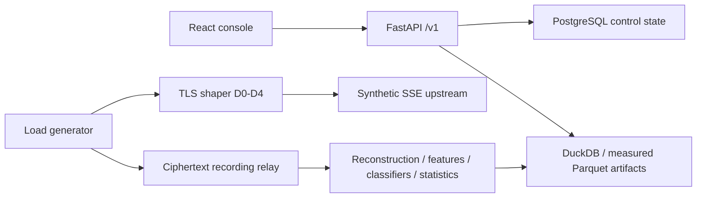
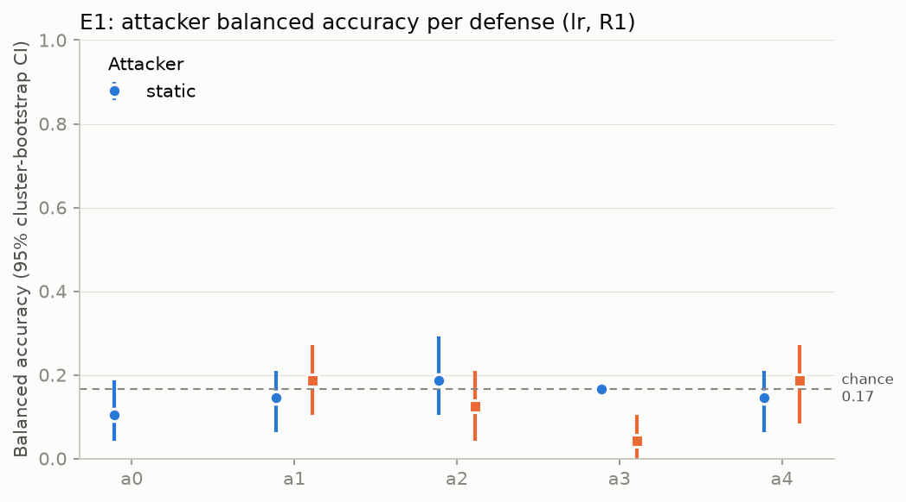
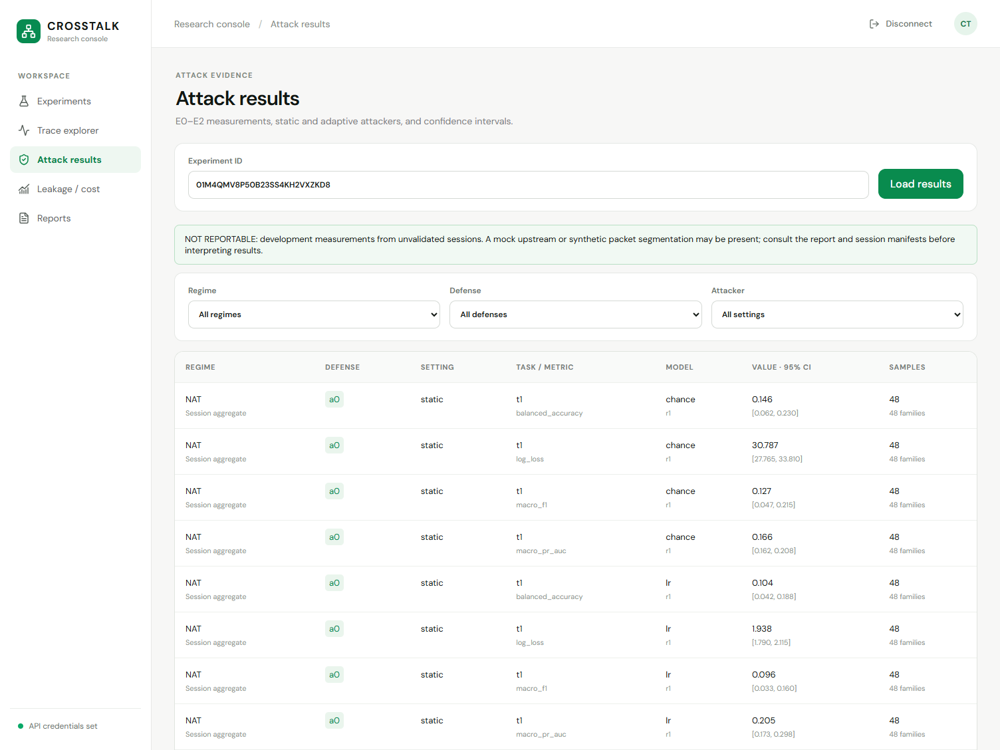
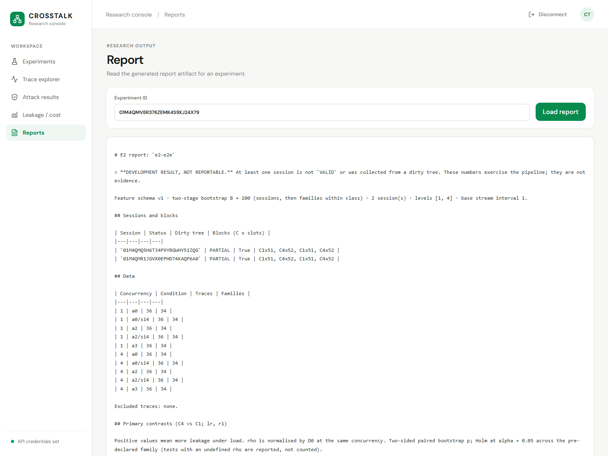
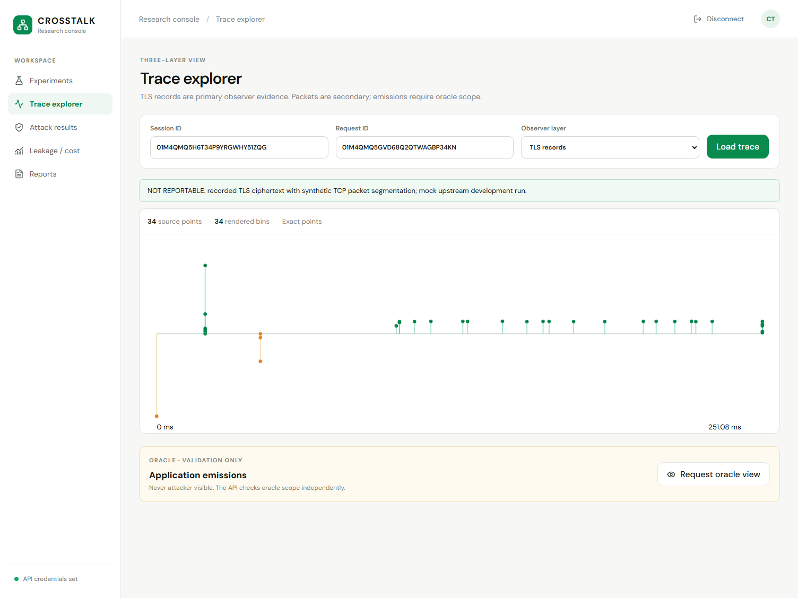
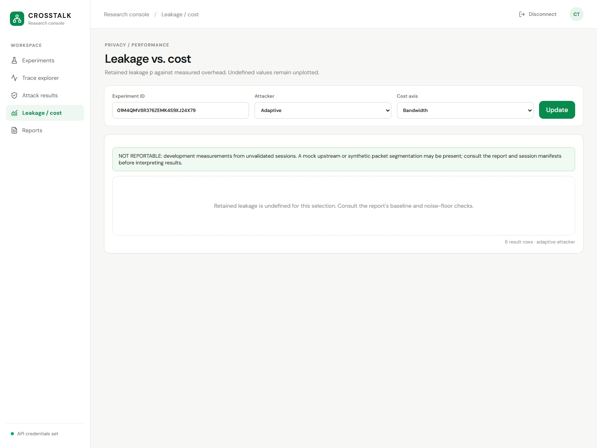
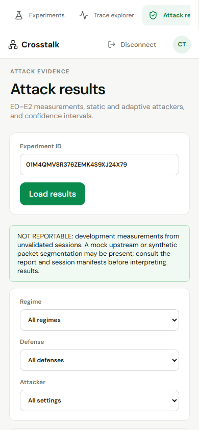

# CrossTalk: encrypted LLM stream measurement laboratory

Evidence date: 12 October 2026. Repository: [darved2305/Crosstalk](https://github.com/darved2305/Crosstalk).

## Abstract

CrossTalk studies the sizes and timing of encrypted streaming responses and
compares traffic-shaping defenses against static and adaptive classifiers.
The implementation combines a Python TLS streaming proxy, traffic
reconstruction and evaluation modules, a FastAPI control API, PostgreSQL state,
and a React/TypeScript/Vite research console.

This report records the demonstrated engineering implementation and a bounded
development campaign. E0, E1, and E2 executed on Windows with a synthetic
OpenAI-compatible SSE upstream. Real TLS ciphertext passed through the shaper
and was recorded by the test relay; the relay generated synthetic TCP packet
segmentation for the production reconstruction pipeline. The resulting
measurements demonstrate execution of the software, but cannot establish
privacy leakage or defense effectiveness on a real vLLM/GPU deployment.
All six session manifests and the three generated reports remain explicitly
non-reportable as scientific results.

## Problem and objectives

Encryption protects response content, while record sizes and timing remain
observable. CrossTalk provides an instrument for comparing those channels
before and after deployable traffic shaping. Its three experiments cover:

- E0: calibration and classifiers under NAT, MATCH-P, and MATCH-PR regimes.
- E1: paired baseline and defenses with static and retrained adaptive attackers.
- E2: serving concurrency and stream aggregation, with repeated sessions.

The research rationale, threat model, literature references, and planned
scientific gates are maintained in [PRODUCT.md](PRODUCT.md),
[RESEARCH.md](RESEARCH.md), and [IMPLEMENTATION_PLAN.md](IMPLEMENTATION_PLAN.md).

## Implementation

| Component | Implementation and demonstrated behavior |
|---|---|
| Console | React 19, strict TypeScript, Vite, React Router, TanStack Query, Zod |
| Control API | FastAPI `/v1`, bearer scopes, typed contracts, problem JSON |
| State | Native PostgreSQL 18, Alembic migrations, sessions and durable jobs |
| Streaming path | Python asyncio TLS shaper with OpenAI-compatible SSE output |
| Defenses | D0 passthrough; D1 bucket padding; D2 batching; D3 constant rate; D4 hybrid |
| Reconstruction | Production PCAPNG, TCP reassembly, TLS-record parsing and flow mapping |
| Attack/evaluation | Family-disjoint folds, logistic regression and LightGBM, cluster bootstrap, paired contrasts |
| Evidence | Generated Markdown reports, JSON summaries, figures, manifests, actual browser captures |



The bounded campaign was executed through the existing end-to-end harnesses
and then imported for console inspection. Its `import_development_evidence`
jobs record that import; they do not claim execution through the production
worker scheduler. Newly created dashboard runs still enqueue jobs pending
production stage adapters.

## Executed campaign

The retained command was:

```powershell
uv run pytest -q tests/test_e2e_e0.py tests/test_e2e_e1.py tests/test_e2e_e2.py --basetemp=artifacts/report-campaign-20261012
```

Result: **4 tests passed in 348.64 seconds**. The fourth test verifies E2
condition naming; the other three collect and analyze the experiments.

| Experiment | Sessions | Requests completed | Failed requests | Evaluation rows |
|---|---:|---:|---:|---:|
| E0 | 3 | 207 | 0 | 336 |
| E1 | 1 | 240 | 0 | 72 |
| E2 | 2 | 412 | 0 | 144 |
| Total | 6 | 859 | 0 | 552 |

Requests include warmup and determinism probes, which are excluded from the
classifier analysis. The classifiers use 180 E0 traces, 240 E1 traces, and 360
E2 traces. The campaign uses bootstrap B=200 and one attacker seed, suitable
for bounded development verification rather than the larger research plan.

The exact configurations, session IDs, manifest/report hashes, and measurements
are in [campaign.json](evidence/campaign/campaign.json). Individual reports:

- [E0 report](evidence/campaign/e0-e2e/report.md) and [summary](evidence/campaign/e0-e2e/summary.json).
- [E1 report](evidence/campaign/e1-e2e/report.md) and [summary](evidence/campaign/e1-e2e/summary.json).
- [E2 report](evidence/campaign/e2-e2e/report.md) and [summary](evidence/campaign/e2-e2e/summary.json).

### Example measured costs

The E1 development run measured D1 bandwidth overhead at **16.5%**, with a
family-bootstrap interval of **[16.3%, 16.8%]**. D3 overhead was **600.7%**,
with interval **[507.4%, 724.5%]**. Those are observations from the mock/Windows
workload and cannot be generalized to production inference serving.

In E2, D0 client TTFT p95 was **22.6 ms at C1** and **90.5 ms at C4**. The
mock upstream deliberately models serving load; this difference is therefore
a harness behavior, not a real vLLM performance claim. The E2 report preserves
the paired bootstrap results, including non-significant and undefined values.

Retained leakage is undefined in the displayed E2 frontier because the
baseline fails the noise-floor condition. The console retains the eight
adaptive artifact rows, displays the reportability warning, and leaves
undefined points unplotted.

### Generated figures





## Actual application screenshots

These Chromium screenshots show the local Vite → FastAPI → PostgreSQL/Parquet
stack. Desktop viewport: 1504×1128. Mobile viewport: 390×844. API responses were
not intercepted or supplied with browser fixtures in the campaign test.











Additional E0/E1/E2 result and report screenshots are in
[`evidence/campaign/screenshots/`](evidence/campaign/screenshots/).

## Google Cloud inspection and deployment limitation

The authenticated Google Cloud SDK inspected project
`inspired-campus-436516-k4` (`db-opt`). Actual command output is retained in
[gcp-audit.json](evidence/gcp-audit.json), including its UTC timestamp.

The billing API returned `billingEnabled: false` and no linked billing account.
The Compute Engine listing returned a billing-required warning even though the
command exit code was zero; its empty output cannot establish a complete VM
inventory. Cloud Run returned a pre-existing `billing-killswitch` service with
historical readiness metadata from August. That service is not CrossTalk and
was neither changed nor invoked.

Google requires an active billing account for Free Tier access, and Cloud Run
charges usage exceeding the applicable free allowance; builds, registry
storage, and data transfer can have separate charges. Official references:
[Free Tier eligibility](https://docs.cloud.google.com/free/docs/free-cloud-features),
[Cloud Run pricing](https://cloud.google.com/run/pricing).

The task's maximum spending allowance is ₹1, with billing activation and paid
VM/GPU creation prohibited. No deployment was performed, and there is no live
CrossTalk cloud URL or cloud execution result. No browser surface was connected
to this session, so actual Google Cloud console screenshots could not be
captured. The report supplies authenticated command evidence and does not
replace missing console screenshots with generated images.

## Verification and fixes found using actual data

The real stack exposed and corrected persistence-column response failures,
numeric-offset date validation, name-to-ID result mapping, nullable E0/E1
concurrency, and unsafe nanosecond serialization. Timestamps now cross the API
as decimal strings and are subtracted as `BigInt` before plotting relative
time. The frontier preserves negative measured costs and displays confidence
intervals without clipping retained leakage to a fixed range.

The API tests verify reportability propagation and lossless nanoseconds.
The campaign browser test verifies all 552 rows, three reports, the E2 frontier,
the recorded trace, and mobile rendering against the running services.
The exact current verification ledger is in
[evidence/README.md](evidence/README.md).

## Reproduction

Use [the Windows zero-cost runbook](runbooks/windows-zero-cost-demo.md) to start
the isolated database, API at port 18080, and console at port 3000. In a terminal
with the same `CT_API_DATABASE_URL`, API token settings, and artifact root:

```powershell
# Choose a fresh --basetemp directory: pytest clears an existing basetemp.
uv run pytest -q tests/test_e2e_e0.py tests/test_e2e_e1.py tests/test_e2e_e2.py --basetemp=artifacts/report-campaign-NEW
uv run python -m crosstalk.testing.report_campaign artifacts/report-campaign-NEW

# In apps/console, using the real API operator token:
Push-Location apps/console
$env:CT_E2E_OPERATOR_TOKEN = '<operator token>'
pnpm exec playwright test tests/campaign.spec.ts
Pop-Location

# Optional read-only GCP command evidence:
uv run python -m crosstalk.testing.cloud_audit
```

The importer refuses to overwrite different artifacts. Use a new experiment
name/root/evidence location for a different campaign. Keep tokens and raw
restricted prompt/keylog data out of Git. Retained captures and Parquet files
are local ignored artifacts; generated public summaries, figures, and
screenshots are committed for the report.

## Remaining requirements for the research/cloud target

Scientific completion still requires Linux with uvloop, native dumpcap/tshark
capture validation, real vLLM serving at pinned revisions, complete provenance,
the full runtime and soak gates, and production worker stage integration.
Cloud execution additionally requires a permitted billing arrangement and
adequate cost allowance. This development campaign does not close those gates.
