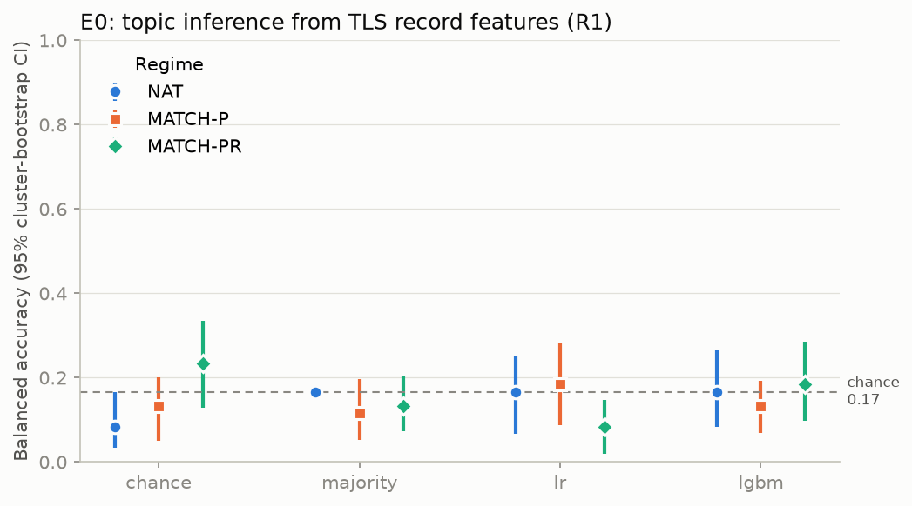

# E0 report: `e0-e2e`

> **DEVELOPMENT RESULT, NOT REPORTABLE.** At least one session is not `VALID` or was collected from a dirty tree (see Sessions). These numbers exercise the pipeline; they are not evidence.

Feature schema v1 · bootstrap B = 200 (family clusters, stratified by class) · outer folds = 5 (family-disjoint) · inner folds = 3 · seeds = 1.

## Sessions

| Session | Regime(s) | Status | Dirty tree | Reasons |
|---|---|---|---|---|
| `01M4QMFXR6EAGQTVC01PPZVNZA` | NAT | PARTIAL | False | Reconstruction and independent validation pending |
| `01M4QMG2R0Z4B4SJRX8NSTB2EV` | MATCH-P | PARTIAL | False | Reconstruction and independent validation pending |
| `01M4QMG80CRVTXG0WD9DRKD154` | MATCH-PR | PARTIAL | False | Reconstruction and independent validation pending |

## Data

| Regime | Traces | Families | Per class |
|---|---|---|---|
| NAT | 60 | 60 | {'cooking': 10, 'finance': 10, 'legal': 10, 'medical': 10, 'programming': 10, 'travel': 10} |
| MATCH-P | 60 | 57 | {'cooking': 10, 'finance': 10, 'legal': 10, 'medical': 10, 'programming': 10, 'travel': 10} |
| MATCH-PR | 60 | 56 | {'cooking': 10, 'finance': 10, 'legal': 10, 'medical': 10, 'programming': 10, 'travel': 10} |

Excluded traces: none.

## T1: topic (balanced accuracy, macro-F1, macro PR-AUC)

6 classes; chance balanced accuracy = 0.167. Values are point estimates with 95% percentile cluster-bootstrap intervals.

| Regime | Representation | Model | Balanced accuracy | Macro-F1 | Macro PR-AUC | Log-loss |
|---|---|---|---|---|---|---|
| NAT | r1 | chance | 0.083 [0.033, 0.167] | 0.067 [0.020, 0.125] | 0.163 [0.162, 0.177] | 33.040 [30.036, 34.857] |
| NAT | r1 | majority | 0.167 [0.167, 0.167] | 0.048 [0.048, 0.048] | 0.167 [0.167, 0.167] | 30.036 [30.036, 30.036] |
| NAT | r1 | lr | 0.167 [0.067, 0.250] | 0.149 [0.058, 0.224] | 0.187 [0.161, 0.266] | 1.925 [1.846, 1.995] |
| NAT | r1 | lgbm | 0.167 [0.083, 0.267] | 0.151 [0.064, 0.237] | 0.175 [0.163, 0.253] | 1.797 [1.789, 1.804] |
| NAT | r2 | chance | 0.083 [0.033, 0.167] | 0.067 [0.020, 0.125] | 0.163 [0.162, 0.177] | 33.040 [30.036, 34.857] |
| NAT | r2 | majority | 0.167 [0.167, 0.167] | 0.048 [0.048, 0.048] | 0.167 [0.167, 0.167] | 30.036 [30.036, 30.036] |
| NAT | r2 | lr | 0.167 [0.100, 0.233] | 0.143 [0.088, 0.200] | 0.190 [0.176, 0.275] | 1.868 [1.782, 1.952] |
| NAT | r2 | lgbm | 0.167 [0.100, 0.233] | 0.130 [0.065, 0.194] | 0.180 [0.156, 0.264] | 1.797 [1.790, 1.805] |
| NAT | tlen | chance | 0.083 [0.033, 0.167] | 0.067 [0.020, 0.125] | 0.163 [0.162, 0.177] | 33.040 [30.036, 34.857] |
| NAT | tlen | majority | 0.167 [0.167, 0.167] | 0.048 [0.048, 0.048] | 0.167 [0.167, 0.167] | 30.036 [30.036, 30.036] |
| NAT | tlen | lr | 0.150 [0.083, 0.233] | 0.128 [0.067, 0.196] | 0.180 [0.163, 0.250] | 1.801 [1.785, 1.817] |
| NAT | tlen | lgbm | 0.150 [0.083, 0.217] | 0.093 [0.055, 0.126] | 0.171 [0.155, 0.236] | 1.794 [1.790, 1.801] |
| MATCH-P | r1 | chance | 0.133 [0.050, 0.200] | 0.116 [0.045, 0.174] | 0.173 [0.164, 0.206] | 31.238 [28.606, 34.179] |
| MATCH-P | r1 | majority | 0.117 [0.052, 0.196] | 0.074 [0.034, 0.132] | 0.161 [0.160, 0.177] | 31.839 [29.208, 34.241] |
| MATCH-P | r1 | lr | 0.183 [0.087, 0.280] | 0.186 [0.087, 0.273] | 0.178 [0.161, 0.257] | 1.911 [1.830, 1.996] |
| MATCH-P | r1 | lgbm | 0.133 [0.068, 0.193] | 0.114 [0.054, 0.167] | 0.183 [0.162, 0.272] | 1.798 [1.792, 1.805] |
| MATCH-P | r2 | chance | 0.133 [0.050, 0.200] | 0.116 [0.045, 0.174] | 0.173 [0.164, 0.206] | 31.238 [28.606, 34.179] |
| MATCH-P | r2 | majority | 0.117 [0.052, 0.196] | 0.074 [0.034, 0.132] | 0.161 [0.160, 0.177] | 31.839 [29.208, 34.241] |
| MATCH-P | r2 | lr | 0.133 [0.067, 0.208] | 0.137 [0.061, 0.210] | 0.156 [0.148, 0.228] | 1.884 [1.828, 1.948] |
| MATCH-P | r2 | lgbm | 0.133 [0.074, 0.211] | 0.087 [0.032, 0.145] | 0.157 [0.147, 0.233] | 1.795 [1.790, 1.799] |
| MATCH-P | tlen | chance | 0.133 [0.050, 0.200] | 0.116 [0.045, 0.174] | 0.173 [0.164, 0.206] | 31.238 [28.606, 34.179] |
| MATCH-P | tlen | majority | 0.117 [0.052, 0.196] | 0.074 [0.034, 0.132] | 0.161 [0.160, 0.177] | 31.839 [29.208, 34.241] |
| MATCH-P | tlen | lr | 0.050 [0.000, 0.105] | 0.063 [0.000, 0.127] | 0.134 [0.129, 0.179] | 1.817 [1.809, 1.828] |
| MATCH-P | tlen | lgbm | 0.067 [0.019, 0.139] | 0.059 [0.013, 0.115] | 0.152 [0.143, 0.215] | 1.796 [1.793, 1.799] |
| MATCH-PR | r1 | chance | 0.233 [0.129, 0.335] | 0.214 [0.112, 0.305] | 0.204 [0.174, 0.264] | 27.633 [23.835, 31.320] |
| MATCH-PR | r1 | majority | 0.133 [0.074, 0.204] | 0.055 [0.029, 0.095] | 0.163 [0.159, 0.174] | 31.238 [29.208, 33.137] |
| MATCH-PR | r1 | lr | 0.083 [0.019, 0.148] | 0.089 [0.021, 0.159] | 0.193 [0.183, 0.272] | 1.838 [1.788, 1.885] |
| MATCH-PR | r1 | lgbm | 0.183 [0.097, 0.285] | 0.175 [0.082, 0.271] | 0.238 [0.198, 0.340] | 1.795 [1.787, 1.802] |
| MATCH-PR | r2 | chance | 0.233 [0.129, 0.335] | 0.214 [0.112, 0.305] | 0.204 [0.174, 0.264] | 27.633 [23.835, 31.320] |
| MATCH-PR | r2 | majority | 0.133 [0.074, 0.204] | 0.055 [0.029, 0.095] | 0.163 [0.159, 0.174] | 31.238 [29.208, 33.137] |
| MATCH-PR | r2 | lr | 0.033 [0.000, 0.089] | 0.035 [0.000, 0.089] | 0.130 [0.127, 0.178] | 1.889 [1.865, 1.914] |
| MATCH-PR | r2 | lgbm | 0.100 [0.033, 0.176] | 0.083 [0.031, 0.139] | 0.152 [0.145, 0.209] | 1.796 [1.792, 1.800] |
| MATCH-PR | tlen | chance | 0.233 [0.129, 0.335] | 0.214 [0.112, 0.305] | 0.204 [0.174, 0.264] | 27.633 [23.835, 31.320] |
| MATCH-PR | tlen | majority | 0.133 [0.074, 0.204] | 0.055 [0.029, 0.095] | 0.163 [0.159, 0.174] | 31.238 [29.208, 33.137] |
| MATCH-PR | tlen | lr | 0.100 [0.050, 0.174] | 0.082 [0.042, 0.136] | 0.147 [0.141, 0.206] | 1.806 [1.798, 1.814] |
| MATCH-PR | tlen | lgbm | 0.183 [0.102, 0.276] | 0.128 [0.069, 0.181] | 0.176 [0.166, 0.246] | 1.793 [1.790, 1.796] |

The `tlen` rows are the T-len diagnostic: the attacker sees only request bytes and count, response record count and bytes, and duration. The gap between `r1` and `tlen` is leakage beyond length.

## T2: sensitive topic (`medical` vs rest, R1)

PR-AUC and precision at fixed recall, re-weighted to explicit base rates.

| Regime | Model | Base rate | PR-AUC | P@R0.05 | P@R0.10 | P@R0.25 |
|---|---|---|---|---|---|---|
| NAT | chance | 1:10 | 0.087 [0.086, 0.113] | 0.091 [0.091, 0.167] | 0.091 [0.091, 0.167] | 0.091 [0.091, 0.158] |
| NAT | chance | 1:100 | 0.009 [0.009, 0.013] | 0.010 [0.010, 0.020] | 0.010 [0.010, 0.020] | 0.010 [0.010, 0.018] |
| NAT | chance | 1:1000 | 0.001 [0.001, 0.001] | 0.001 [0.001, 0.002] | 0.001 [0.001, 0.002] | 0.001 [0.001, 0.002] |
| NAT | majority | 1:10 | 0.091 [0.091, 0.091] | 0.091 [0.091, 0.091] | 0.091 [0.091, 0.091] | 0.091 [0.091, 0.091] |
| NAT | majority | 1:100 | 0.010 [0.010, 0.010] | 0.010 [0.010, 0.010] | 0.010 [0.010, 0.010] | 0.010 [0.010, 0.010] |
| NAT | majority | 1:1000 | 0.001 [0.001, 0.001] | 0.001 [0.001, 0.001] | 0.001 [0.001, 0.001] | 0.001 [0.001, 0.001] |
| NAT | lr | 1:10 | 0.178 [0.066, 0.407] | 1.000 [0.093, 1.000] | 0.103 [0.091, 1.000] | 0.103 [0.091, 1.000] |
| NAT | lr | 1:100 | 0.109 [0.007, 0.313] | 1.000 [0.010, 1.000] | 0.011 [0.010, 1.000] | 0.011 [0.010, 1.000] |
| NAT | lr | 1:1000 | 0.101 [0.001, 0.301] | 1.000 [0.001, 1.000] | 1.000 [0.001, 1.000] | 0.001 [0.001, 1.000] |
| NAT | lgbm | 1:10 | 0.104 [0.073, 0.169] | 0.135 [0.091, 0.226] | 0.135 [0.091, 0.226] | 0.135 [0.091, 0.226] |
| NAT | lgbm | 1:100 | 0.012 [0.008, 0.020] | 0.015 [0.010, 0.028] | 0.015 [0.010, 0.028] | 0.015 [0.010, 0.028] |
| NAT | lgbm | 1:1000 | 0.001 [0.001, 0.002] | 0.002 [0.001, 0.003] | 0.002 [0.001, 0.003] | 0.002 [0.001, 0.003] |
| MATCH-P | chance | 1:10 | 0.091 [0.085, 0.149] | 0.091 [0.091, 0.216] | 0.091 [0.091, 0.216] | 0.091 [0.091, 0.214] |
| MATCH-P | chance | 1:100 | 0.010 [0.009, 0.018] | 0.010 [0.010, 0.027] | 0.010 [0.010, 0.027] | 0.010 [0.010, 0.027] |
| MATCH-P | chance | 1:1000 | 0.001 [0.001, 0.002] | 0.001 [0.001, 0.003] | 0.001 [0.001, 0.003] | 0.001 [0.001, 0.003] |
| MATCH-P | majority | 1:10 | 0.091 [0.091, 0.091] | 0.091 [0.091, 0.091] | 0.091 [0.091, 0.091] | 0.091 [0.091, 0.091] |
| MATCH-P | majority | 1:100 | 0.010 [0.010, 0.010] | 0.010 [0.010, 0.010] | 0.010 [0.010, 0.010] | 0.010 [0.010, 0.010] |
| MATCH-P | majority | 1:1000 | 0.001 [0.001, 0.001] | 0.001 [0.001, 0.001] | 0.001 [0.001, 0.001] | 0.001 [0.001, 0.001] |
| MATCH-P | lr | 1:10 | 0.087 [0.070, 0.164] | 0.102 [0.093, 0.239] | 0.102 [0.093, 0.239] | 0.102 [0.093, 0.227] |
| MATCH-P | lr | 1:100 | 0.009 [0.008, 0.020] | 0.011 [0.010, 0.030] | 0.011 [0.010, 0.030] | 0.011 [0.010, 0.029] |
| MATCH-P | lr | 1:1000 | 0.001 [0.001, 0.002] | 0.001 [0.001, 0.003] | 0.001 [0.001, 0.003] | 0.001 [0.001, 0.003] |
| MATCH-P | lgbm | 1:10 | 0.165 [0.099, 0.410] | 0.217 [0.138, 1.000] | 0.217 [0.128, 1.000] | 0.217 [0.123, 0.595] |
| MATCH-P | lgbm | 1:100 | 0.020 [0.011, 0.149] | 0.027 [0.016, 1.000] | 0.027 [0.016, 1.000] | 0.027 [0.014, 0.128] |
| MATCH-P | lgbm | 1:1000 | 0.002 [0.001, 0.107] | 0.003 [0.002, 1.000] | 0.003 [0.002, 1.000] | 0.003 [0.001, 0.014] |
| MATCH-PR | chance | 1:10 | 0.093 [0.086, 0.164] | 0.100 [0.091, 0.282] | 0.100 [0.091, 0.282] | 0.091 [0.091, 0.282] |
| MATCH-PR | chance | 1:100 | 0.010 [0.009, 0.021] | 0.011 [0.010, 0.038] | 0.011 [0.010, 0.038] | 0.010 [0.010, 0.038] |
| MATCH-PR | chance | 1:1000 | 0.001 [0.001, 0.002] | 0.001 [0.001, 0.004] | 0.001 [0.001, 0.004] | 0.001 [0.001, 0.004] |
| MATCH-PR | majority | 1:10 | 0.091 [0.091, 0.091] | 0.091 [0.091, 0.091] | 0.091 [0.091, 0.091] | 0.091 [0.091, 0.091] |
| MATCH-PR | majority | 1:100 | 0.010 [0.010, 0.010] | 0.010 [0.010, 0.010] | 0.010 [0.010, 0.010] | 0.010 [0.010, 0.010] |
| MATCH-PR | majority | 1:1000 | 0.001 [0.001, 0.001] | 0.001 [0.001, 0.001] | 0.001 [0.001, 0.001] | 0.001 [0.001, 0.001] |
| MATCH-PR | lr | 1:10 | 0.097 [0.066, 0.275] | 0.200 [0.091, 1.000] | 0.120 [0.091, 1.000] | 0.120 [0.091, 0.595] |
| MATCH-PR | lr | 1:100 | 0.011 [0.007, 0.208] | 0.024 [0.010, 1.000] | 0.013 [0.010, 1.000] | 0.013 [0.010, 0.128] |
| MATCH-PR | lr | 1:1000 | 0.001 [0.001, 0.201] | 0.002 [0.001, 1.000] | 0.002 [0.001, 1.000] | 0.001 [0.001, 0.014] |
| MATCH-PR | lgbm | 1:10 | 0.161 [0.096, 0.481] | 0.333 [0.118, 1.000] | 0.250 [0.103, 1.000] | 0.231 [0.096, 1.000] |
| MATCH-PR | lgbm | 1:100 | 0.020 [0.010, 0.323] | 0.048 [0.013, 1.000] | 0.032 [0.012, 1.000] | 0.029 [0.011, 1.000] |
| MATCH-PR | lgbm | 1:1000 | 0.002 [0.001, 0.302] | 0.005 [0.001, 1.000] | 0.005 [0.001, 1.000] | 0.003 [0.001, 1.000] |

## Null control

Family → class mapping permuted (class sizes preserved); full D0 static pipeline on R1. Passing means chance lies inside every permutation's bootstrap interval.

| Regime | Model | Permutations | Null mean | Null max | Chance in CI | Passes | Observed | p |
|---|---|---|---|---|---|---|---|---|
| NAT | lr | 2 | 0.200 | 0.283 | 1/2 | **NO** | 0.167 | 0.667 |
| MATCH-P | lr | 2 | 0.148 | 0.148 | 2/2 | yes | 0.183 | 0.333 |
| MATCH-PR | lr | 2 | 0.173 | 0.243 | 2/2 | yes | 0.083 | 1.000 |

## Noise floor (determinism probe)

Repeated probe prompts. ICC near 1 means repeats of one prompt agree far more than different prompts do; drift is the within-prompt slope over session time.

| Regime | Feature | n | ICC | Within var | Between var | Drift / hour [95% CI] |
|---|---|---|---|---|---|---|
| NAT | resp_count | 7 | n/a (needs repeated probes) | | | |
| NAT | duration_ms | 7 | n/a (needs repeated probes) | | | |
| NAT | ttft_ms | 7 | n/a (needs repeated probes) | | | |
| MATCH-P | resp_count | 7 | n/a (needs repeated probes) | | | |
| MATCH-P | duration_ms | 7 | n/a (needs repeated probes) | | | |
| MATCH-P | ttft_ms | 7 | n/a (needs repeated probes) | | | |
| MATCH-PR | resp_count | 7 | n/a (needs repeated probes) | | | |
| MATCH-PR | duration_ms | 7 | n/a (needs repeated probes) | | | |
| MATCH-PR | ttft_ms | 7 | n/a (needs repeated probes) | | | |

## Power check

From `NAT` / `lr` (R1): bootstrap SE of balanced accuracy 0.0451 at 10 per class. Projected 95% half-width of a paired Δ at 200 per class: 0.028 (target 0.050). Recommended n per class for E1/E2: **63**.

## Learning curve (R1, fraction of training families)

| Regime | Model | 25% | 50% | 75% | 100% |
|---|---|---|---|---|---|
| NAT | lr | n/a (too few families) | 0.067 [0.033, 0.117] | 0.050 [0.000, 0.117] | 0.167 [0.083, 0.250] |
| NAT | lgbm | n/a (too few families) | 0.167 [0.167, 0.167] | 0.167 [0.167, 0.167] | 0.167 [0.100, 0.250] |
| MATCH-P | lr | n/a (too few families) | 0.083 [0.033, 0.150] | 0.083 [0.017, 0.150] | 0.183 [0.086, 0.294] |
| MATCH-P | lgbm | n/a (too few families) | 0.150 [0.080, 0.260] | 0.183 [0.141, 0.233] | 0.133 [0.059, 0.197] |
| MATCH-PR | lr | n/a (too few families) | 0.133 [0.050, 0.260] | 0.117 [0.050, 0.174] | 0.083 [0.029, 0.166] |
| MATCH-PR | lgbm | n/a (too few families) | 0.167 [0.090, 0.256] | 0.150 [0.067, 0.241] | 0.183 [0.100, 0.291] |

## Reading this report

E0 is a reproduction and calibration step, not a contribution. Absolute numbers depend on the synthetic corpus and the served model; the claims that matter later are paired comparisons with intervals (E1/E2).
