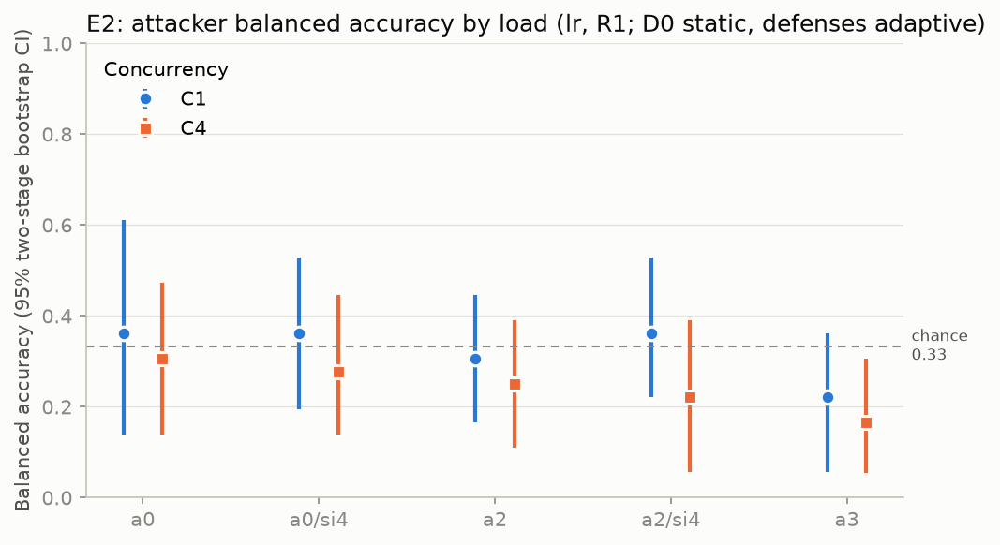

# E2 report: `e2-e2e`

> **DEVELOPMENT RESULT, NOT REPORTABLE.** At least one session is not `VALID` or was collected from a dirty tree. These numbers exercise the pipeline; they are not evidence.

Feature schema v1 · two-stage bootstrap B = 200 (sessions, then families within class) · 2 session(s) · levels [1, 4] · base stream interval 1.

## Sessions and blocks

| Session | Status | Dirty tree | Blocks (C x slots) |
|---|---|---|---|
| `01M4QMQ5H6T34P9YRGWHY51ZQG` | PARTIAL | True | C1x51, C4x52, C1x51, C4x52 |
| `01M4QMR1JGVX0EPHD74KAQP6A0` | PARTIAL | True | C1x51, C4x52, C1x51, C4x52 |

## Data

| Concurrency | Condition | Traces | Families |
|---|---|---|---|
| 1 | a0 | 36 | 34 |
| 1 | a0/si4 | 36 | 34 |
| 1 | a2 | 36 | 34 |
| 1 | a2/si4 | 36 | 34 |
| 1 | a3 | 36 | 34 |
| 4 | a0 | 36 | 34 |
| 4 | a0/si4 | 36 | 34 |
| 4 | a2 | 36 | 34 |
| 4 | a2/si4 | 36 | 34 |
| 4 | a3 | 36 | 34 |

Excluded traces: none.

## Primary contrasts (C4 vs C1; lr, r1)

Positive values mean more leakage under load. rho is normalised by D0 at the same concurrency. Two-sided paired bootstrap p; Holm at alpha = 0.05 across the pre-declared family (tests with an undefined rho are reported, not counted).

| Test | Low load | High load | Difference [95% CI] | p | p (Holm) | Reject H0 |
|---|---|---|---|---|---|---|
| a0 leakage | 0.361 | 0.306 | -0.056 [-0.222, 0.084] | 0.700 | 0.700 | no |
| a2 adaptive rho | n/a | n/a | n/a | n/a | n/a | no |
| a3 adaptive rho | n/a | n/a | n/a | n/a | n/a | no |

## Leakage per load level

| Concurrency | Condition | Attacker | Balanced accuracy | rho [95% CI] |
|---|---|---|---|---|
| 1 | a0 | static | 0.361 [0.139, 0.611] | n/a |
| 1 | a0/si4 | static | 0.361 [0.333, 0.417] | n/a |
| 1 | a0/si4 | adaptive | 0.361 [0.194, 0.528] | n/a |
| 1 | a2 | static | 0.361 [0.222, 0.472] | n/a |
| 1 | a2 | adaptive | 0.306 [0.167, 0.445] | n/a |
| 1 | a2/si4 | static | 0.333 [0.250, 0.417] | n/a |
| 1 | a2/si4 | adaptive | 0.361 [0.222, 0.528] | n/a |
| 1 | a3 | static | 0.333 [0.333, 0.333] | n/a |
| 1 | a3 | adaptive | 0.222 [0.056, 0.361] | n/a |
| 4 | a0 | static | 0.306 [0.139, 0.473] | n/a |
| 4 | a0/si4 | static | 0.333 [0.333, 0.333] | n/a |
| 4 | a0/si4 | adaptive | 0.278 [0.139, 0.445] | n/a |
| 4 | a2 | static | 0.306 [0.167, 0.417] | n/a |
| 4 | a2 | adaptive | 0.250 [0.111, 0.390] | n/a |
| 4 | a2/si4 | static | 0.333 [0.194, 0.444] | n/a |
| 4 | a2/si4 | adaptive | 0.222 [0.056, 0.390] | n/a |
| 4 | a3 | static | 0.333 [0.333, 0.333] | n/a |
| 4 | a3 | adaptive | 0.167 [0.055, 0.306] | n/a |

## Server-side aggregation vs gateway batching (exploratory, H5)

Adaptive balanced accuracy difference (first minus second), paired.

| Comparison | Difference [95% CI] | p |
|---|---|---|
| C1: a0/si4 vs a2 | 0.056 [-0.194, 0.278] | 0.860 |
| C1: a2/si4 vs a2 | 0.056 [-0.140, 0.278] | 0.790 |
| C4: a0/si4 vs a2 | 0.028 [-0.167, 0.251] | 0.970 |
| C4: a2/si4 vs a2 | -0.028 [-0.306, 0.223] | 0.860 |

## Cost per load level

| Concurrency | Condition | n | TTFT p50/p95/p99 ms | ITL p50/p95/p99 ms | Bytes / request | Bandwidth overhead % | Δ TTFT p50 ms | Dummy records | Timer lateness p99 ms |
|---|---|---|---|---|---|---|---|---|---|
| 1 | a0 | 36 | 10.4/22.6/44.0 | 2.0/6.2/11.7 | 10396 | - | - | 0.0 | - |
| 1 | a0/si4 | 36 | 10.8/30.2/61.7 | 41.8/53.9/64.9 | 6454 | -37.9 [-39.2, -36.7] | 0.8 [-2.5, 2.2] | 0.0 | - |
| 1 | a2 | 36 | 11.6/24.4/40.0 | 15.5/29.4/33.3 | 6896 | -33.7 [-35.2, -32.1] | 1.7 [-2.7, 3.0] | 0.0 | 18.32 |
| 1 | a2/si4 | 36 | 9.7/17.2/25.9 | 39.8/51.2/63.6 | 6433 | -38.1 [-39.6, -36.8] | -0.3 [-3.3, 1.1] | 0.0 | 16.85 |
| 1 | a3 | 36 | 27.3/40.7/60.9 | 5.3/18.6/24.2 | 18971 | 82.5 [72.5, 94.9] | 17.2 [14.0, 19.7] | 10.0 | 30.80 |
| 4 | a0 | 36 | 38.3/90.5/186.9 | 6.5/15.6/31.6 | 10396 | - | - | 0.0 | - |
| 4 | a0/si4 | 36 | 43.2/91.7/150.9 | 22.3/42.6/71.5 | 6454 | -37.9 [-39.2, -36.7] | 4.9 [-6.7, 11.7] | 0.0 | - |
| 4 | a2 | 36 | 37.8/74.7/192.4 | 15.9/31.4/51.7 | 6997 | -32.7 [-34.6, -31.1] | -1.7 [-10.9, 9.4] | 0.0 | 18.28 |
| 4 | a2/si4 | 36 | 41.1/71.4/110.1 | 26.0/50.7/80.0 | 6275 | -39.6 [-41.4, -38.0] | 2.4 [-7.0, 7.1] | 0.0 | 29.96 |
| 4 | a3 | 36 | 50.9/88.6/160.6 | 6.9/16.6/31.5 | 26743 | 157.2 [141.2, 178.6] | 12.5 [3.2, 19.4] | 16.0 | 31.32 |

## Leakage-cost frontier

Written to `frontier/frontier.parquet`: one point per (concurrency, condition, attacker) with rho and its interval against bandwidth overhead, TTFT p95 and ITL p99.

## Determinism probes per block

| Session | Block | Concurrency | Probes | Records (median) | Duration ms (median) | TTFT ms (median) |
|---|---|---|---|---|---|---|
| `01M4QMQ5H6T34P9YRGWHY51ZQG` | 0 | 1 | 4 | 24 | 53.1 | 6.0 |
| `01M4QMQ5H6T34P9YRGWHY51ZQG` | 1 | 4 | 5 | 25 | 116.8 | 27.6 |
| `01M4QMQ5H6T34P9YRGWHY51ZQG` | 2 | 1 | 4 | 23 | 46.5 | 13.6 |
| `01M4QMQ5H6T34P9YRGWHY51ZQG` | 3 | 4 | 5 | 25 | 148.3 | 19.8 |
| `01M4QMR1JGVX0EPHD74KAQP6A0` | 0 | 1 | 4 | 23 | 41.2 | 10.2 |
| `01M4QMR1JGVX0EPHD74KAQP6A0` | 1 | 4 | 5 | 23 | 119.1 | 25.9 |
| `01M4QMR1JGVX0EPHD74KAQP6A0` | 2 | 1 | 4 | 25 | 41.4 | 8.3 |
| `01M4QMR1JGVX0EPHD74KAQP6A0` | 3 | 4 | 5 | 23 | 128.9 | 21.8 |

## Reading this report

The headline is whether an adaptive attacker's retained leakage changes between low and high load. Costs come from the same runs. A null difference with a tight interval is a result: the defense's effectiveness does not depend on load in this range.
